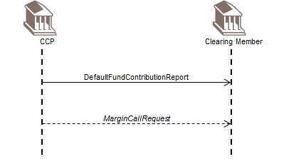
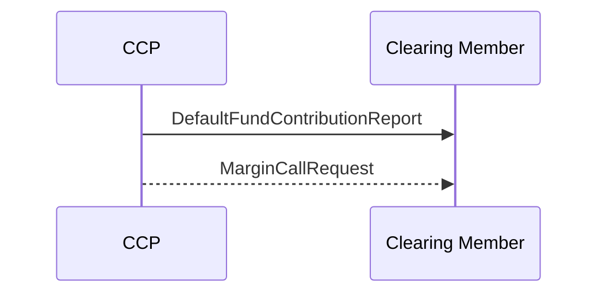

# Default Fund Contribution business transaction

## Source evidence

[src-000052](../../../../../../../../raw-input/central_counterparty_clearing_ccp_clearing/ISO20022_MDRPart1_CentralCounterPartySecuritiesClearing_Maintenance_2025_2026_v2.docx); P246 / Default Fund Contribution. [Unchanged source figure](../../../../../../assets/src-000052/originals/image15.png).

## Mermaid reconstruction

## Participants, messages and conditions

The CCP reports the calculated default-fund contribution and potential net excess or deficit (P241-P242). Depending on CCP rules, it may send a margin call for a deficit. The optional call belongs to collateral management and is outside this MDR scope (P244-P245).

| Source order | Message label | Sender | Receiver | Source line semantics | Exact supplied definition |
| --- | --- | --- | --- | --- | --- |
| 1 | DefaultFundContributionReport | CCP | CM | Mandatory (solid) | [secl.006.001.02](../../../../../messages/secl.006.001.02/index.md) |
| 2 | MarginCallRequest | CCP | CM | Optional/potential (dotted) | No exact definition bound by this CCP source segment |

P214 defines solid lines as mandatory messages and P215 defines dotted lines as optional/potential. The reconstruction preserves this distinction. Building symbols represent the two source participant endpoints; they do not identify named institutions.

[Reusable flow and complete narrative](../../flows/flow-src-000052-p240-default-fund-contribution-business-transaction.md); [Related source process, trigger and conditions](../../flows/flow-src-000052-p137-default-fund-contribution-process.md).

## Review evidence

Opened the full source image and Mermaid render; compared both participant labels, all 2 ordered message labels and directions, 1 dotted optional/potential path(s), and 0 clearing-member-to-CCP arrow(s). P214-P215 line semantics and relevant narrative conditions are retained. Building silhouettes are replaced by labeled participant boxes; they do not identify named institutions. Parsed/rendered with Mermaid 12.3.0 and Chromium 156.0.8078.81; visual review on 2026-11-09 Europe/Warsaw, rendering report UTC date 2026-11-08.

[Compared reconstruction](../../../../../../assets/src-000052/reconstructed-transactions/fig-0016.png).
