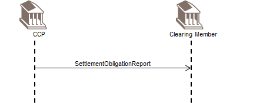
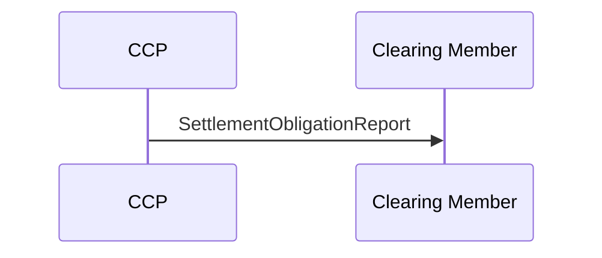

# Settlement Netting business transaction

## Source evidence

[src-000052](../../../../../../../../raw-input/central_counterparty_clearing_ccp_clearing/ISO20022_MDRPart1_CentralCounterPartySecuritiesClearing_Maintenance_2025_2026_v2.docx); P249 / Settlement Netting. [Unchanged source figure](../../../../../../assets/src-000052/originals/image16.png).

## Mermaid reconstruction

## Participants, messages and conditions

The CCP reports settlement obligations to be submitted for settlement (P248). T16 additionally includes CSD result and corporate-event reports, optional position updates/netting/event application, and settlement instructions to the CSD. A clearing member normally sends instructions to its paying agent; with power of attorney, the CCP sends the instructions to the CSD on its behalf. The two-actor sequence intentionally omits these related CSD/agent activities.

| Source order | Message label | Sender | Receiver | Source line semantics | Exact supplied definition |
| --- | --- | --- | --- | --- | --- |
| 1 | SettlementObligationReport | CCP | CM | Mandatory (solid) | [secl.010.001.04](../../../../../messages/secl.010.001.04/index.md) |

P214 defines solid lines as mandatory messages and P215 defines dotted lines as optional/potential. The reconstruction preserves this distinction. Building symbols represent the two source participant endpoints; they do not identify named institutions.

Part1 tables T4/T5/T9 contain stale V03 message-name suffixes beside .05/.04 identifiers; exact bindings above use the corresponding source053 definition heading, preserving the naming conflict under issue-000030.

[Reusable flow and complete narrative](../../flows/flow-src-000052-p247-settlement-netting-business-transaction.md); [Related source process, trigger and conditions](../../flows/flow-src-000052-p155-settlement-netting-process.md).

## Review evidence

Opened the full source image and Mermaid render; compared both participant labels, all 1 ordered message labels and directions, 0 dotted optional/potential path(s), and 0 clearing-member-to-CCP arrow(s). P214-P215 line semantics and relevant narrative conditions are retained. Building silhouettes are replaced by labeled participant boxes; they do not identify named institutions. Visual comparison passes; page remains needs-review because Part1 message-name suffix conflict is recorded under issue-000030. Parsed/rendered with Mermaid 12.3.0 and Chromium 156.0.8078.81; visual review on 2026-11-09 Europe/Warsaw, rendering report UTC date 2026-11-08.

[Compared reconstruction](../../../../../../assets/src-000052/reconstructed-transactions/fig-0017.png).
