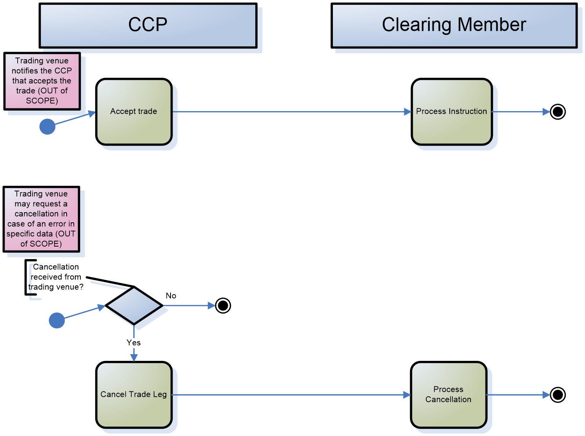
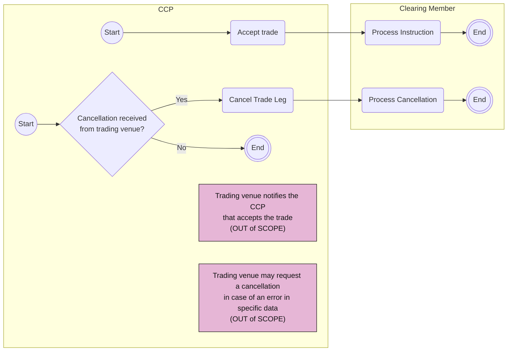

# Trade Management activities

## Source evidence

[src-000052](../../../../../../../../raw-input/central_counterparty_clearing_ccp_clearing/ISO20022_MDRPart1_CentralCounterPartySecuritiesClearing_Maintenance_2025_2026_v2.docx); P192. [Unchanged original image](../../../../../../assets/src-000052/originals/image5.emf); [Viewable source rendering](../../../../../../assets/src-000052/derived-previews/image5.emf.png).

## Mermaid reconstruction

## Actors, activities and relationships

Two separate source start points represent the accepted-trade and cancellation paths. The negative cancellation decision ends immediately; the positive branch cancels the trade leg and the member processes the cancellation. Pink trading-venue notes provide out-of-scope trigger context, not additional message arrows. T12 preserves the independent trade-matching cases, contact with a trading member firm, and the opposite-trade alternative. Start/End words are explanatory marker labels added to the source circles.

[Complete activity responsibility table T12](../../documents/src-000052/tables/tbl-0012.md).

[Reusable process and full source narrative](../../flows/flow-src-000052-p191-business-process-trade-management.md).

## Review evidence

Opened the full source PNG or full EMF rendering and the Mermaid render; compared two initial nodes, all four activities, cancellation Yes/No branches, three end nodes and both trading-venue notes. Source direction, labels, boundaries, responsibility and qualifiers were checked against the artwork and adjacent narrative/table. Layout differs; Start/End text and thick bar glyphs explain the original markers. Parser/render passed with Mermaid 12.3.0 and Chromium 156.0.8078.81. Visual comparison on 2026-11-09 Europe/Warsaw; render report UTC date 2026-11-08.

[Compared reconstruction](../../../../../../assets/src-000052/reconstructed-processes/fig-0006.png).
