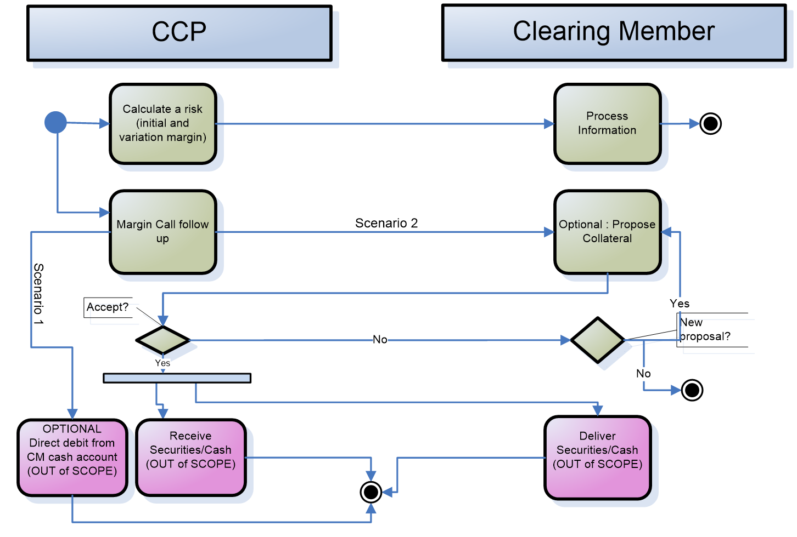
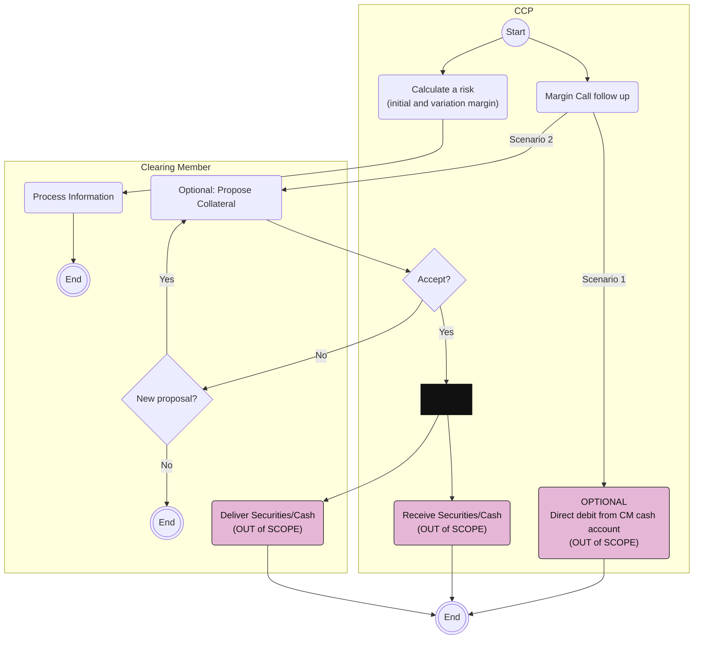

# Risk Management: Margining activities

## Source evidence

[src-000052](../../../../../../../../raw-input/central_counterparty_clearing_ccp_clearing/ISO20022_MDRPart1_CentralCounterPartySecuritiesClearing_Maintenance_2025_2026_v2.docx); P197. [Unchanged original image](../../../../../../assets/src-000052/originals/image7.emf); [Viewable source rendering](../../../../../../assets/src-000052/derived-previews/image7.emf.png).

## Mermaid reconstruction

## Actors, activities and relationships

The source start branches to risk calculation/information and margin-call follow-up. Scenario 1 permits automatic cash debit; Scenario 2 allows the member to propose collateral. CCP rejection leads to the member choosing whether to propose again; acceptance reaches a parallel bar, followed by receiving and delivering securities/cash. The three out-of-scope cash/securities paths share the source end marker. The source bar is retained as a thick bar symbol, not converted into an exclusive decision. T14 supplies collateral-deficit conditions and the CCP-rule dependency.

[Complete activity responsibility table T14](../../documents/src-000052/tables/tbl-0014.md).

[Reusable process and full source narrative](../../flows/flow-src-000052-p196-business-process-risk-management-margining-process.md).

## Review evidence

Opened the full source PNG or full EMF rendering and the Mermaid render; compared two start branches, both margin-follow-up scenarios, acceptance/reproposal decisions, loop, parallel bar and three out-of-scope collateral actions. Source direction, labels, boundaries, responsibility and qualifiers were checked against the artwork and adjacent narrative/table. Layout differs; Start/End text and thick bar glyphs explain the original markers. Parser/render passed with Mermaid 12.3.0 and Chromium 156.0.8078.81. Visual comparison on 2026-11-09 Europe/Warsaw; render report UTC date 2026-11-08.

[Compared reconstruction](../../../../../../assets/src-000052/reconstructed-processes/fig-0008.png).
