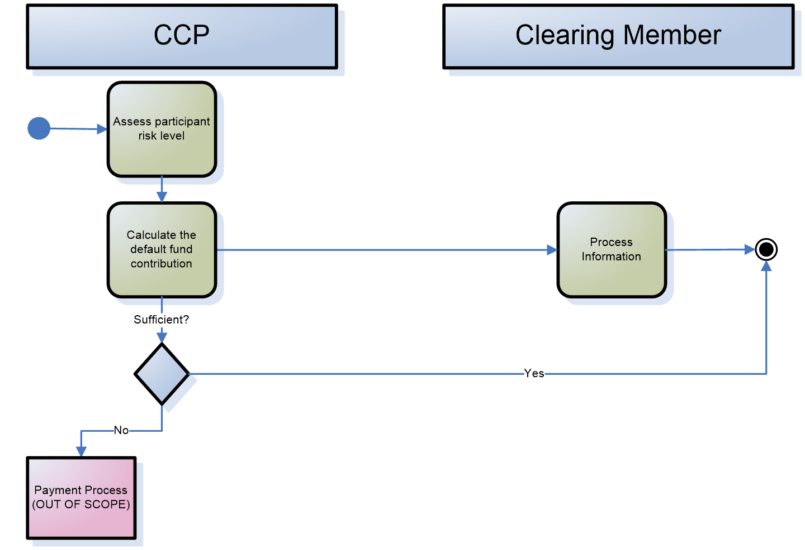
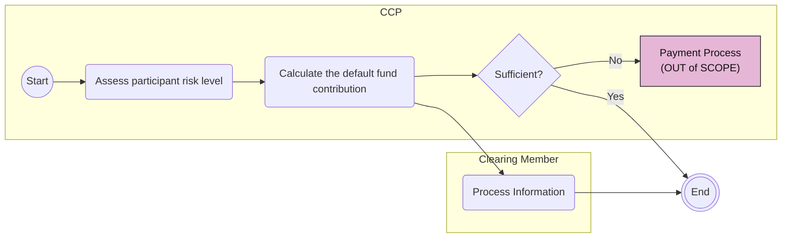

# Risk Management: Default Fund Contribution activities

## Source evidence

[src-000052](../../../../../../../../raw-input/central_counterparty_clearing_ccp_clearing/ISO20022_MDRPart1_CentralCounterPartySecuritiesClearing_Maintenance_2025_2026_v2.docx); P199. [Unchanged original image](../../../../../../assets/src-000052/originals/image8.emf); [Viewable source rendering](../../../../../../assets/src-000052/derived-previews/image8.emf.png).

## Mermaid reconstruction

## Actors, activities and relationships

The CCP assesses risk and calculates the contribution, while the member processes the result. A sufficient contribution reaches the source end marker; a deficit enters an out-of-scope payment process. The source does not draw an end beyond the payment process, so none is added. T15 preserves daily/monthly calculation, automatic debit or payment on behalf under power of attorney, optional margin calls, and possible return of excess.

[Complete activity responsibility table T15](../../documents/src-000052/tables/tbl-0015.md).

[Reusable process and full source narrative](../../flows/flow-src-000052-p198-business-process-risk-management-default-fund-contribution-process.md).

## Review evidence

Opened the full source PNG or full EMF rendering and the Mermaid render; compared risk assessment, contribution calculation, information processing, sufficient Yes/No branches and open payment-process path. Source direction, labels, boundaries, responsibility and qualifiers were checked against the artwork and adjacent narrative/table. Layout differs; Start/End text and thick bar glyphs explain the original markers. Parser/render passed with Mermaid 12.3.0 and Chromium 156.0.8078.81. Visual comparison on 2026-11-09 Europe/Warsaw; render report UTC date 2026-11-08.

[Compared reconstruction](../../../../../../assets/src-000052/reconstructed-processes/fig-0009.png).
