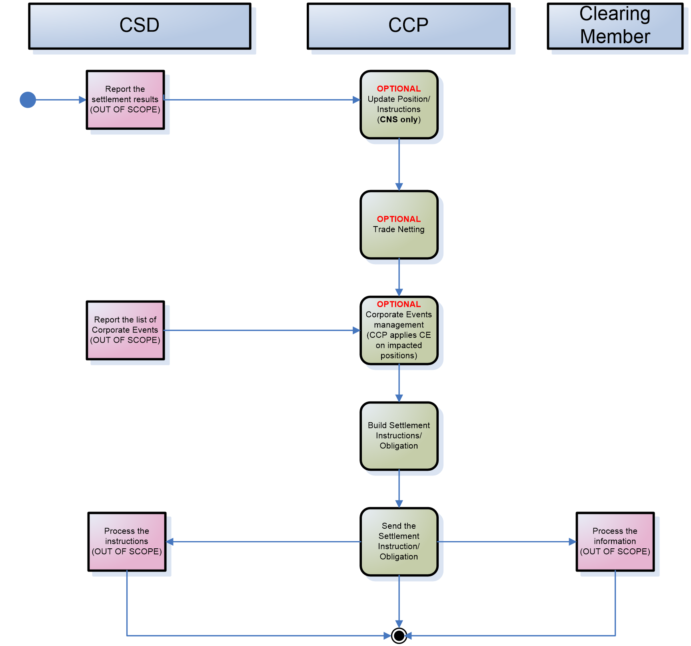
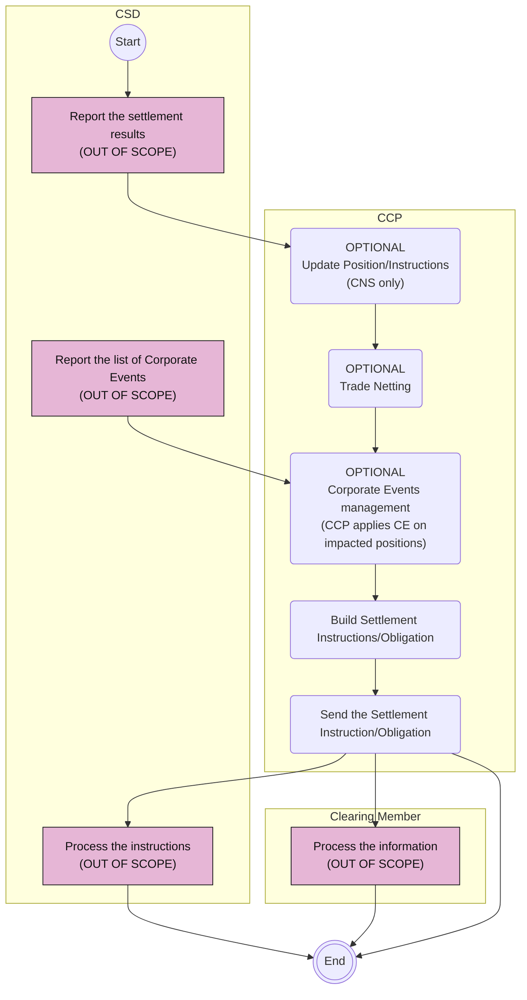

# Settlement Management: Settlement Netting activities

## Source evidence

[src-000052](../../../../../../../../raw-input/central_counterparty_clearing_ccp_clearing/ISO20022_MDRPart1_CentralCounterPartySecuritiesClearing_Maintenance_2025_2026_v2.docx); P202. [Unchanged original image](../../../../../../assets/src-000052/originals/image9.emf); [Viewable source rendering](../../../../../../assets/src-000052/derived-previews/image9.emf.png).

## Mermaid reconstruction

## Actors, activities and relationships

Three source lanes assign CSD reporting/processing, CCP updates/netting/event application/instruction building, and clearing-member information processing. The three CCP optional activities remain individually labeled; CNS-only applies to position/instruction update. Both CSD event input and settlement results are preserved, as are all three final paths. T16 additionally describes clearing-member instructions to a paying agent, the power-of-attorney exception, and failed-trade reporting when the general clearing member is absent from the settlement chain.

[Complete activity responsibility table T16](../../documents/src-000052/tables/tbl-0016.md).

[Reusable process and full source narrative](../../flows/flow-src-000052-p201-business-process-settlement-management-settlement-netting-process.md).

## Review evidence

Opened the full source PNG or full EMF rendering and the Mermaid render; compared all three participant lanes, three optional CCP activities, CNS qualifier, both CSD reports and all three final paths. Source direction, labels, boundaries, responsibility and qualifiers were checked against the artwork and adjacent narrative/table. Layout differs; Start/End text and thick bar glyphs explain the original markers. Parser/render passed with Mermaid 12.3.0 and Chromium 156.0.8078.81. Visual comparison on 2026-11-09 Europe/Warsaw; render report UTC date 2026-11-08.

[Compared reconstruction](../../../../../../assets/src-000052/reconstructed-processes/fig-0010.png).
