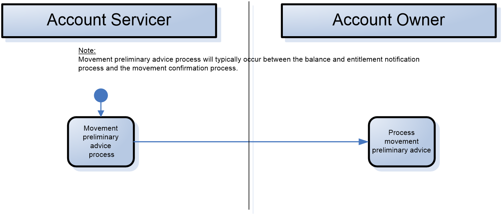
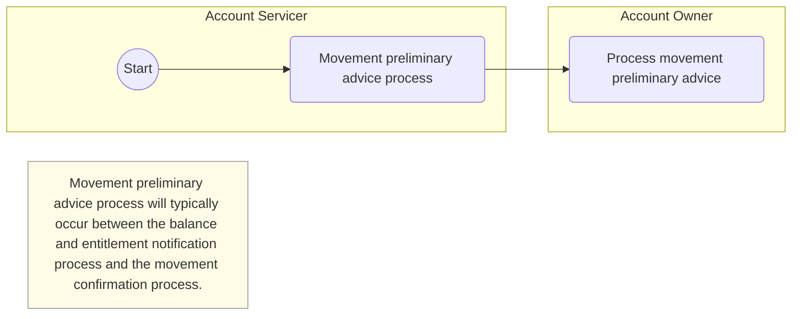

# Movement preliminary advice activities

## Source evidence

[src-000079](../../../../../../../../raw-input/corporate_actions/ISO20022_MDRPart1_CorporateActions_2025_2026_v2.docx); Description of BusinessActivities / BusinessActivities  / Movement Preliminary Advice Process; direct-body paragraph P190. [Unchanged original EMF](../../../../../../assets/src-000079/originals/image17.emf); separate GDI+ preview below.

## Mermaid reconstruction

## Activities and responsibilities

The start point is in the Account Servicer lane. The servicer performs Movement preliminary advice process. The arrow leads to the Account Owner activity Process movement preliminary advice. The source arrow has no message name label. The source note states: Movement preliminary advice process will typically occur between the balance and entitlement notification process and the movement confirmation process.

Participant lanes preserve functional responsibilities. The unchanged original remains available for source notation. [Related reusable business flow](../../flows/flow-src-000079-p150-movement-preliminary-advice-final-entitlement-process.md) supplies surrounding conditions and message evidence; exact message names are not invented for unlabeled activity arrows.

[Account Servicer](../../../../../../../../shared/reference/participants/participant-src-000079-account-servicer.md); [Account Owner](../../../../../../../../shared/reference/participants/participant-src-000079-account-owner.md).

## Review evidence

Opened full-size unchanged source image or vector preview and rendered PNG. Compared both functional participants, start point, two named activities, source arrow direction and any source note/edge label. Parse/render passed with Mermaid 12.3.0 and Chromium 156.0.8078.81. Visual review date 2026-11-09 Europe/Warsaw; the render report records UTC 2026-11-08. Label wrapping/background styling improves legibility without altering source wording.

[Visually checked reconstruction](../../../../../../assets/src-000079/reconstructed-activities/fig-0017.png).
