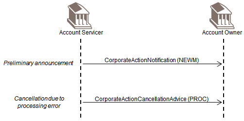
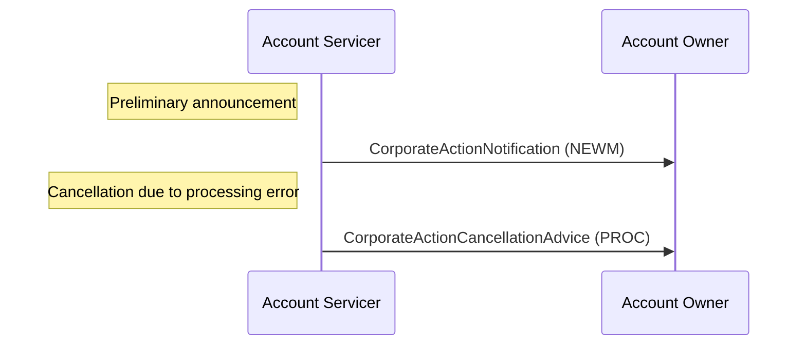

# Announcement and cancellation due to processing error

## Source evidence

[src-000079](../../../../../../../../raw-input/corporate_actions/ISO20022_MDRPart1_CorporateActions_2025_2026_v2.docx); BusinessTransactions / Announcement  / Announcement and Cancellation due to Processing Error; direct-body paragraph P228; word/media/image22.png. Narrative: P224-P227.

## Mermaid reconstruction

## Actors, messages and conditions

Trigger: the Account Servicer discovers that a previous announcement to the Account Owner was erroneous, for example because the owner has no holdings in the security. The cancellation reason is processing error. Detection can follow multiple replacement notifications or preliminary advice; the two-arrow illustration is a minimal path.

The source narrative P203-P204 intentionally uses Account Servicer and Account Owner as functional roles to keep these flows generic. Intermediaries can act as servicer in one relationship and owner in another. Decorative building icons are represented by labeled participants. No additional actor or exchange is inferred from the omitted chain.

| Step | Sender | Receiver | Source message label | Source phase label |
| --- | --- | --- | --- | --- |
| 1 | Account Servicer | Account Owner | CorporateActionNotification (NEWM) | Preliminary announcement |
| 2 | Account Servicer | Account Owner | CorporateActionCancellationAdvice (PROC) | Cancellation due to processing error |

[Reusable flow and complete surrounding source narrative](../../flows/flow-src-000079-p223-announcement-and-cancellation-due-to-processing-error.md).

[Account Servicer](../../../../../../../../shared/reference/participants/participant-src-000079-account-servicer.md); [Account Owner](../../../../../../../../shared/reference/participants/participant-src-000079-account-owner.md).

## Review evidence

Opened the unchanged full-size original and rendered PNG. Verified both actor labels, all 2 message arrows and labels, 0 Account Owner-to-Account Servicer arrows, remaining arrows in the reverse direction, and all source phase/qualifier notes. Decorative building icons replaced by labeled participants; no source semantics dropped. Parse/render passed with Mermaid 12.3.0 and Chromium 156.0.8078.81. Visual comparison performed 2026-11-09 Europe/Warsaw; render report UTC date is 2026-11-08.

[Visually checked reconstruction](../../../../../../assets/src-000079/reconstructed-transactions/fig-0022.png).
