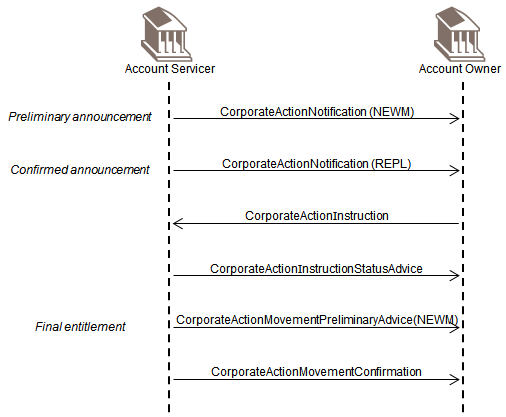
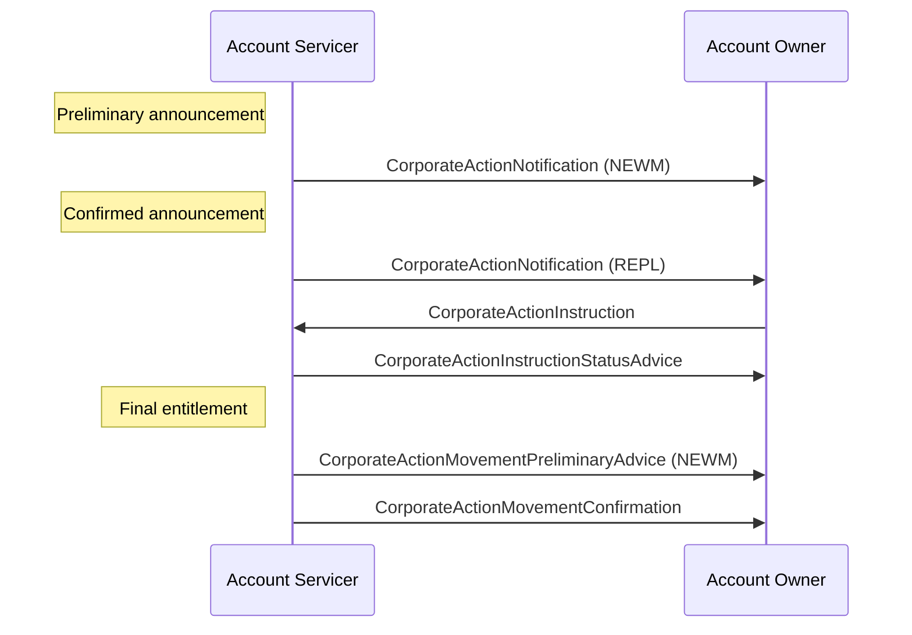

# Movement confirmation

## Source evidence

[src-000079](../../../../../../../../raw-input/corporate_actions/ISO20022_MDRPart1_CorporateActions_2025_2026_v2.docx); BusinessTransactions / Confirmation and Reversal / Confirmation; direct-body paragraph P268; word/media/image28.png. Narrative: P263-P269.

## Mermaid reconstruction

## Actors, messages and conditions

For elective events, confirmation follows election; for non-elective events it follows announcement/final entitlement. The Account Servicer may pre-advise movements and must confirm effected cash/securities credits or debits. The drawing uses CorporateActionMovementConfirmation; P269 shortens its name to CorporateActionConfirmation.

The source narrative P203-P204 intentionally uses Account Servicer and Account Owner as functional roles to keep these flows generic. Intermediaries can act as servicer in one relationship and owner in another. Decorative building icons are represented by labeled participants. No additional actor or exchange is inferred from the omitted chain.

| Step | Sender | Receiver | Source message label | Source phase label |
| --- | --- | --- | --- | --- |
| 1 | Account Servicer | Account Owner | CorporateActionNotification (NEWM) | Preliminary announcement |
| 2 | Account Servicer | Account Owner | CorporateActionNotification (REPL) | Confirmed announcement |
| 3 | Account Owner | Account Servicer | CorporateActionInstruction |  |
| 4 | Account Servicer | Account Owner | CorporateActionInstructionStatusAdvice |  |
| 5 | Account Servicer | Account Owner | CorporateActionMovementPreliminaryAdvice (NEWM) | Final entitlement |
| 6 | Account Servicer | Account Owner | CorporateActionMovementConfirmation |  |

[Reusable flow and complete surrounding source narrative](../../flows/flow-src-000079-p265-confirmation.md).

[Account Servicer](../../../../../../../../shared/reference/participants/participant-src-000079-account-servicer.md); [Account Owner](../../../../../../../../shared/reference/participants/participant-src-000079-account-owner.md).

## Review evidence

Opened the unchanged full-size original and rendered PNG. Verified both actor labels, all 6 message arrows and labels, 1 Account Owner-to-Account Servicer arrows, remaining arrows in the reverse direction, and all source phase/qualifier notes. Decorative building icons replaced by labeled participants; no source semantics dropped. Parse/render passed with Mermaid 12.3.0 and Chromium 156.0.8078.81. Visual comparison performed 2026-11-09 Europe/Warsaw; render report UTC date is 2026-11-08.

[Visually checked reconstruction](../../../../../../assets/src-000079/reconstructed-transactions/fig-0028.png).
