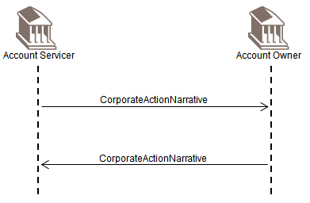
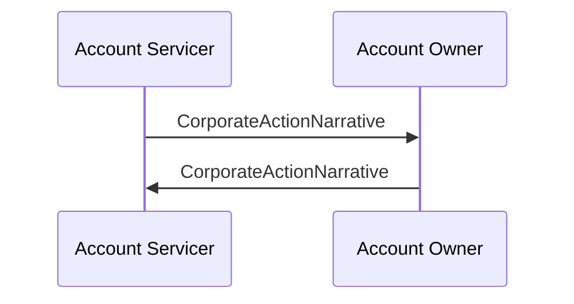

# Narrative exchange

## Source evidence

[src-000079](../../../../../../../../raw-input/corporate_actions/ISO20022_MDRPart1_CorporateActions_2025_2026_v2.docx); BusinessTransactions / Narrative; direct-body paragraph P287; word/media/image32.png. Narrative: P286.

## Mermaid reconstruction

## Actors, messages and conditions

Either functional participant may provide narrative information for taxation conditions, registration details, confirmation of holdings transfer and ancillary processes. The two directions shown do not establish a request-response dependency or mandatory ordering between otherwise independent narrative messages.

The source narrative P203-P204 intentionally uses Account Servicer and Account Owner as functional roles to keep these flows generic. Intermediaries can act as servicer in one relationship and owner in another. Decorative building icons are represented by labeled participants. No additional actor or exchange is inferred from the omitted chain.

| Step | Sender | Receiver | Source message label | Source phase label |
| --- | --- | --- | --- | --- |
| 1 | Account Servicer | Account Owner | CorporateActionNarrative |  |
| 2 | Account Owner | Account Servicer | CorporateActionNarrative |  |

[Reusable flow and complete surrounding source narrative](../../flows/flow-src-000079-p285-narrative.md).

[Account Servicer](../../../../../../../../shared/reference/participants/participant-src-000079-account-servicer.md); [Account Owner](../../../../../../../../shared/reference/participants/participant-src-000079-account-owner.md).

## Review evidence

Opened the unchanged full-size original and rendered PNG. Verified both actor labels, all 2 message arrows and labels, 1 Account Owner-to-Account Servicer arrows, remaining arrows in the reverse direction, and all source phase/qualifier notes. Decorative building icons replaced by labeled participants; no source semantics dropped. Parse/render passed with Mermaid 12.3.0 and Chromium 156.0.8078.81. Visual comparison performed 2026-11-09 Europe/Warsaw; render report UTC date is 2026-11-08.

[Visually checked reconstruction](../../../../../../assets/src-000079/reconstructed-transactions/fig-0032.png).
