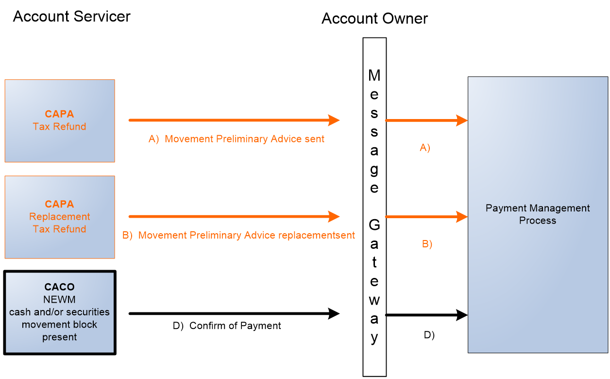
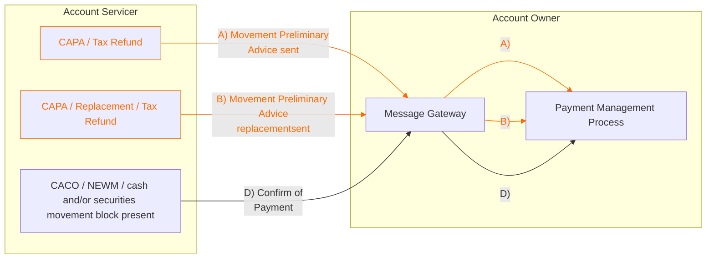

# Tax Refund preliminary advice replacement and confirmation

[src-000079](../../../../../../../../raw-input/corporate_actions/ISO20022_MDRPart1_CorporateActions_2025_2026_v2.docx); BusinessTransactions / Movement Preliminary Advice – Detailed Usage in Typical CA Business Scenarios  / Business Scenarios / Scenario 13: Movement Preliminary Advice for Market Claim & Compensation and Tax Refund; direct-body paragraph P392. [Unchanged source EMF](../../../../../../assets/src-000079/originals/image46.emf).

## Mermaid reconstruction

## Participants and routing

The Account Servicer sends A) CAPA for Tax Refund and B) CAPA / Replacement / Tax Refund through the Account Owner Message Gateway to the Payment Management Process. It also sends D) CACO NEWM with a cash and/or securities movement block present, labeled Confirm of Payment, through the same gateway/process. The source intentionally labels the third path D), with no C) path shown; that lettering is preserved. CAPA paths are orange and the CACO path is black in the original. The Message Gateway and Payment Management Process are internal entities under Account Owner, not additional institutional participants. The source does not provide branch conditions, dates, preconditions or alternative outcomes in these four drawings.

Source labels CAPA, CAPC, CACO, NEWM and the exact joined wording replacementsent (where present) are preserved. No automatic synonym mapping of CAPA to the CAFE abbreviation in source T6 is asserted. Full message-name semantics are available in the related message-set source tables.

[Reusable market-claim and tax-refund flow](../../flows/flow-corporate-actions-market-claims-tax-refunds.md).

[Account Servicer](../../../../../../../../shared/reference/participants/participant-src-000079-account-servicer.md); [Account Owner](../../../../../../../../shared/reference/participants/participant-src-000079-account-owner.md).

## Review evidence

Opened full-size original vector preview and rendered PNG. Verified both functional participants, Message Gateway and Payment Management Process in the Account Owner context, all 3 incoming and 3 outgoing paths, their letter labels and arrow directions, all source message-block qualifiers, and the orange preliminary-advice/cancellation versus black confirmation paths. Node layout changes do not add temporal constraints; source path letters remain authoritative. Parse/render passed with Mermaid 12.3.0 and Chromium 156.0.8078.81. Visual review date 2026-11-09 Europe/Warsaw; render report UTC date 2026-11-08.

[Visually checked reconstruction](../../../../../../assets/src-000079/reconstructed-claims-tax/fig-0046.png).
