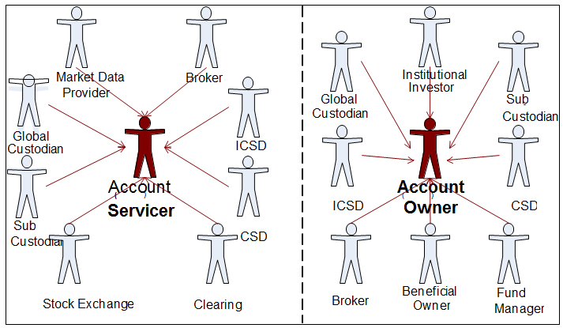
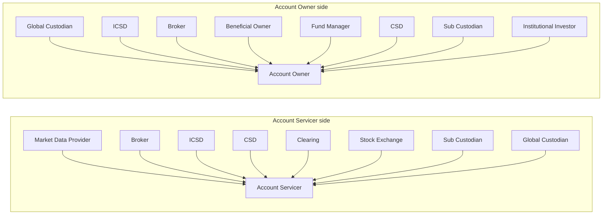

# Corporate Actions business roles and functional participants

## Source evidence

[src-000079](../../../../../../../../raw-input/corporate_actions/ISO20022_MDRPart1_CorporateActions_2025_2026_v2.docx); direct-body paragraph P136, word/media/image2.png. [Extraction occurrence](../../documents/src-000079/diagrams/fig-0002.md).

[Unchanged original asset](../../../../../../assets/src-000079/originals/image2.png).

## Mermaid reconstruction

## Meaning and boundaries

The artwork has two separated sides. Eight source labels point to Account Servicer: Market Data Provider, Broker, ICSD, CSD, Clearing, Stock Exchange, Sub Custodian, and Global Custodian. Eight source labels point to Account Owner: Global Custodian, ICSD, Broker, Beneficial Owner, Fund Manager, CSD, Sub Custodian, and Institutional Investor. Labels appearing on both sides are represented separately in the drawing but link to the same scoped business-role record.

P132-P135 define business roles versus functional participants and explicitly state a many-to-many relationship. An institution is not permanently equated with either functional participant. T8 gives the two participant definitions; T9 gives business-role definitions; T10 supplies the role-to-participant mapping. The source label Clearing corresponds to Clearing Agent in T10; both source labels are preserved. Issuer and Issuer Agent occur in T9 but are absent from this overview and T10. Their absence from the drawing is not evidence that they do not participate in the business context.

The arrows show source-supported role participation. They do not specify message direction, inheritance, composition, ownership or cardinality. The two enclosing boxes in this reconstruction denote the two visually separated sides of the source; no system boundary is asserted. Decorative actor silhouettes and the central dashed divider are represented by labeled nodes and the two sides. There are no source use-case ellipses or include/extend relationships in this figure.

## Scoped participants

- [Global Custodian](../../../../../../../../shared/reference/participants/participant-src-000079-global-custodian.md)
- [Sub Custodian](../../../../../../../../shared/reference/participants/participant-src-000079-sub-custodian.md)
- [Stock Exchange](../../../../../../../../shared/reference/participants/participant-src-000079-stock-exchange.md)
- [Clearing Agent](../../../../../../../../shared/reference/participants/participant-src-000079-clearing-agent.md)
- [Icsd](../../../../../../../../shared/reference/participants/participant-src-000079-icsd.md)
- [Csd](../../../../../../../../shared/reference/participants/participant-src-000079-csd.md)
- [Market Data Provider](../../../../../../../../shared/reference/participants/participant-src-000079-market-data-provider.md)
- [Institutional Investor](../../../../../../../../shared/reference/participants/participant-src-000079-institutional-investor.md)
- [Fund Manager](../../../../../../../../shared/reference/participants/participant-src-000079-fund-manager.md)
- [Broker](../../../../../../../../shared/reference/participants/participant-src-000079-broker.md)
- [Beneficial Owner](../../../../../../../../shared/reference/participants/participant-src-000079-beneficial-owner.md)
- [Account Servicer](../../../../../../../../shared/reference/participants/participant-src-000079-account-servicer.md)
- [Account Owner](../../../../../../../../shared/reference/participants/participant-src-000079-account-owner.md)

## Review evidence

The unchanged original and Mermaid-rendered PNG were both opened and compared on 2026-11-09 (Europe/Warsaw). All sixteen role-to-participant arrows, both functional roles, all business-role labels and the two source sides match. Decorative silhouettes and side divider are explicitly represented differently. No inheritance or message direction was inferred. Parse and render passed with Mermaid 12.3.0 and Chromium 156.0.8078.81. The render report records the UTC date 2026-11-08; local visual review date is 2026-11-09.

[Rendered reconstruction](../../../../../../assets/src-000079/reconstructed-overview/fig-0001.png).
