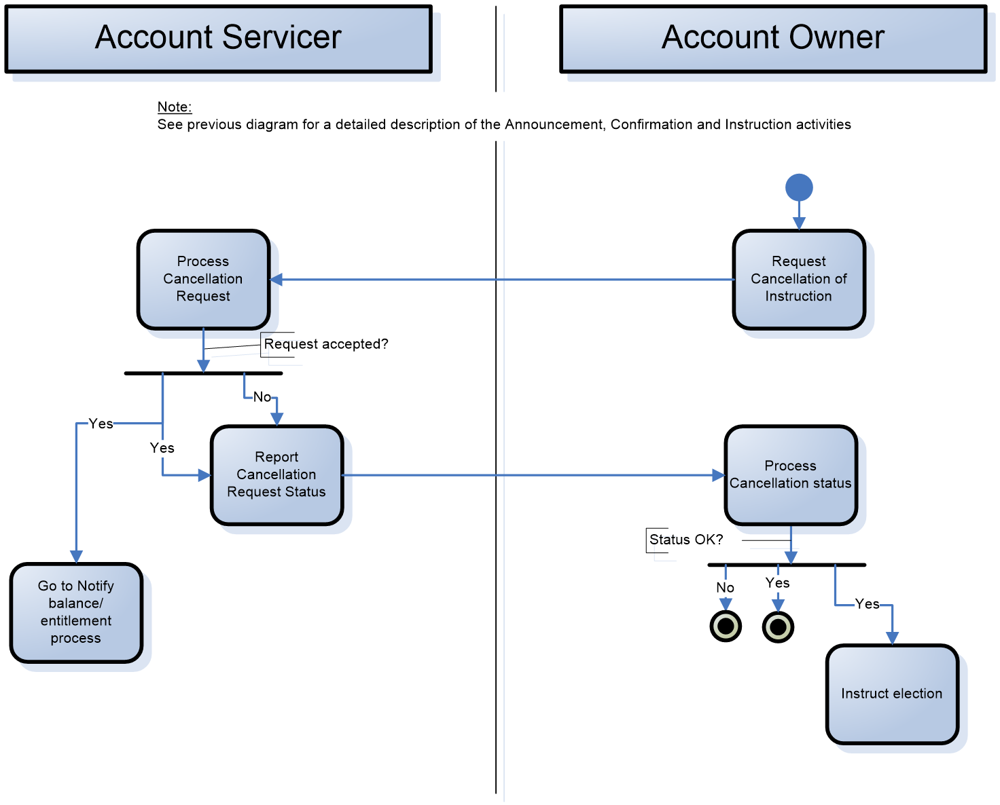
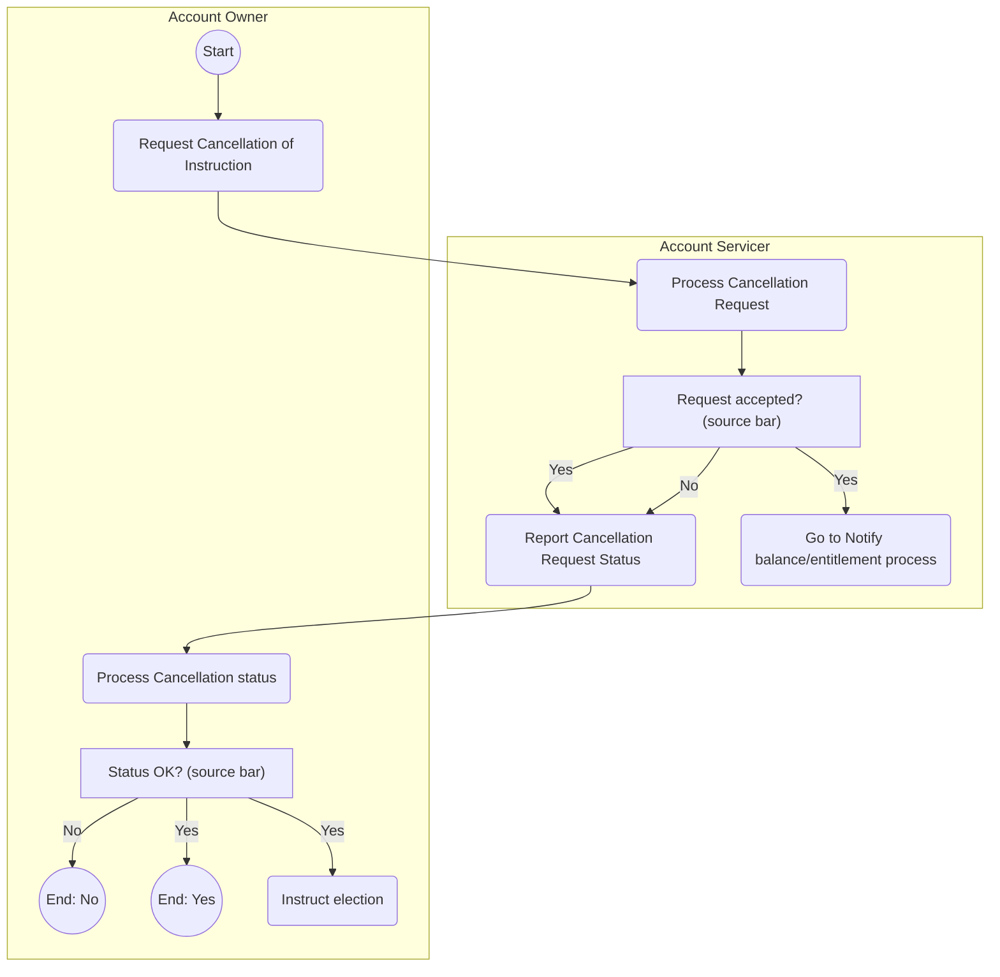

# Corporate action instruction cancellation activities

## Source evidence

[src-000079](../../../../../../../../raw-input/corporate_actions/ISO20022_MDRPart1_CorporateActions_2025_2026_v2.docx); direct-body paragraph P184, word/media/image14.emf. [Extraction occurrence](../../documents/src-000079/diagrams/fig-0014.md).

[Unchanged original asset](../../../../../../assets/src-000079/originals/image14.emf).

## Mermaid reconstruction

## Meaning and boundaries

The Account Owner initiates Request Cancellation of Instruction, which travels to the Account Servicer's Process Cancellation Request activity. At the source bar annotated Request accepted?, two outgoing paths labeled Yes lead to Go to Notify balance/entitlement process and Report Cancellation Request Status; the No path also leads to Report Cancellation Request Status. The Account Servicer sends the status to the Account Owner's Process Cancellation status activity. At the source bar annotated Status OK?, No and Yes each lead to a separate endpoint, while another Yes path leads to Instruct election.

The source legend T20 defines a bar as initiating several actions in parallel. The two bars are retained as source-bar nodes with every outgoing edge and label. The source mixes these bars with Yes/No conditions; it does not establish exclusive-choice semantics or the synchronization/join behavior. Do not infer that the two Yes branches are exclusive. This is an explicit notation limitation requiring business review, not an inferred execution rule.

The source note says to see the previous diagram for detailed Announcement, Confirmation and Instruction activities (P182, image13.emf). This cancellation diagram intentionally shows the two functional participants and a subset of the full business activity sequence. No external initiator or designated agent is added to the artwork. Message bindings come from the separately cited cancellation flow; this activity artwork itself uses activity names, not exact message identifiers.

## Scoped participants

- [Account Servicer](../../../../../../../../shared/reference/participants/participant-src-000079-account-servicer.md)
- [Account Owner](../../../../../../../../shared/reference/participants/participant-src-000079-account-owner.md)

## Related flow

[flow-src-000079-p154-cancellation](../../flows/flow-src-000079-p154-cancellation.md)

## Review evidence

The unchanged original and Mermaid-rendered PNG were both opened and compared on 2026-11-09 (Europe/Warsaw). All six named activities, start and two end points, both source-bar labels, all six Yes/No branch labels and two cross-participant arrows match. Source bars remain explicitly identified; ambiguity issue-000020 prevents a reviewed business interpretation. Parse and render passed with Mermaid 12.3.0 and Chromium 156.0.8078.81. The render report records the UTC date 2026-11-08; local visual review date is 2026-11-09.

[Rendered reconstruction](../../../../../../assets/src-000079/reconstructed-overview/fig-0003.png).

