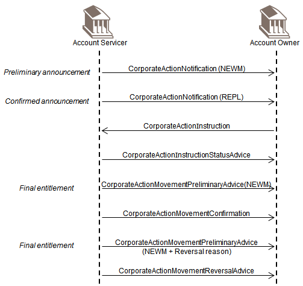
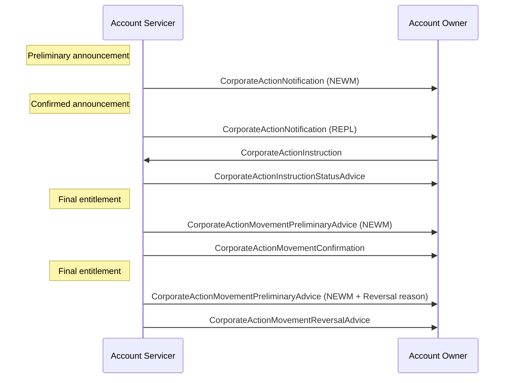

# Corporate action movement reversal

## Source evidence

Source src-000079, BusinessTransactions / Confirmation and Reversal / Reversal, P270–P275 (image at P275). Paragraph IDs count direct body paragraphs, excluding tables.

The original extracted image is unchanged. Building icons are decorative actor symbols; the two participant labels and their lifelines are preserved.

## Mermaid reconstruction

## Actors and relationships

| Actor | Scoped participant |
| --- | --- |
| Account Servicer | [Account Servicer](../../../../../../../../shared/reference/participants/participant-src-000079-account-servicer.md) |
| Account Owner | [Account Owner](../../../../../../../../shared/reference/participants/participant-src-000079-account-owner.md) |

The source shows eight message arrows. The CorporateActionInstruction travels from Account Owner to Account Servicer. The other seven arrows travel from Account Servicer to Account Owner. The announcement labels (preliminary and confirmed) and both occurrences of the Final entitlement label are retained. NEWM, REPL and Reversal reason are source labels.

The final arrow confirms that the movements have been reversed. The source narrative at P272 makes the reversal preliminary advice optional; P273 requires the reversal advice. The drawing depicts the illustrated path without an optional fragment, which is retained here.

[Reusable movement reversal flow](../../flows/flow-src-000079-p153-movement-reversal.md)

## Review evidence

Parse and render passed with Mermaid 12.3.0 and Chromium 156.0.8078.81 on 2026-11-08. The rendered PNG was opened and compared with the unchanged original image. Both actor labels, all eight message names, seven rightward and one leftward arrow, NEWM/REPL/reversal-reason qualifiers, and the preliminary/confirmed/final-entitlement notes agree. No cardinality, inheritance or include/extend feature occurs in this sequence. The source actor icons are decorative and are represented by participant boxes.

Rendered output: [Verified sequence](../../../../../../assets/src-000079/reconstructed-reversal/fig-0001.png).
