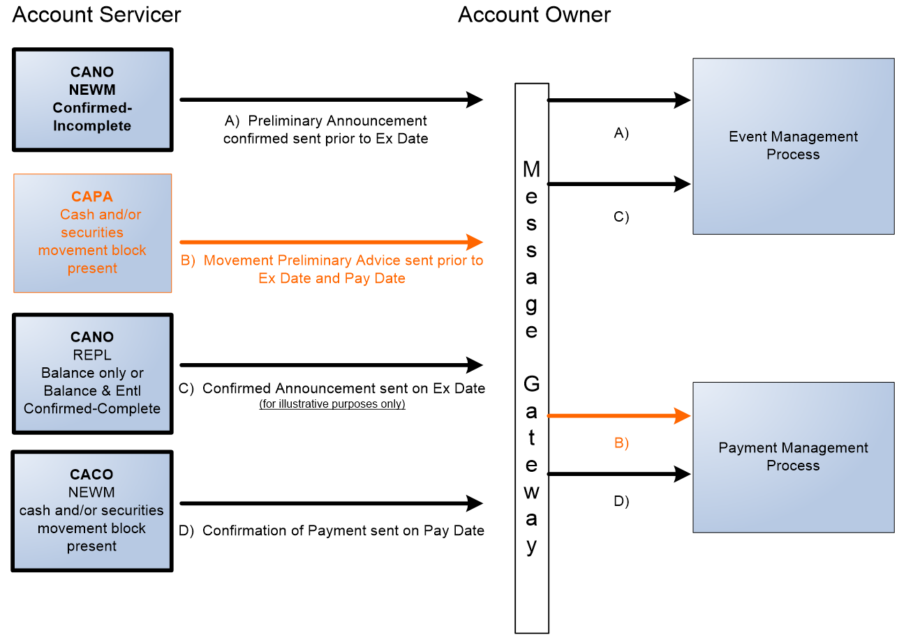
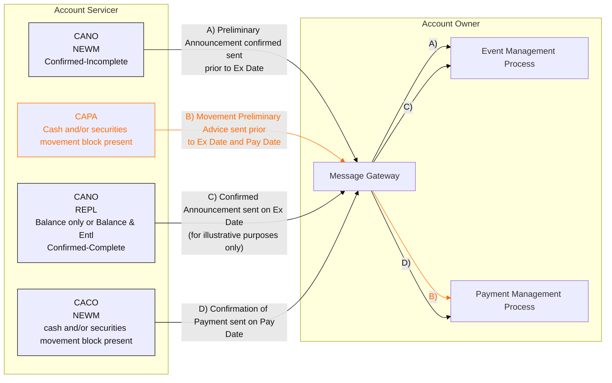

# Scenario 3: Mandatory Event Ex Date = Pay Date

## Source evidence

[src-000079](../../../../../../../../raw-input/corporate_actions/ISO20022_MDRPart1_CorporateActions_2025_2026_v2.docx); BusinessTransactions / Movement Preliminary Advice – Detailed Usage in Typical CA Business Scenarios  / Business Scenarios / Scenario 3: Mandatory Event Ex Date = Pay Date; direct-body paragraph P336; word/media/image35.emf. [Unchanged original asset](../../../../../../assets/src-000079/originals/image35.emf).

## Mermaid reconstruction

## Purpose, conditions and routing

P335: mandatory event with payment date equal to ex-date. Preliminary advice is sent before both dates.

The Message Gateway routes received messages to the Event, Response or Payment Management component indicated by each source route letter. These are internal processing entities, not additional institutions. The exact source message-block labels are retained; line breaks are represented by slashes in the table. Message blocks next to outward instruction arrows remain unconnected labels, as in the source; small recipient boxes labeled source-side arrow endpoint are derived layout aids marking the otherwise unlabeled arrow endpoint. They do not add business actors or messages. Account Servicer and Account Owner boundaries follow the source headings.

| Source path | Direction | Source message block | Source arrow label | Receiving internal process | Incoming/outgoing source colors |
| --- | --- | --- | --- | --- | --- |
| A) | Account Servicer to Account Owner | CANO / NEWM / Confirmed-Incomplete | Preliminary Announcement confirmed sent prior to Ex Date | Event Management Process | black/black |
| B) | Account Servicer to Account Owner | CAPA / Cash and/or securities movement block present | Movement Preliminary Advice sent prior to Ex Date and Pay Date | Payment Management Process | orange/orange |
| C) | Account Servicer to Account Owner | CANO / REPL / Balance only or Balance & Entl / Confirmed-Complete | Confirmed Announcement sent on Ex Date (for illustrative purposes only) | Event Management Process | black/black |
| D) | Account Servicer to Account Owner | CACO / NEWM / cash and/or securities movement block present | Confirmation of Payment sent on Pay Date | Payment Management Process | black/black |

## Color and scope qualifications

P324-P326 defines black as mandatory message flow, blue as optional message flow, and orange as preliminary-advice/cancellation flow. The source also colors several status/reminder paths orange. The reconstruction preserves the observed colors without deriving occurrence constraints or a new semantic rule from color alone. In scenarios with joint A) & B) captions, the two original arrows are labeled A) and B) separately for readability; their shared destination is preserved. P320-P321 explicitly says these are plain-vanilla examples, not exhaustive market/SLA-specific flows. P300 makes movement preliminary advice optional in the overall corporate-action flow.

[Reusable flow and full narrative](../../flows/flow-src-000079-p334-scenario-3-mandatory-event-ex-date-pay-date.md).

## Review evidence

Opened the full source image and rendered reconstruction. Compared all 4 lettered source paths, 0 outward instruction path(s), message blocks, arrow direction, every internal-process destination, source colors and timing/footnotes. The rendering repositions the source entities but preserves the observed relationships. Line breaks were adjusted and re-rendered to keep labels clear of connectors. Parse/render passed with Mermaid 12.3.0 and Chromium 156.0.8078.81. Visual comparison on 2026-11-09 Europe/Warsaw; render report UTC date 2026-11-08.

[Visually checked reconstruction](../../../../../../assets/src-000079/reconstructed-routing/fig-0035.png).
