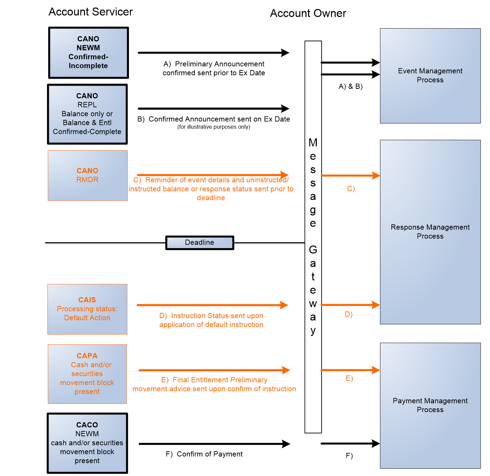
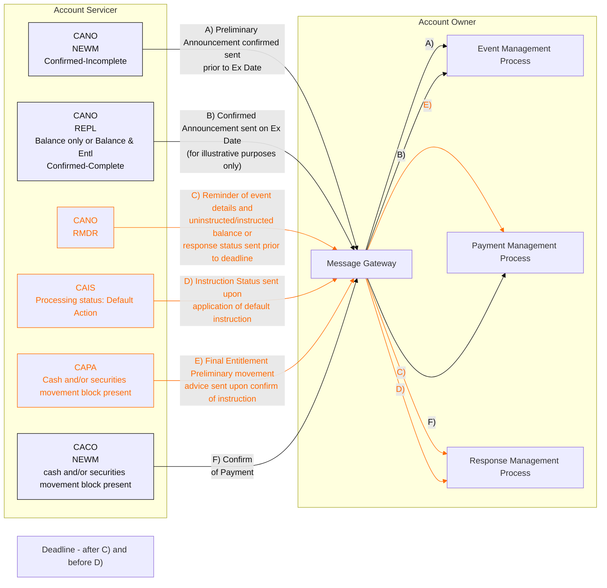

# Scenario 10: Mandatory with Election – No Instruction Received

## Source evidence

[src-000079](../../../../../../../../raw-input/corporate_actions/ISO20022_MDRPart1_CorporateActions_2025_2026_v2.docx); BusinessTransactions / Movement Preliminary Advice – Detailed Usage in Typical CA Business Scenarios  / Business Scenarios / Scenario 10: Mandatory with Election – No Instruction Received; direct-body paragraph P363; word/media/image42.emf. [Unchanged original asset](../../../../../../assets/src-000079/originals/image42.emf).

## Mermaid reconstruction

## Purpose, conditions and routing

P361 title and image42 show no instruction received: the Account Servicer sends a reminder, then default-action status after the deadline, preliminary advice, and payment confirmation. P362 contradicts this by saying the owner does provide instructions and sends the reminder. Both source claims remain visible under issue-000026; this reconstruction preserves the artwork direction.

The Message Gateway routes received messages to the Event, Response or Payment Management component indicated by each source route letter. These are internal processing entities, not additional institutions. The exact source message-block labels are retained; line breaks are represented by slashes in the table. Message blocks next to outward instruction arrows remain unconnected labels, as in the source; small recipient boxes labeled source-side arrow endpoint are derived layout aids marking the otherwise unlabeled arrow endpoint. They do not add business actors or messages. Account Servicer and Account Owner boundaries follow the source headings.

| Source path | Direction | Source message block | Source arrow label | Receiving internal process | Incoming/outgoing source colors |
| --- | --- | --- | --- | --- | --- |
| A) | Account Servicer to Account Owner | CANO / NEWM / Confirmed-Incomplete | Preliminary Announcement confirmed sent prior to Ex Date | Event Management Process | black/black |
| B) | Account Servicer to Account Owner | CANO / REPL / Balance only or Balance & Entl / Confirmed-Complete | Confirmed Announcement sent on Ex Date (for illustrative purposes only) | Event Management Process | black/black |
| C) | Account Servicer to Account Owner | CANO / RMDR | Reminder of event details and uninstructed/instructed balance or response status sent prior to deadline | Response Management Process | orange/orange |
| D) | Account Servicer to Account Owner | CAIS / Processing status: Default Action | Instruction Status sent upon application of default instruction | Response Management Process | orange/orange |
| E) | Account Servicer to Account Owner | CAPA / Cash and/or securities movement block present | Final Entitlement Preliminary movement advice sent upon confirm of instruction | Payment Management Process | orange/orange |
| F) | Account Servicer to Account Owner | CACO / NEWM / cash and/or securities movement block present | Confirm of Payment | Payment Management Process | black/black |

The source Deadline boundary is after C) and before D). It is an event-time boundary, not a message arrow.

## Color and scope qualifications

P324-P326 defines black as mandatory message flow, blue as optional message flow, and orange as preliminary-advice/cancellation flow. The source also colors several status/reminder paths orange. The reconstruction preserves the observed colors without deriving occurrence constraints or a new semantic rule from color alone. In scenarios with joint A) & B) captions, the two original arrows are labeled A) and B) separately for readability; their shared destination is preserved. P320-P321 explicitly says these are plain-vanilla examples, not exhaustive market/SLA-specific flows. P300 makes movement preliminary advice optional in the overall corporate-action flow.

[Reusable flow and full narrative](../../flows/flow-src-000079-p361-scenario-10-mandatory-with-election-no-instruction-received.md).

## Review evidence

Opened the full source image and rendered reconstruction. Compared all 6 lettered source paths, 0 outward instruction path(s), message blocks, arrow direction, every internal-process destination, source colors and timing/footnotes. The rendering repositions the source entities but preserves the observed relationships. Line breaks were adjusted and re-rendered to keep labels clear of connectors. Artwork direction and labels match; the source narrative contradiction at P362 remains unresolved (issue-000026), so the page is not marked reviewed. Parse/render passed with Mermaid 12.3.0 and Chromium 156.0.8078.81. Visual comparison on 2026-11-09 Europe/Warsaw; render report UTC date 2026-11-08.

[Visually checked reconstruction](../../../../../../assets/src-000079/reconstructed-routing/fig-0042.png).
