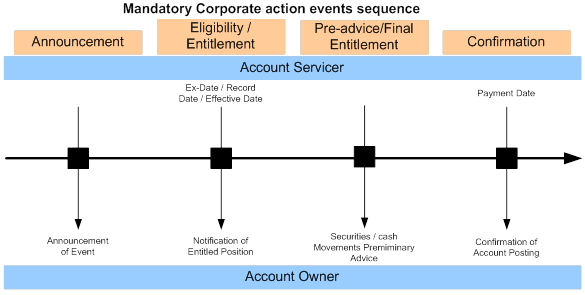
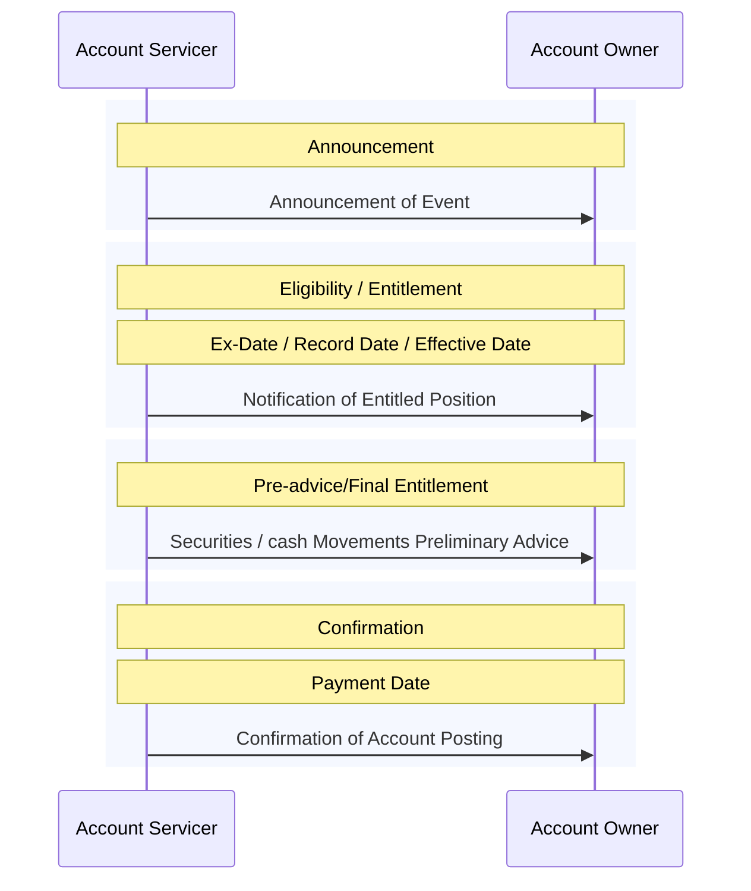

# Mandatory Corporate action events sequence

[src-000079](../../../../../../../../raw-input/corporate_actions/ISO20022_MDRPart1_CorporateActions_2025_2026_v2.docx); Description of BusinessActivities / BusinessActivities Timeline; P164; word/media/image8.png; context P161-P169.

## Mermaid reconstruction

## Activities, dates and scope

The source horizontal time axis becomes top-to-bottom sequence order; colored regions preserve the named phases. Each source vertical arrow becomes a message/activity arrow between the same functional roles. All four activities point from Account Servicer to Account Owner. The original date labels are attached to the corresponding phases; no dates or durations are inferred. Labels describe information/activities rather than exact ISO message identifiers.

P161 states that sequencing can differ between events and that activities may occur simultaneously according to market rules or account-servicer practice. P162 says the timelines do not include cancellation and status-reporting possibilities; the elective timeline includes a broad Status stage but does not enumerate those alternative paths. These are illustrative phase sequences, not universal mandatory execution orders.

[Reusable flow](../../flows/flow-src-000079-p163-mandatory-corporate-action-events-sequence.md).

## Review evidence

Opened the source PNG and Mermaid render. Compared both functional actors, all 4 ordered phases and activity labels, 0 owner-to-servicer arrow(s) and remaining servicer-to-owner arrows, plus every date/deadline label. Horizontal source time axis is represented vertically; P161 event-dependent ordering/concurrency limitation is retained. Parse/render passed with Mermaid 12.3.0 and Chromium 156.0.8078.81. Visual comparison on 2026-11-09 Europe/Warsaw; render report UTC date 2026-11-08.

[Visually checked reconstruction](../../../../../../assets/src-000079/reconstructed-timelines/fig-0008.png).
