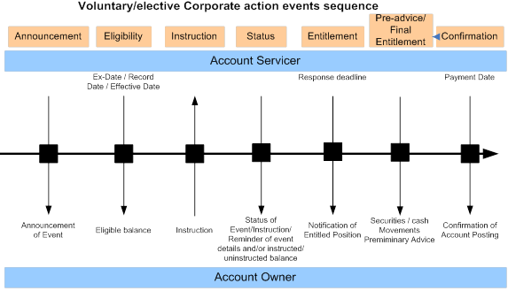

# fig-0009 - original figure evidence

Source: [src-000079](../../../../../../../../../raw-input/corporate_actions/ISO20022_MDRPart1_CorporateActions_2025_2026_v2.docx). Locator: direct-body paragraph P167; Description of BusinessActivities / BusinessActivities Timeline / Elective Corporate Action Events Sequence; /w:document/w:body/w:p[167].

Original extracted asset: [image9.png](../../../../../../../assets/src-000079/originals/image9.png)

## Canonical reconstruction and review

[Canonical diagram, source qualifications, participant/flow links and recorded review evidence](../../../diagrams/timelines/fig-0009.md). Original media and this occurrence's precise locator are retained. Rendering and visual comparison results above are copied from the canonical reference; any unresolved business, version or contextual limitation remains open.

## Reviewed reconstruction

[Voluntary/elective Corporate action events sequence](../../../diagrams/timelines/fig-0009.md). Original and rendered reconstruction visually compared.
