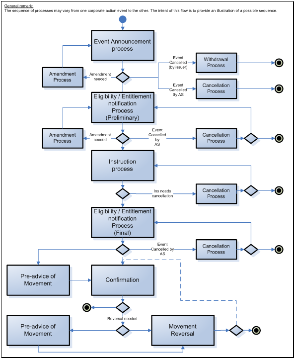

# fig-0011 - original figure evidence

Source: [src-000079](../../../../../../../../../raw-input/corporate_actions/ISO20022_MDRPart1_CorporateActions_2025_2026_v2.docx). Locator: direct-body paragraph P175; Description of BusinessActivities / BusinessActivities Timeline / Elective Corporate Action Events Sequence / Mandatory Reorganisation with Options; /w:document/w:body/w:p[175].

Original extracted asset: [image11.png](../../../../../../../assets/src-000079/originals/image11.png)

## Canonical reconstruction and review

[Canonical diagram, source qualifications, participant/flow links and recorded review evidence](../../../diagrams/detailed-activities/fig-0011.md). Original media and this occurrence's precise locator are retained. Rendering and visual comparison results above are copied from the canonical reference; any unresolved business, version or contextual limitation remains open.

## Reconstruction with explicit limitation

[Corporate action processes with options](../../../diagrams/detailed-activities/fig-0011.md). The source dashed connector between the pre-confirmation region and final post-reversal merge has no clearly readable arrowhead in the supplied PNG. It is reconstructed as an undirected dashed connection; no reverse loop or extra execution order is inferred.
