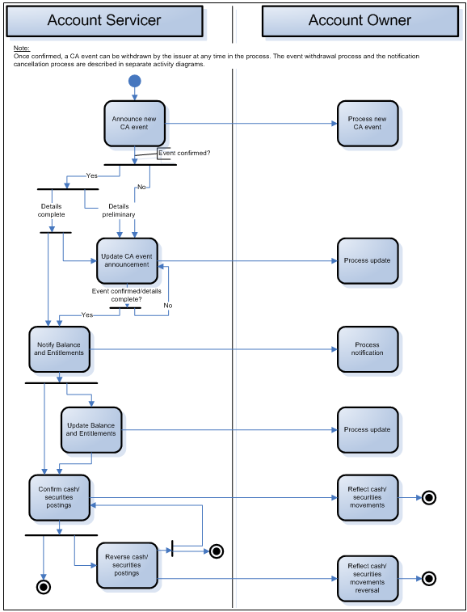

# fig-0012 - original figure evidence

Source: [src-000079](../../../../../../../../../raw-input/corporate_actions/ISO20022_MDRPart1_CorporateActions_2025_2026_v2.docx). Locator: direct-body paragraph P178; Description of BusinessActivities / BusinessActivities  / Generic Corporate Action Process (Non Elective Event); /w:document/w:body/w:p[178].

Original extracted asset: [image12.png](../../../../../../../assets/src-000079/originals/image12.png)

## Canonical reconstruction and review

[Canonical diagram, source qualifications, participant/flow links and recorded review evidence](../../../diagrams/detailed-activities/fig-0012.md). Original media and this occurrence's precise locator are retained. Rendering and visual comparison results above are copied from the canonical reference; any unresolved business, version or contextual limitation remains open.

## Reconstruction with explicit limitation

[Generic non-elective corporate action activities](../../../diagrams/detailed-activities/fig-0012.md). Source T20 defines bars as parallel actions, yet this artwork combines bars with Yes/No conditional labels. Every source branch is retained; exclusive-choice and synchronization semantics remain unresolved under issue-000020.
