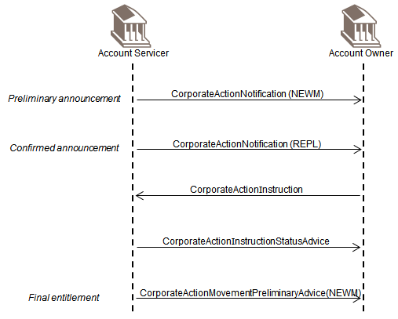

# fig-0024 - original figure evidence

Source: [src-000079](../../../../../../../../../raw-input/corporate_actions/ISO20022_MDRPart1_CorporateActions_2025_2026_v2.docx). Locator: direct-body paragraph P242; BusinessTransactions / Election, Entitlement and Reminder Scenarios / Election and Final Entitlement ; /w:document/w:body/w:p[242].

Original extracted asset: [image24.png](../../../../../../../assets/src-000079/originals/image24.png)

## Canonical reconstruction and review

[Canonical diagram, source qualifications, participant/flow links and recorded review evidence](../../../diagrams/business-transactions/fig-0024.md). Original media and this occurrence's precise locator are retained. Rendering and visual comparison results above are copied from the canonical reference; any unresolved business, version or contextual limitation remains open.

## Reviewed reconstruction

[Election and final entitlement](../../../diagrams/business-transactions/fig-0024.md). Source artwork and rendered reconstruction visually compared.
