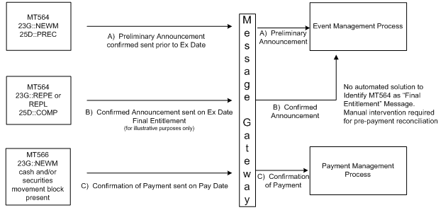

# fig-0033 - original figure evidence

Source: [src-000079](../../../../../../../../../raw-input/corporate_actions/ISO20022_MDRPart1_CorporateActions_2025_2026_v2.docx). Locator: direct-body paragraph P329; BusinessTransactions / Movement Preliminary Advice – Detailed Usage in Typical CA Business Scenarios  / Business Scenarios / Scenario 1: Mandatory Event – No Preliminary Advice; /w:document/w:body/w:p[329].

Original extracted asset: [image33.png](../../../../../../../assets/src-000079/originals/image33.png)

## Canonical reconstruction and review

[Canonical diagram, source qualifications, participant/flow links and recorded review evidence](../../../diagrams/routing-scenarios/fig-0033.md). Original media and this occurrence's precise locator are retained. Rendering and visual comparison results above are copied from the canonical reference; any unresolved business, version or contextual limitation remains open.

## Source reconstruction

[Scenario 1: Mandatory Event – No Preliminary Advice](../../../diagrams/routing-scenarios/fig-0033.md). Original and rendered reconstruction visually compared. All source paths and labels checked.
