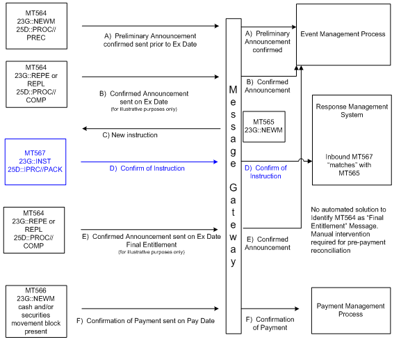

# fig-0034 - original figure evidence

Source: [src-000079](../../../../../../../../../raw-input/corporate_actions/ISO20022_MDRPart1_CorporateActions_2025_2026_v2.docx). Locator: direct-body paragraph P332; BusinessTransactions / Movement Preliminary Advice – Detailed Usage in Typical CA Business Scenarios  / Business Scenarios / Scenario 2: Mandatory with Election and Voluntary Event - No Preliminary Advice ; /w:document/w:body/w:p[332].

Original extracted asset: [image34.png](../../../../../../../assets/src-000079/originals/image34.png)

## Canonical reconstruction and review

[Canonical diagram, source qualifications, participant/flow links and recorded review evidence](../../../diagrams/routing-scenarios/fig-0034.md). Original media and this occurrence's precise locator are retained. Rendering and visual comparison results above are copied from the canonical reference; any unresolved business, version or contextual limitation remains open.

## Source reconstruction

[Scenario 2: Mandatory with Election and Voluntary Event - No Preliminary Advice](../../../diagrams/routing-scenarios/fig-0034.md). Original and rendered reconstruction visually compared. The recorded source ambiguity remains open.
