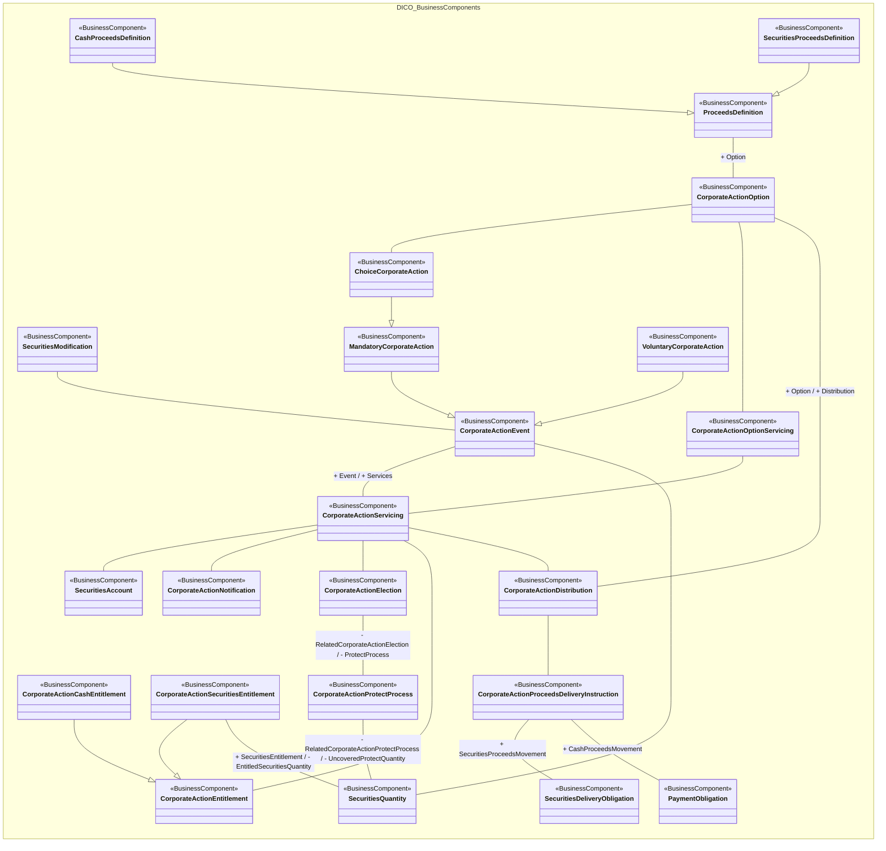

# Corporate-action services and entitlements

[src-000081](../../../../../../../../../raw-input/corporate_actions/ISO20022_MDRPart3_CorporateActions_2025_2026_v1.xlsx), CorporateActionServices!A1:AA59; xl/drawings/drawing3.xml; anchor 1. Original image SHA-256: 87ab96538eda06654cb65747efbb8ad180164ebcbb45040000b86e85575b1071.

[Original complete figure](../../../../../../../assets/src-000081/media/image3.png) · [Rendered Mermaid SVG](../../../../../../../assets/src-000081/reconstructed/src-000081-fig-0003.svg) · [Rendered Mermaid PNG](../../../../../../../assets/src-000081/reconstructed/src-000081-fig-0003.png)

## Source reconstruction

## Entities and relationships

Mandatory and voluntary corporate actions specialize CorporateActionEvent; ChoiceCorporateAction specializes MandatoryCorporateAction. Cash and securities proceeds specialize ProceedsDefinition. Cash and securities entitlements specialize CorporateActionEntitlement. CorporateActionServicing links event, option servicing, account, notification, election, entitlement and distribution. Distribution links proceeds delivery; the delivery instruction connects securities-delivery and payment obligations. The outer unlabelled Event–SecuritiesQuantity association is retained, alongside the separate protect-process and securities-entitlement quantity associations.

All 23 visible node occurrences and 26 relationship lines are retained. No numeric multiplicity is shown in this source view, so none is inferred. Namespaces group the source’s printed “from” package labels for readability; the source did not draw those enclosing package boxes. Association labels retain literal +/− prefixes and combined end names. Their re-layout position is not additional navigability evidence. The native class inheritance marker is reserved for the source’s hollow-triangle generalizations. Source editor/navigation icons are omitted as interface decoration; no business entity or relationship is excluded.

## Complete relationship register

| From node | To node | Source relationship kind | Visible source label(s) | From-end multiplicity | To-end multiplicity |
| --- | --- | --- | --- | --- | --- |
| SecuritiesModification | CorporateActionEvent | association | (unlabelled in source) | not printed | not printed |
| MandatoryCorporateAction | CorporateActionEvent | generalization: subtype to supertype | (unlabelled in source) | not printed | not printed |
| VoluntaryCorporateAction | CorporateActionEvent | generalization: subtype to supertype | (unlabelled in source) | not printed | not printed |
| ChoiceCorporateAction | MandatoryCorporateAction | generalization: subtype to supertype | (unlabelled in source) | not printed | not printed |
| CashProceedsDefinition | ProceedsDefinition | generalization: subtype to supertype | (unlabelled in source) | not printed | not printed |
| SecuritiesProceedsDefinition | ProceedsDefinition | generalization: subtype to supertype | (unlabelled in source) | not printed | not printed |
| CorporateActionCashEntitlement | CorporateActionEntitlement | generalization: subtype to supertype | (unlabelled in source) | not printed | not printed |
| CorporateActionSecuritiesEntitlement | CorporateActionEntitlement | generalization: subtype to supertype | (unlabelled in source) | not printed | not printed |
| CorporateActionOption | ChoiceCorporateAction | association | (unlabelled in source) | not printed | not printed |
| ProceedsDefinition | CorporateActionOption | association | + Option | not printed | not printed |
| CorporateActionOption | CorporateActionOptionServicing | association | (unlabelled in source) | not printed | not printed |
| CorporateActionOption | CorporateActionDistribution | association | + Option / + Distribution | not printed | not printed |
| CorporateActionOptionServicing | CorporateActionServicing | association | (unlabelled in source) | not printed | not printed |
| CorporateActionEvent | CorporateActionServicing | association | + Event / + Services | not printed | not printed |
| CorporateActionServicing | SecuritiesAccount | association | (unlabelled in source) | not printed | not printed |
| CorporateActionServicing | CorporateActionNotification | association | (unlabelled in source) | not printed | not printed |
| CorporateActionServicing | CorporateActionElection | association | (unlabelled in source) | not printed | not printed |
| CorporateActionServicing | CorporateActionEntitlement | association | (unlabelled in source) | not printed | not printed |
| CorporateActionServicing | CorporateActionDistribution | association | (unlabelled in source) | not printed | not printed |
| CorporateActionDistribution | CorporateActionProceedsDeliveryInstruction | association | (unlabelled in source) | not printed | not printed |
| CorporateActionProceedsDeliveryInstruction | SecuritiesDeliveryObligation | association | + SecuritiesProceedsMovement | not printed | not printed |
| CorporateActionProceedsDeliveryInstruction | PaymentObligation | association | + CashProceedsMovement | not printed | not printed |
| CorporateActionElection | CorporateActionProtectProcess | association | - RelatedCorporateActionElection / - ProtectProcess | not printed | not printed |
| CorporateActionProtectProcess | SecuritiesQuantity | association | - RelatedCorporateActionProtectProcess / - UncoveredProtectQuantity | not printed | not printed |
| CorporateActionSecuritiesEntitlement | SecuritiesQuantity | association | + SecuritiesEntitlement / - EntitledSecuritiesQuantity | not printed | not printed |
| CorporateActionEvent | SecuritiesQuantity | association | (unlabelled in source) | not printed | not printed |

## Entity definitions and precise workbook locators

| Visible label | Source package / stereotype | Definition evidence |
| --- | --- | --- |
| SecuritiesModification | DICO_BusinessComponents / BusinessComponent | [FullBusinessModel!A4105:D4105](../sheets/02-fullbusinessmodel/tbl-0022.md) — Modification of the reference data of a security or of the organisation that issued it. |
| CorporateActionEvent | DICO_BusinessComponents / BusinessComponent | [FullBusinessModel!A1083:D1083](../sheets/02-fullbusinessmodel/tbl-0007.md) — An event determined by a corporation's board of directors, that changes the existing corporate capital structure or financial condition. |
| MandatoryCorporateAction | DICO_BusinessComponents / BusinessComponent | [FullBusinessModel!A2702:D2702](../sheets/02-fullbusinessmodel/tbl-0015.md) — Corporate action that will result in only one possibility for account holders. The shareholder is just a passive beneficiary of these actions. |
| VoluntaryCorporateAction | DICO_BusinessComponents / BusinessComponent | [FullBusinessModel!A5384:D5384](../sheets/02-fullbusinessmodel/tbl-0028.md) — Participation in the corporate action is voluntary. To take part in the event, the account owner must provide its instructions. |
| ChoiceCorporateAction | DICO_BusinessComponents / BusinessComponent | [FullBusinessModel!A794:D794](../sheets/02-fullbusinessmodel/tbl-0005.md) — Mandatory with choice corporate action event that involves a choice on behalf of the owner of the securities. The shareholders are given a chance to choose among several options. |
| ProceedsDefinition | DICO_BusinessComponents / BusinessComponent | [FullBusinessModel!A3516:D3516](../sheets/02-fullbusinessmodel/tbl-0019.md) — Definition of exchanges of cash and/or securities available in the processing of corporate actions. |
| CashProceedsDefinition | DICO_BusinessComponents / BusinessComponent | [FullBusinessModel!A702:D702](../sheets/02-fullbusinessmodel/tbl-0005.md) — Definition of the cash proceeds for a corporate action in generic terms; that is, before applying it to specific securities holding. An example would be the definition of a dividend payment where all the information will be given in general on a per share basis. |
| SecuritiesProceedsDefinition | DICO_BusinessComponents / BusinessComponent | [FullBusinessModel!A4329:D4329](../sheets/02-fullbusinessmodel/tbl-0023.md) — The definition of the securities proceeds for a corporate action in generic terms; that is, before applying it to specific securities holding. An example would be the definition of a  bonus rights issue where all the information will be given in general on a per share basis. |
| CorporateActionOption | DICO_BusinessComponents / BusinessComponent | [FullBusinessModel!A1152:D1152](../sheets/02-fullbusinessmodel/tbl-0007.md) — Provides information about the alternatives available to an account owner when participating to a corporate action event. This is defined at a general level without looking at the specificities of the securities balances. |
| CorporateActionOptionServicing | DICO_BusinessComponents / BusinessComponent | [FullBusinessModel!A1170:D1170](../sheets/02-fullbusinessmodel/tbl-0007.md) — Option servicing process which calculates the entitlement based on a corporate action option. |
| CorporateActionServicing | DICO_BusinessComponents / BusinessComponent | [FullBusinessModel!A1205:D1205](../sheets/02-fullbusinessmodel/tbl-0008.md) — Services which consists in notifying the investor or its agent of a corporate event and calculating its proceeds based on its holdings. |
| CorporateActionProceedsDeliveryInstruction | DICO_BusinessComponents / BusinessComponent | [FullBusinessModel!A1188:D1188](../sheets/02-fullbusinessmodel/tbl-0007.md) — Specifies the delivery instructions for the securities and cash proceeds at any stage of the Corporate Action process. |
| CorporateActionDistribution | DICO_BusinessComponents / BusinessComponent | [FullBusinessModel!A1048:D1048](../sheets/02-fullbusinessmodel/tbl-0007.md) — Distribution of the proceeds of a CA event. |
| SecuritiesAccount | DICO_BusinessComponents / BusinessComponent | [FullBusinessModel!A3889:D3889](../sheets/02-fullbusinessmodel/tbl-0021.md) — Account to or from which a securities entry is made. |
| CorporateActionNotification | DICO_BusinessComponents / BusinessComponent | [FullBusinessModel!A1146:D1146](../sheets/02-fullbusinessmodel/tbl-0007.md) — The process of notifying of an upcoming corporate action. It provides corporate action details including the different options. |
| SecuritiesDeliveryObligation | DICO_BusinessComponents / BusinessComponent | [FullBusinessModel!A3984:D3984](../sheets/02-fullbusinessmodel/tbl-0021.md) — Obligation for one party to deliver securities to another party. |
| PaymentObligation | DICO_BusinessComponents / BusinessComponent | [FullBusinessModel!A3166:D3166](../sheets/02-fullbusinessmodel/tbl-0017.md) — Obligation for the debtor to pay the creditor an amount of cash. |
| CorporateActionElection | DICO_BusinessComponents / BusinessComponent | [FullBusinessModel!A1066:D1066](../sheets/02-fullbusinessmodel/tbl-0007.md) — Decision taken by the account holder regarding the corporate action event. |
| CorporateActionEntitlement | DICO_BusinessComponents / BusinessComponent | [FullBusinessModel!A1075:D1075](../sheets/02-fullbusinessmodel/tbl-0007.md) — Rights entitled to the account owner based on the terms of the corporate action event and the balance of underlying securities. |
| CorporateActionCashEntitlement | DICO_BusinessComponents / BusinessComponent | [FullBusinessModel!A1018:D1018](../sheets/02-fullbusinessmodel/tbl-0007.md) — Rights for cash entitled to the account owner based on the terms of the corporate action event and the balance of underlying securities. |
| CorporateActionSecuritiesEntitlement | DICO_BusinessComponents / BusinessComponent | [FullBusinessModel!A1202:D1202](../sheets/02-fullbusinessmodel/tbl-0008.md) — Rights for securities entitled to the account owner based on the terms of the corporate action event and the balance of underlying securities. |
| CorporateActionProtectProcess | DICO_BusinessComponents / BusinessComponent | [FullBusinessModel!A1194:D1194](../sheets/02-fullbusinessmodel/tbl-0007.md) — Provides detailed information on protect and cover protect instructions. |
| SecuritiesQuantity | DICO_BusinessComponents / BusinessComponent | [FullBusinessModel!A4350:D4350](../sheets/02-fullbusinessmodel/tbl-0023.md) — Quantity of a security. |

## Participant and flow navigation

This is a conceptual entity model, not a message exchange diagram. A business component or relationship label is not automatically a functional participant or institution. [Message-set participant references](../../../participants.md) and [Message-set business flows](../../../flows/index.md) provide the independently sourced actor/process context. These references are navigational; source figure associations do not establish message direction.

## Rendering and visual review

2026-11-09: Mermaid 12.3.0 parsed and rendered successfully with Mermaid browser API + Chromium 156.0.8078.81. Visually compared original complete source figure with final rendered PNG, checking every entity occurrence, package/stereotype, association endpoint, arrow type, inheritance direction and literal label. All23/26/14/16 lines respectively reconciled in explicit relationship registers. [Renderer evidence](../../../../../../../../../work/corporate-workbook-models/render-report.json).

