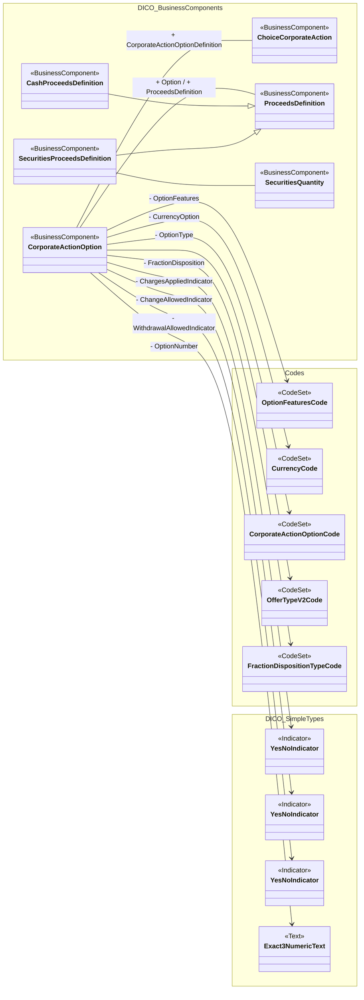

# CorporateActionOption attributes and proceeds

[src-000081](../../../../../../../../../raw-input/corporate_actions/ISO20022_MDRPart3_CorporateActions_2025_2026_v1.xlsx), CorporateActionOption!A1:S28; xl/drawings/drawing4.xml; anchor 1. Original image SHA-256: 37f5bf526a53f210226780d747f4e3a739a32aef6342407cb9c14ecd1f3bc7e6.

[Original complete figure](../../../../../../../assets/src-000081/media/image4.png) · [Rendered Mermaid SVG](../../../../../../../assets/src-000081/reconstructed/src-000081-fig-0004.svg) · [Rendered Mermaid PNG](../../../../../../../assets/src-000081/reconstructed/src-000081-fig-0004.png)

## Source reconstruction

## Entities and relationships

CorporateActionOption has directed attribute/type associations to charges/change/withdrawal indicators, currency and option code lists, feature and fraction-disposition code lists, offer type and option number. The source draws YesNoIndicator three times; the reconstruction retains three visible occurrences with one identical source label and package. Plain association links connect choice and proceeds. Cash and securities proceeds specialize ProceedsDefinition; securities proceeds link SecuritiesQuantity. The OfferTypeV2Code arrow is unlabelled in the artwork and remains so in the Mermaid graph.

All 15 visible node occurrences and 14 relationship lines are retained. No numeric multiplicity is shown in this source view, so none is inferred. Namespaces group the source’s printed “from” package labels for readability; the source did not draw those enclosing package boxes. Association labels retain literal +/− prefixes and combined end names. Their re-layout position is not additional navigability evidence. The native class inheritance marker is reserved for the source’s hollow-triangle generalizations. Source editor/navigation icons are omitted as interface decoration; no business entity or relationship is excluded.

## Complete relationship register

| From node | To node | Source relationship kind | Visible source label(s) | From-end multiplicity | To-end multiplicity |
| --- | --- | --- | --- | --- | --- |
| CorporateActionOption | ChargesIndicator | directed attribute/type association | - ChargesAppliedIndicator | not printed | not printed |
| CorporateActionOption | ChangeIndicator | directed attribute/type association | - ChangeAllowedIndicator | not printed | not printed |
| CorporateActionOption | WithdrawalIndicator | directed attribute/type association | - WithdrawalAllowedIndicator | not printed | not printed |
| CorporateActionOption | CurrencyCode | directed attribute/type association | - CurrencyOption | not printed | not printed |
| CorporateActionOption | CorporateActionOptionCode | directed attribute/type association | - OptionType | not printed | not printed |
| CorporateActionOption | OfferTypeV2Code | directed attribute/type association | (unlabelled in source) | not printed | not printed |
| CorporateActionOption | OptionFeaturesCode | directed attribute/type association | - OptionFeatures | not printed | not printed |
| CorporateActionOption | Exact3NumericText | directed attribute/type association | - OptionNumber | not printed | not printed |
| CorporateActionOption | FractionDispositionTypeCode | directed attribute/type association | - FractionDisposition | not printed | not printed |
| CorporateActionOption | ChoiceCorporateAction | association | + CorporateActionOptionDefinition | not printed | not printed |
| CorporateActionOption | ProceedsDefinition | association | + Option / + ProceedsDefinition | not printed | not printed |
| CashProceedsDefinition | ProceedsDefinition | generalization: subtype to supertype | (unlabelled in source) | not printed | not printed |
| SecuritiesProceedsDefinition | ProceedsDefinition | generalization: subtype to supertype | (unlabelled in source) | not printed | not printed |
| SecuritiesProceedsDefinition | SecuritiesQuantity | association | (unlabelled in source) | not printed | not printed |

## Entity definitions and precise workbook locators

| Visible label | Source package / stereotype | Definition evidence |
| --- | --- | --- |
| CorporateActionOption | DICO_BusinessComponents / BusinessComponent | [FullBusinessModel!A1152:D1152](../sheets/02-fullbusinessmodel/tbl-0007.md) — Provides information about the alternatives available to an account owner when participating to a corporate action event. This is defined at a general level without looking at the specificities of the securities balances. |
| ChoiceCorporateAction | DICO_BusinessComponents / BusinessComponent | [FullBusinessModel!A794:D794](../sheets/02-fullbusinessmodel/tbl-0005.md) — Mandatory with choice corporate action event that involves a choice on behalf of the owner of the securities. The shareholders are given a chance to choose among several options. |
| ProceedsDefinition | DICO_BusinessComponents / BusinessComponent | [FullBusinessModel!A3516:D3516](../sheets/02-fullbusinessmodel/tbl-0019.md) — Definition of exchanges of cash and/or securities available in the processing of corporate actions. |
| CashProceedsDefinition | DICO_BusinessComponents / BusinessComponent | [FullBusinessModel!A702:D702](../sheets/02-fullbusinessmodel/tbl-0005.md) — Definition of the cash proceeds for a corporate action in generic terms; that is, before applying it to specific securities holding. An example would be the definition of a dividend payment where all the information will be given in general on a per share basis. |
| SecuritiesProceedsDefinition | DICO_BusinessComponents / BusinessComponent | [FullBusinessModel!A4329:D4329](../sheets/02-fullbusinessmodel/tbl-0023.md) — The definition of the securities proceeds for a corporate action in generic terms; that is, before applying it to specific securities holding. An example would be the definition of a  bonus rights issue where all the information will be given in general on a per share basis. |
| SecuritiesQuantity | DICO_BusinessComponents / BusinessComponent | [FullBusinessModel!A4350:D4350](../sheets/02-fullbusinessmodel/tbl-0023.md) — Quantity of a security. |
| YesNoIndicator | DICO_SimpleTypes / Indicator | Label/type is shown by this figure; no independent component definition is asserted from the FullBusinessModel sheet. |
| YesNoIndicator | DICO_SimpleTypes / Indicator | Label/type is shown by this figure; no independent component definition is asserted from the FullBusinessModel sheet. |
| YesNoIndicator | DICO_SimpleTypes / Indicator | Label/type is shown by this figure; no independent component definition is asserted from the FullBusinessModel sheet. |
| Exact3NumericText | DICO_SimpleTypes / Text | Label/type is shown by this figure; no independent component definition is asserted from the FullBusinessModel sheet. |
| OptionFeaturesCode | Codes / CodeSet | Label/type is shown by this figure; no independent component definition is asserted from the FullBusinessModel sheet. |
| CurrencyCode | Codes / CodeSet | Label/type is shown by this figure; no independent component definition is asserted from the FullBusinessModel sheet. |
| CorporateActionOptionCode | Codes / CodeSet | Label/type is shown by this figure; no independent component definition is asserted from the FullBusinessModel sheet. |
| OfferTypeV2Code | Codes / CodeSet | Label/type is shown by this figure; no independent component definition is asserted from the FullBusinessModel sheet. |
| FractionDispositionTypeCode | Codes / CodeSet | Label/type is shown by this figure; no independent component definition is asserted from the FullBusinessModel sheet. |

## Participant and flow navigation

This is a conceptual entity model, not a message exchange diagram. A business component or relationship label is not automatically a functional participant or institution. [Message-set participant references](../../../participants.md) and [Message-set business flows](../../../flows/index.md) provide the independently sourced actor/process context. These references are navigational; source figure associations do not establish message direction.

## Rendering and visual review

2026-11-09: Mermaid 12.3.0 parsed and rendered successfully with Mermaid browser API + Chromium 156.0.8078.81. Visually compared original complete source figure with final rendered PNG, checking every entity occurrence, package/stereotype, association endpoint, arrow type, inheritance direction and literal label. All23/26/14/16 lines respectively reconciled in explicit relationship registers. [Renderer evidence](../../../../../../../../../work/corporate-workbook-models/render-report.json).

