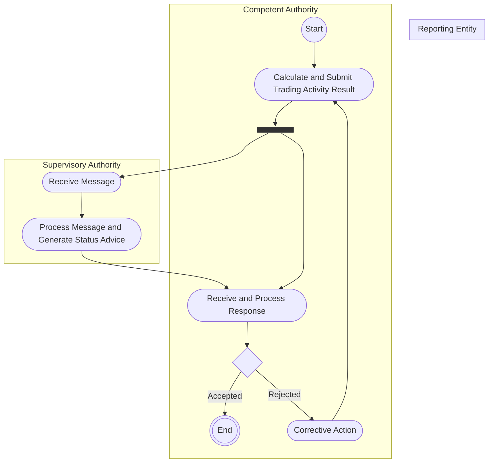

# Trading activity results

[src-000320](../../../../../../../../raw-input/transactions_and_financial_instruments_data_reporting_fitrr/ISO20022_MDRPart1_FITRR_TransactionAndFinancialInstrumentsDataReporting_FastTrackMaintenance2025_v2.docx); direct-body paragraph P158; Description of BusinessActivities / Transparency Reporting / Transparency Result Data.

[Original source figure](../../../../../../assets/src-000320/originals/image14.emf) · [Readable original preview](../../../../../../assets/src-000320/derived-previews/image14.emf.png) · [Reusable business flow](../../flows/flow-src-000320-p157-transparency-result-data.md)

## Source reconstruction

## Activities, actors and control paths

| Node | Responsible source lane | Literal source label | Source shape |
| --- | --- | --- | --- |
| start | Competent Authority | start | start |
| calculate | Competent Authority | Calculate and Submit Trading Activity Result | action |
| fork | Competent Authority | Source control bar | bar |
| receive | Supervisory Authority | Receive Message | action |
| process | Supervisory Authority | Process Message and Generate Status Advice | action |
| response | Competent Authority | Receive and Process Response | action |
| decision | Competent Authority | Unlabelled decision | decision |
| correct | Competent Authority | Corrective Action | action |
| endCA | Competent Authority | end | end |

| From | To | Source path condition |
| --- | --- | --- |
| start | calculate | Unlabelled |
| calculate | fork | Unlabelled |
| fork | receive | Unlabelled |
| fork | response | Unlabelled |
| receive | process | Unlabelled |
| process | response | Unlabelled |
| response | decision | Unlabelled |
| decision | endCA | Accepted |
| decision | correct | Rejected |
| correct | calculate | Unlabelled |

## Responsibilities from the activity table

[T29](../../documents/src-000320/tables/tbl-0029.md) preserves every action description and source Initiator value.

## Qualifications

- Mermaid flowchart subgraphs preserve the source swimlanes. Dark bar nodes retain each source control bar and all connected edges; they are not silently flattened into exclusive decisions. Source start/final symbols become labelled circles; blank source decisions remain unlabelled.
- Node IDs in the edge table distinguish otherwise repeated labels. The source original is retained for exact geometry; no additional business path or timing is inferred.
- The Reporting Entity lane is empty. T18 Role names SA while this picture, T29 and P233–P235 assign calculation/submission to CA; issue-000032.

## Rendering and visual review

Mermaid 12.3.0 with Mermaid browser API + Chromium 156.0.8078.81 parsed and rendered this diagram. On 2026-11-09 (Europe/Warsaw), the original and final reconstruction were directly compared for labels, actors, lane responsibility, all endpoints/directions, guards, parallel bars and corrective loops. Result: **visible-source fidelity pass**. Source conflicts remain open where listed.

[Rendered SVG](../../../../../../assets/src-000320/reconstructed-activities/fig-0014.svg) · [Rendered PNG](../../../../../../assets/src-000320/reconstructed-activities/fig-0014.png) · [Hash-bound review evidence](../../../../../../../../tracking/reviews/fitrr-activities.json)

Source notation: [T22 legend](../../documents/src-000320/tables/tbl-0022.md) defines a bar as initiating several actions in parallel. The reconstruction retains these nodes; empty source swimlanes may render as labels rather than a full-height box.
