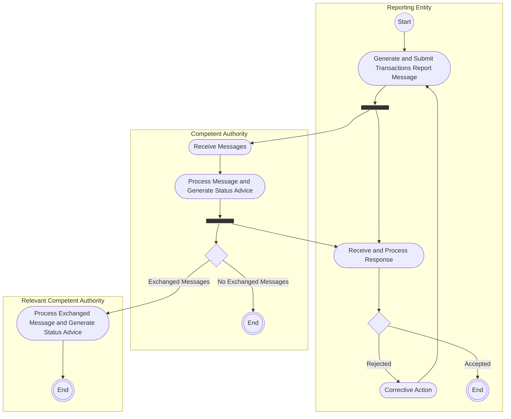

# Transaction reporting and authority exchange

[src-000320](../../../../../../../../raw-input/transactions_and_financial_instruments_data_reporting_fitrr/ISO20022_MDRPart1_FITRR_TransactionAndFinancialInstrumentsDataReporting_FastTrackMaintenance2025_v2.docx); direct-body paragraph P163; Description of BusinessActivities / Transaction Reporting / Financial Instrument Transaction Report.

[Original source figure](../../../../../../assets/src-000320/originals/image16.png) · [Readable original preview](../../../../../../assets/src-000320/originals/image16.png) · [Reusable business flow](../../flows/flow-src-000320-p162-financial-instrument-transaction-report.md)

## Source reconstruction

## Activities, actors and control paths

| Node | Responsible source lane | Literal source label | Source shape |
| --- | --- | --- | --- |
| start | Reporting Entity | start | start |
| submit | Reporting Entity | Generate and Submit Transactions Report Message | action |
| forkRE | Reporting Entity | Source control bar | bar |
| receive | Competent Authority | Receive Messages | action |
| process | Competent Authority | Process Message and Generate Status Advice | action |
| forkCA | Competent Authority | Source control bar | bar |
| response | Reporting Entity | Receive and Process Response | action |
| accepted | Reporting Entity | Unlabelled decision | decision |
| correct | Reporting Entity | Corrective Action | action |
| endRE | Reporting Entity | end | end |
| exchange | Competent Authority | Unlabelled decision | decision |
| endCA | Competent Authority | end | end |
| processRCA | Relevant Competent Authority | Process Exchanged Message and Generate Status Advice | action |
| endRCA | Relevant Competent Authority | end | end |

| From | To | Source path condition |
| --- | --- | --- |
| start | submit | Unlabelled |
| submit | forkRE | Unlabelled |
| forkRE | receive | Unlabelled |
| forkRE | response | Unlabelled |
| receive | process | Unlabelled |
| process | forkCA | Unlabelled |
| forkCA | response | Unlabelled |
| forkCA | exchange | Unlabelled |
| exchange | processRCA | Exchanged Messages |
| exchange | endCA | No Exchanged Messages |
| processRCA | endRCA | Unlabelled |
| response | accepted | Unlabelled |
| accepted | correct | Rejected |
| accepted | endRE | Accepted |
| correct | submit | Unlabelled |

## Responsibilities from the activity table

[T31](../../documents/src-000320/tables/tbl-0031.md) preserves every action description and source Initiator value.

## Qualifications

- Mermaid flowchart subgraphs preserve the source swimlanes. Dark bar nodes retain each source control bar and all connected edges; they are not silently flattened into exclusive decisions. Source start/final symbols become labelled circles; blank source decisions remain unlabelled.
- Node IDs in the edge table distinguish otherwise repeated labels. The source original is retained for exact geometry; no additional business path or timing is inferred.
- The activity picture ends after the Relevant Competent Authority generates status; it does not draw a return arrow. Sequence figure36 separately shows that response. The source label Transactions Report Message is preserved, though T31 uses Transaction Report Message.

## Rendering and visual review

Mermaid 12.3.0 with Mermaid browser API + Chromium 156.0.8078.81 parsed and rendered this diagram. On 2026-11-09 (Europe/Warsaw), the original and final reconstruction were directly compared for labels, actors, lane responsibility, all endpoints/directions, guards, parallel bars and corrective loops. Result: **visible-source fidelity pass**. Source conflicts remain open where listed.

[Rendered SVG](../../../../../../assets/src-000320/reconstructed-activities/fig-0016.svg) · [Rendered PNG](../../../../../../assets/src-000320/reconstructed-activities/fig-0016.png) · [Hash-bound review evidence](../../../../../../../../tracking/reviews/fitrr-activities.json)

Source notation: [T22 legend](../../documents/src-000320/tables/tbl-0022.md) defines a bar as initiating several actions in parallel. The reconstruction retains these nodes; empty source swimlanes may render as labels rather than a full-height box.
