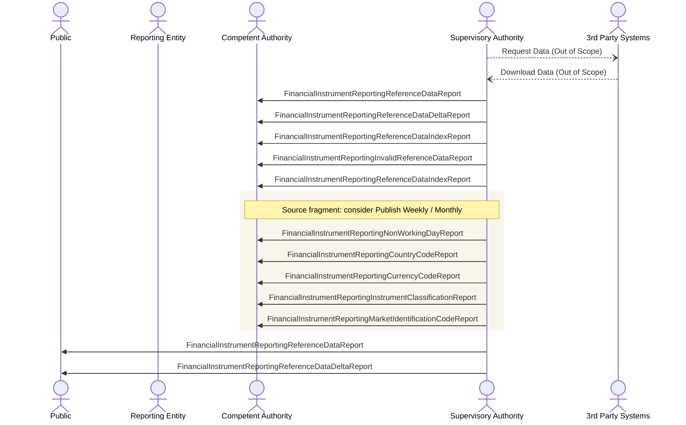

# Reference data distribution

[src-000320](../../../../../../../../raw-input/transactions_and_financial_instruments_data_reporting_fitrr/ISO20022_MDRPart1_FITRR_TransactionAndFinancialInstrumentsDataReporting_FastTrackMaintenance2025_v2.docx); direct-body paragraph P200; BusinessTransactions / Data Distribution BusinessTransaction .

[Original image](../../../../../../assets/src-000320/originals/image23.emf) · [Readable original preview](../../../../../../assets/src-000320/derived-previews/image23.emf.png) · [Flow, conditions and narrative responsibilities](../../flows/flow-src-000320-p198-data-distribution-business-transaction.md)

## Source reconstruction

## Actors and relationships

- [Public](../../../../../../../../shared/reference/participants/participant-src-000320-public.md)
- [Reporting Entity](../../../../../../../../shared/reference/participants/participant-src-000320-reporting-entity.md)
- [Competent Authority](../../../../../../../../shared/reference/participants/participant-src-000320-competent-authority.md)
- [Supervisory Authority](../../../../../../../../shared/reference/participants/participant-src-000320-supervisory-authority.md)
- [3rd Party Systems](../../../../../../../../shared/reference/participants/participant-src-000320-third-party-systems.md)

| Order | Sender | Receiver | Literal source message / exchange | Source condition or fragment |
| --- | --- | --- | --- | --- |
| 1 | Supervisory Authority | 3rd Party Systems | Request Data (Out of Scope) | Outside conditional frame |
| 2 | 3rd Party Systems | Supervisory Authority | Download Data (Out of Scope) | Outside conditional frame |
| 3 | Supervisory Authority | Competent Authority | FinancialInstrumentReportingReferenceDataReport | Outside conditional frame |
| 4 | Supervisory Authority | Competent Authority | FinancialInstrumentReportingReferenceDataDeltaReport | Outside conditional frame |
| 5 | Supervisory Authority | Competent Authority | FinancialInstrumentReportingReferenceDataIndexReport | Outside conditional frame |
| 6 | Supervisory Authority | Competent Authority | FinancialInstrumentReportingInvalidReferenceDataReport | Outside conditional frame |
| 7 | Supervisory Authority | Competent Authority | FinancialInstrumentReportingReferenceDataIndexReport | Outside conditional frame |
| 8 | Supervisory Authority | Competent Authority | FinancialInstrumentReportingNonWorkingDayReport | rgb(248, 245, 235) |
| 9 | Supervisory Authority | Competent Authority | FinancialInstrumentReportingCountryCodeReport | rgb(248, 245, 235) |
| 10 | Supervisory Authority | Competent Authority | FinancialInstrumentReportingCurrencyCodeReport | rgb(248, 245, 235) |
| 11 | Supervisory Authority | Competent Authority | FinancialInstrumentReportingInstrumentClassificationReport | rgb(248, 245, 235) |
| 12 | Supervisory Authority | Competent Authority | FinancialInstrumentReportingMarketIdentificationCodeReport | rgb(248, 245, 235) |
| 13 | Supervisory Authority | Public | FinancialInstrumentReportingReferenceDataReport | Outside conditional frame |
| 14 | Supervisory Authority | Public | FinancialInstrumentReportingReferenceDataDeltaReport | Outside conditional frame |

The source activation bars are execution markers without specified duration. Vertical message ordering is retained; synchronous versus asynchronous transport behavior is not inferred. OR-labelled message alternatives remain alternatives, not two required transmissions.

## Qualifications

- The source consider operator has no native Mermaid sequence equivalent. A shaded group plus an explicit note retains the exact operator and label; it is not recast as opt or a mandatory publication schedule.
- ReferenceDataIndexReport occurs twice from SA to CA and both arrows are retained. The two final arrows go to Public (full report, then delta report). The Reporting Entity lifeline is present but has no connected arrow in this picture.
- Request Data and Download Data are explicitly out of scope. No ISO message identifier is assigned to those arrows.

## Rendering and visual review

Mermaid 12.3.0 with Mermaid browser API + Chromium 156.0.8078.81 parsed and rendered this reconstruction. The original and rendered PNG were directly compared on 2026-11-09 (Europe/Warsaw), checking labels, endpoints, order, branches and repeated exchanges. Result: **pass-with-documented-notation-limitations**.

[Rendered SVG](../../../../../../assets/src-000320/reconstructed-sequences/fig-0023.svg) · [Rendered PNG](../../../../../../assets/src-000320/reconstructed-sequences/fig-0023.png) · [Hash-bound visual-review evidence](../../../../../../../../tracking/reviews/fitrr-sequences.json)

This review does not resolve conflicting source statements or native hidden-content coverage.
