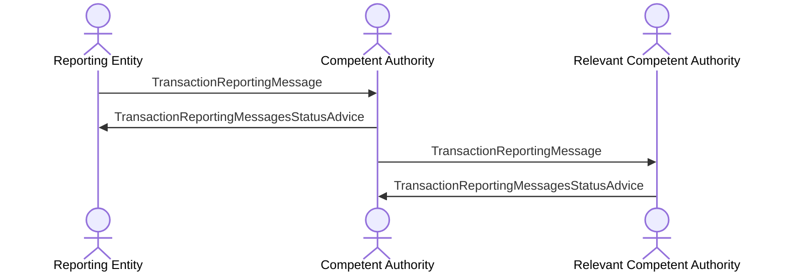

# Transaction reporting and authority exchange

[src-000320](../../../../../../../../raw-input/transactions_and_financial_instruments_data_reporting_fitrr/ISO20022_MDRPart1_FITRR_TransactionAndFinancialInstrumentsDataReporting_FastTrackMaintenance2025_v2.docx); direct-body paragraph P250; BusinessTransactions / Transaction Reporting / Financial Instrument Transaction Report.

[Original image](../../../../../../assets/src-000320/originals/image36.emf) · [Readable original preview](../../../../../../assets/src-000320/derived-previews/image36.emf.png) · [Flow, conditions and narrative responsibilities](../../flows/flow-src-000320-p248-financial-instrument-transaction-report.md)

## Source reconstruction

## Actors and relationships

- [Reporting Entity](../../../../../../../../shared/reference/participants/participant-src-000320-reporting-entity.md)
- [Competent Authority](../../../../../../../../shared/reference/participants/participant-src-000320-competent-authority.md)
- [Relevant Competent Authority](../../../../../../../../shared/reference/participants/participant-src-000320-relevant-ca.md)

| Order | Sender | Receiver | Literal source message / exchange | Source condition or fragment |
| --- | --- | --- | --- | --- |
| 1 | Reporting Entity | Competent Authority | TransactionReportingMessage | Outside conditional frame |
| 2 | Competent Authority | Reporting Entity | TransactionReportingMessagesStatusAdvice | Outside conditional frame |
| 3 | Competent Authority | Relevant Competent Authority | TransactionReportingMessage | Outside conditional frame |
| 4 | Relevant Competent Authority | Competent Authority | TransactionReportingMessagesStatusAdvice | Outside conditional frame |

The source activation bars are execution markers without specified duration. Vertical message ordering is retained; synchronous versus asynchronous transport behavior is not inferred. OR-labelled message alternatives remain alternatives, not two required transmissions.

## Qualifications

- TransactionReportingMessage and TransactionReportingMessagesStatusAdvice are literal picture labels. T7 identifies the transaction-reporting family auth.016; the generic status label is not silently equated with auth.031.

## Rendering and visual review

Mermaid 12.3.0 with Mermaid browser API + Chromium 156.0.8078.81 parsed and rendered this reconstruction. The original and rendered PNG were directly compared on 2026-11-09 (Europe/Warsaw), checking labels, endpoints, order, branches and repeated exchanges. Result: **pass**.

[Rendered SVG](../../../../../../assets/src-000320/reconstructed-sequences/fig-0036.svg) · [Rendered PNG](../../../../../../assets/src-000320/reconstructed-sequences/fig-0036.png) · [Hash-bound visual-review evidence](../../../../../../../../tracking/reviews/fitrr-sequences.json)

This review does not resolve conflicting source statements or native hidden-content coverage.
