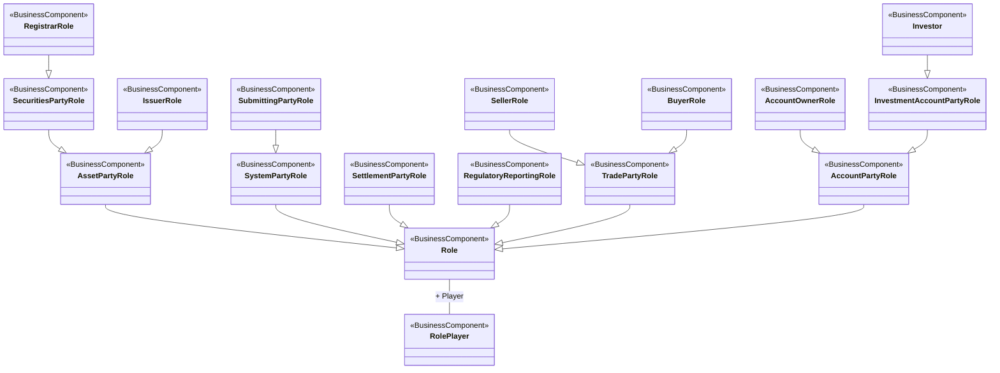

# FITRR role players and contextual business roles

[src-000322](../../../../../../../../../raw-input/transactions_and_financial_instruments_data_reporting_fitrr/ISO20022_MDRPart3_FITRR_TransactionAndFinancialInstrumentsDataReporting_FastTrackMaintenance2025_v1.xlsx), RolePlayers!A1:AA28; xl/drawings/drawing2.xml; anchor 1. Original image SHA-256: 8616b311320e7462eb3f488a3f29a5a3d4be3641ca137b20d96ed0cbc16270d7.

[Original complete figure](../../../../../../../assets/src-000322/media/image2.png) · [Rendered Mermaid SVG](../../../../../../../assets/src-000322/reconstructed/src-000322-fig-0002.svg) · [Rendered Mermaid PNG](../../../../../../../assets/src-000322/reconstructed/src-000322-fig-0002.png)

## Source reconstruction

## Entities and relationships

Role is associated with RolePlayer by Player; roles and the entities playing them remain distinct. Role generalizes asset, system, settlement, regulatory-reporting, trade and account roles. SecuritiesPartyRole and IssuerRole specialize AssetPartyRole; RegistrarRole further specializes SecuritiesPartyRole. SubmittingPartyRole specializes SystemPartyRole, buyer/seller specialize trade role, account owner and investment-account party specialize account role, and investor specializes investment-account party role. No message direction or permanent institution identity follows from this hierarchy.

All 17 visible node occurrences and 16 relationship lines are retained. No numeric multiplicity is shown in this source view, so none is inferred. Printed package labels are preserved in the entity register. Nodes without a printed package remain explicitly unqualified in that register; no enclosing package boundaries are invented. Association labels retain literal +/− prefixes and combined end names. Their re-layout position is not additional navigability evidence. The native class inheritance marker is reserved for the source’s hollow-triangle generalizations. Source editor/navigation icons are omitted as interface decoration; no business entity or relationship is excluded.

## Complete relationship register

| From node | To node | Source relationship kind | Visible source label(s) | From-end multiplicity | To-end multiplicity |
| --- | --- | --- | --- | --- | --- |
| Role | RolePlayer | association | + Player | not printed | not printed |
| AssetPartyRole | Role | generalization: subtype to supertype | (unlabelled in source) | not printed | not printed |
| SystemPartyRole | Role | generalization: subtype to supertype | (unlabelled in source) | not printed | not printed |
| SettlementPartyRole | Role | generalization: subtype to supertype | (unlabelled in source) | not printed | not printed |
| RegulatoryReportingRole | Role | generalization: subtype to supertype | (unlabelled in source) | not printed | not printed |
| TradePartyRole | Role | generalization: subtype to supertype | (unlabelled in source) | not printed | not printed |
| AccountPartyRole | Role | generalization: subtype to supertype | (unlabelled in source) | not printed | not printed |
| SecuritiesPartyRole | AssetPartyRole | generalization: subtype to supertype | (unlabelled in source) | not printed | not printed |
| IssuerRole | AssetPartyRole | generalization: subtype to supertype | (unlabelled in source) | not printed | not printed |
| RegistrarRole | SecuritiesPartyRole | generalization: subtype to supertype | (unlabelled in source) | not printed | not printed |
| SubmittingPartyRole | SystemPartyRole | generalization: subtype to supertype | (unlabelled in source) | not printed | not printed |
| SellerRole | TradePartyRole | generalization: subtype to supertype | (unlabelled in source) | not printed | not printed |
| BuyerRole | TradePartyRole | generalization: subtype to supertype | (unlabelled in source) | not printed | not printed |
| AccountOwnerRole | AccountPartyRole | generalization: subtype to supertype | (unlabelled in source) | not printed | not printed |
| InvestmentAccountPartyRole | AccountPartyRole | generalization: subtype to supertype | (unlabelled in source) | not printed | not printed |
| Investor | InvestmentAccountPartyRole | generalization: subtype to supertype | (unlabelled in source) | not printed | not printed |

## Entity definitions and precise workbook locators

| Visible label | Source package / stereotype | Definition evidence |
| --- | --- | --- |
| Role | DICO_BusinessComponents / BusinessComponent | [FullBusinessModel!A3808:D3808](../sheets/02-fullbusinessmodel/tbl-0021.md) — Role of a party in an activity. |
| RolePlayer | DICO_BusinessComponents / BusinessComponent | [FullBusinessModel!A3814:D3814](../sheets/02-fullbusinessmodel/tbl-0021.md) — Type of entity that plays a specific role in a specific context. |
| AssetPartyRole | DICO_BusinessComponents / BusinessComponent | [FullBusinessModel!A313:D313](../sheets/02-fullbusinessmodel/tbl-0003.md) — Specifies roles played by a party that are linked to the handling of assets but not related to a specific process. |
| SystemPartyRole | DICO_BusinessComponents / BusinessComponent | [FullBusinessModel!A4927:D4927](../sheets/02-fullbusinessmodel/tbl-0026.md) — Role played by a party in a system. |
| SettlementPartyRole | DICO_BusinessComponents / BusinessComponent | [FullBusinessModel!A4715:D4715](../sheets/02-fullbusinessmodel/tbl-0025.md) — Role played by a party in a settlement process. |
| RegulatoryReportingRole | DICO_BusinessComponents / BusinessComponent | [FullBusinessModel!A3752:D3752](../sheets/02-fullbusinessmodel/tbl-0020.md) — Party which plays a role for regulatory reporting. |
| TradePartyRole | DICO_BusinessComponents / BusinessComponent | [FullBusinessModel!A5108:D5108](../sheets/02-fullbusinessmodel/tbl-0027.md) — Trading party in a commercial, securities, treasury trade. This role may also represent parties which play different intermediary roles in a trade. |
| AccountPartyRole | DICO_BusinessComponents / BusinessComponent | [FullBusinessModel!A90:D90](../sheets/02-fullbusinessmodel/tbl-0002.md) — Role played by a party in the context of account operations. |
| SecuritiesPartyRole | not printed in figure / BusinessComponent | [FullBusinessModel!A4209:D4209](../sheets/02-fullbusinessmodel/tbl-0023.md) — Specifies roles played by a party that are linked to the handling of securities but not related to a specific process. |
| IssuerRole | DICO_BusinessComponents / BusinessComponent | [FullBusinessModel!A2501:D2501](../sheets/02-fullbusinessmodel/tbl-0014.md) — Legal entity that has the right to issue securities. |
| SubmittingPartyRole | DICO_BusinessComponents / BusinessComponent | [FullBusinessModel!A4823:D4823](../sheets/02-fullbusinessmodel/tbl-0026.md) — Specifies the party which submits trade data sets to a system or to a counterparty. |
| SellerRole | DICO_BusinessComponents / BusinessComponent | [FullBusinessModel!A4696:D4696](../sheets/02-fullbusinessmodel/tbl-0025.md) — Party that sells assets, goods or services. |
| BuyerRole | DICO_BusinessComponents / BusinessComponent | [FullBusinessModel!A464:D464](../sheets/02-fullbusinessmodel/tbl-0004.md) — Party that buys assets, good or services. |
| AccountOwnerRole | DICO_BusinessComponents / BusinessComponent | [FullBusinessModel!A89:D89](../sheets/02-fullbusinessmodel/tbl-0002.md) — Party that legally owns the account. |
| InvestmentAccountPartyRole | DICO_BusinessComponents / BusinessComponent | [FullBusinessModel!A2223:D2223](../sheets/02-fullbusinessmodel/tbl-0013.md) — Specifies roles played by a party that are related to an investment account. |
| RegistrarRole | not printed in figure / BusinessComponent | [FullBusinessModel!A3717:D3717](../sheets/02-fullbusinessmodel/tbl-0020.md) — Party responsible for keeping track of the owners of securities. |
| Investor | DICO_BusinessComponents / BusinessComponent | [FullBusinessModel!A2408:D2408](../sheets/02-fullbusinessmodel/tbl-0014.md) — Party which makes investment decisions in relation with its investment account. |

## Participant and flow navigation

This is a conceptual entity model, not a message exchange diagram. A business component or relationship label is not automatically a functional participant or institution. [Message-set participant references](../../../participants.md) and [Message-set business flows](../../../flows/index.md) provide the independently sourced actor/process context. These references are navigational; source figure associations do not establish message direction.

## Rendering and visual review

2026-11-09: Mermaid 12.3.0 parsed and rendered successfully with Mermaid browser API + Chromium 156.0.8078.81. Compared every entity, printed package/stereotype and relationship in the complete source and four readable source crops against final Mermaid render. Checked role generalizations, self-association, parallel issuance/debt quantity associations and benchmark/interest links. The overlapping Derivative–Asset inheritance/UnderlyingAsset route was reconciled against FullBusinessModel!A1545:F1546, which separately establishes both. No numeric multiplicity is printed; none added. [Renderer evidence](../../../../../../../../../work/fitrr-workbook-models/render-report.json).

