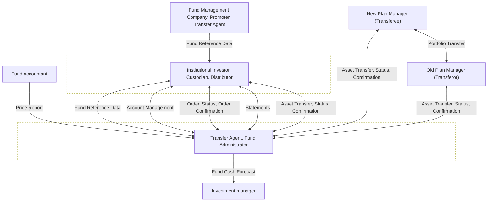

# Investment Funds communication scope

[src-000095](../../../../../../../../raw-input/investment_funds/ISO20022_MDRPart1_InvestmentFunds_2025_2026_v2.docx); direct-body paragraph P109; Scope and Functionality / Scope.

[Original source figure](../../../../../../assets/src-000095/originals/image1.png) · [Readable original preview](../../../../../../assets/src-000095/originals/image1.png) · [Complete Word-rendered page 7](../../../../../../assets/src-000095/word-render/page-007.png)

## Source reconstruction

## Source entities and relationships

| Occurrence | Literal source label |
| --- | --- |
| A | Fund Management Company, Promoter, Transfer Agent |
| B | Institutional Investor, Custodian, Distributor |
| C | Fund accountant |
| D | Transfer Agent, Fund Administrator |
| E | Investment manager |
| F | New Plan Manager (Transferee) |
| G | Old Plan Manager (Transferor) |

| Endpoint 1 | Endpoint 2 | Label | Connector |
| --- | --- | --- | --- |
| A | B | Fund Reference Data | --&gt; |
| C | D | Price Report | --&gt; |
| B | D | Fund Reference Data | &lt;--&gt; |
| B | D | Account Management | &lt;--&gt; |
| B | D | Order, Status, Order Confirmation | &lt;--&gt; |
| B | D | Statements | &lt;--&gt; |
| B | D | Asset Transfer, Status, Confirmation | &lt;--&gt; |
| D | E | Fund Cash Forecast | --&gt; |
| F | G | Portfolio Transfer | &lt;--&gt; |
| F | D | Asset Transfer, Status, Confirmation | &lt;--&gt; |
| G | D | Asset Transfer, Status, Confirmation | &lt;--&gt; |

## Participants

## Qualifications

- Grouped source labels remain grouped; their coexistence does not equate these institutions or functional roles. Source bank icons are presentation glyphs. Two dashed grouping rectangles surround B and D; they are not labelled systems, so no business system meaning is inferred. The textual edge list preserves the complete communication labels including repeated Status. This is a communication overview, not a timed sequence.

## Rendering and visual review

Mermaid 12.3.0 parsed and rendered successfully on 2026-11-09 with Mermaid browser API + Chromium 156.0.8078.81. [Rendered SVG](../../../../../../assets/src-000095/reconstructed-processes/fig-0001.svg) · [Rendered PNG](../../../../../../assets/src-000095/reconstructed-processes/fig-0001.png).

Original extracted picture and complete Word-rendered source page compared with rendered Mermaid PNG; checked actor occurrences, source labels, endpoints, arrowheads/plain lines, lane/control boundaries and alternatives. Complete-page composition checked in contact sheets; original pictures inspected at readable size. Review date: 2026-11-09. Source page 7.

The recorded review covers this bounded figure and its cited source context.

## Scoped participant references

- [participant-src-000095-fund-management-company](../../../../../../../../shared/reference/participants/participant-src-000095-fund-management-company.md)
- [participant-src-000095-promoter](../../../../../../../../shared/reference/participants/participant-src-000095-promoter.md)
- [participant-src-000095-transfer-agent](../../../../../../../../shared/reference/participants/participant-src-000095-transfer-agent.md)
- [participant-src-000095-institutional-investor](../../../../../../../../shared/reference/participants/participant-src-000095-institutional-investor.md)
- [participant-src-000095-custodian](../../../../../../../../shared/reference/participants/participant-src-000095-custodian.md)
- [participant-src-000095-distributor](../../../../../../../../shared/reference/participants/participant-src-000095-distributor.md)
- [participant-src-000095-fund-accountant](../../../../../../../../shared/reference/participants/participant-src-000095-fund-accountant.md)
- [participant-src-000095-fund-administrator](../../../../../../../../shared/reference/participants/participant-src-000095-fund-administrator.md)
- [participant-src-000095-investment-manager](../../../../../../../../shared/reference/participants/participant-src-000095-investment-manager.md)
- [participant-src-000095-transferor](../../../../../../../../shared/reference/participants/participant-src-000095-transferor.md)
- [participant-src-000095-transferee](../../../../../../../../shared/reference/participants/participant-src-000095-transferee.md)
