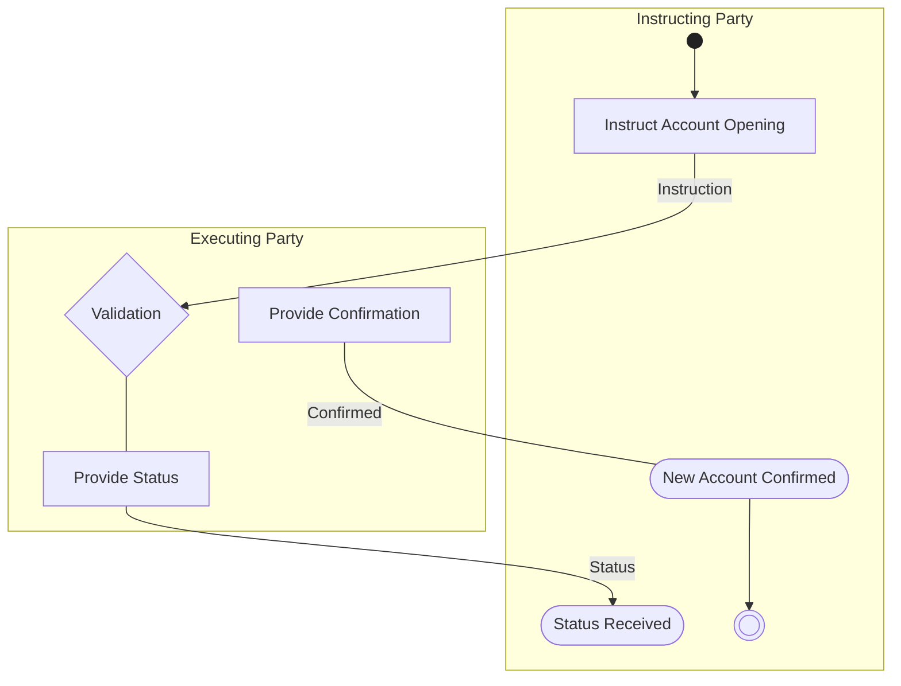

# Account Opening Flow

[src-000095](../../../../../../../../raw-input/investment_funds/ISO20022_MDRPart1_InvestmentFunds_2025_2026_v2.docx); direct-body paragraph P206; Description of BusinessActivities / Account Administration / Account Opening.

[Original source figure](../../../../../../assets/src-000095/originals/image9.png) · [Readable original preview](../../../../../../assets/src-000095/originals/image9.png) · [Complete Word-rendered page 26](../../../../../../assets/src-000095/word-render/page-026.png)

## Source reconstruction

## Activities and source connectors

| Node | Responsible lane | Literal label | Source shape |
| --- | --- | --- | --- |
| start | Instructing Party |  | start |
| instruct | Instructing Party | Instruct Account Opening | action |
| validation | Executing Party | Validation | decision |
| provideStatus | Executing Party | Provide Status | action |
| status | Instructing Party | Status Received | receive |
| provideConfirm | Executing Party | Provide Confirmation | action |
| confirmed | Instructing Party | New Account Confirmed | receive |
| end | Instructing Party |  | end |

| From / endpoint 1 | To / endpoint 2 | Label | Connector |
| --- | --- | --- | --- |
| start | instruct |  | arrow |
| instruct | validation | Instruction | arrow |
| validation | provideStatus |  | plain line |
| provideStatus | status | Status | arrow |
| provideConfirm | confirmed | Confirmed | plain line |
| confirmed | end |  | arrow |

[Reusable flow with source-defined conditions and responsibilities](../../flows/flow-src-000095-p205-account-opening.md)

## Participants

- [participant-src-000095-instructing-party](../../../../../../../../shared/reference/participants/participant-src-000095-instructing-party.md)
- [participant-src-000095-executing-party](../../../../../../../../shared/reference/participants/participant-src-000095-executing-party.md)
- [participant-src-000095-executing-party-registering-party](../../../../../../../../shared/reference/participants/participant-src-000095-executing-party-registering-party.md)

## Qualifications

- The source draws no connector between Provide Status and Provide Confirmation; no such edge is added. T37 supplies the acceptance condition and optional status semantics.
- Unlabelled plain source connectors are retained as undirected lines; business direction established by the activity table is described separately. Blank start/end and control symbols remain blank. Mermaid swimlanes preserve responsibility labels but not the exact source geometry.
- Mermaid final-state glyphs use an unfilled double circle instead of the source black-centred bullseye; final-state meaning and every endpoint are preserved, and originals retain exact glyph geometry.

## Rendering and visual review

Mermaid 12.3.0 parsed and rendered successfully on 2026-11-09 with Mermaid browser API + Chromium 156.0.8078.81. [Rendered SVG](../../../../../../assets/src-000095/reconstructed-processes/fig-0009.svg) · [Rendered PNG](../../../../../../assets/src-000095/reconstructed-processes/fig-0009.png).

Original extracted picture and complete Word-rendered source page compared with rendered Mermaid PNG; checked actor occurrences, source labels, endpoints, arrowheads/plain lines, lane/control boundaries and alternatives. Complete-page composition checked in contact sheets; original pictures inspected at readable size. Review date: 2026-11-09. Source page 26.

The recorded review covers this bounded figure and its cited source context.
