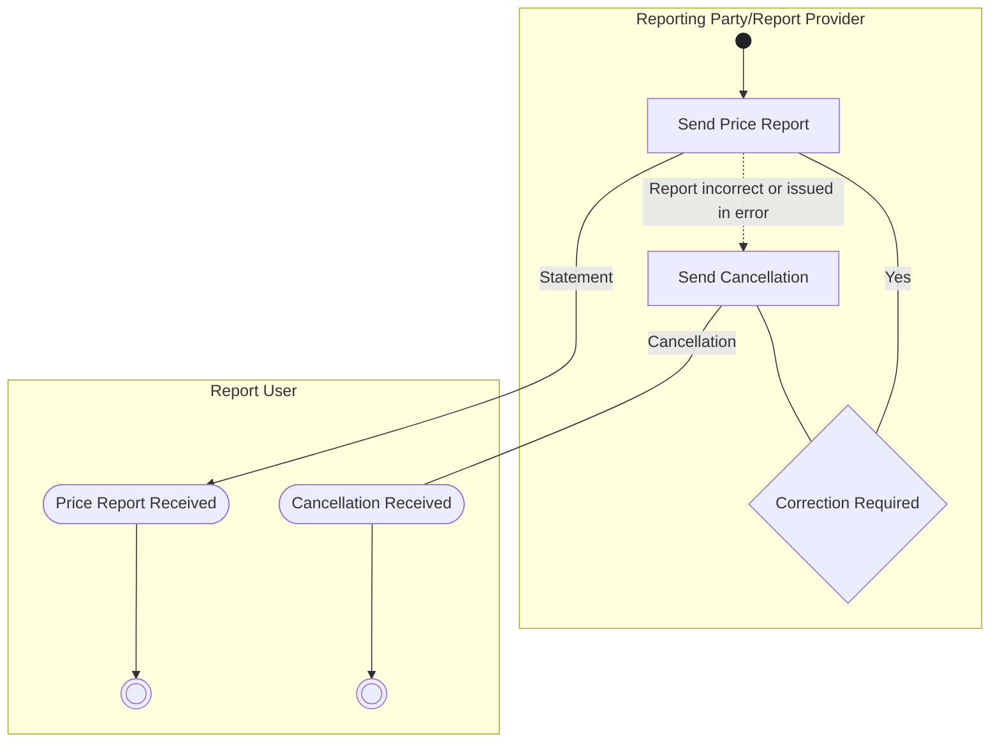

# Reporting Flow

[src-000095](../../../../../../../../raw-input/investment_funds/ISO20022_MDRPart1_InvestmentFunds_2025_2026_v2.docx); direct-body paragraph P211; Description of BusinessActivities / Reporting.

[Original source figure](../../../../../../assets/src-000095/originals/image11.png) · [Readable original preview](../../../../../../assets/src-000095/originals/image11.png) · [Complete Word-rendered page 28](../../../../../../assets/src-000095/word-render/page-028.png)

## Source reconstruction

## Activities and source connectors

| Node | Responsible lane | Literal label | Source shape |
| --- | --- | --- | --- |
| start | Reporting Party/Report Provider |  | start |
| report | Reporting Party/Report Provider | Send Price Report | action |
| received | Report User | Price Report Received | receive |
| endReport | Report User |  | end |
| cancel | Reporting Party/Report Provider | Send Cancellation | action |
| cancelReceived | Report User | Cancellation Received | receive |
| endCancel | Report User |  | end |
| correct | Reporting Party/Report Provider | Correction Required | decision |

| From / endpoint 1 | To / endpoint 2 | Label | Connector |
| --- | --- | --- | --- |
| start | report |  | arrow |
| report | received | Statement | arrow |
| received | endReport |  | arrow |
| report | cancel | Report incorrect or issued in error | dashed arrow |
| cancel | cancelReceived | Cancellation | plain line |
| cancelReceived | endCancel |  | arrow |
| cancel | correct |  | plain line |
| correct | report | Yes | plain line |

[Reusable flow with source-defined conditions and responsibilities](../../flows/flow-src-000095-p209-reporting.md)

## Participants

- [participant-src-000095-reporting-party](../../../../../../../../shared/reference/participants/participant-src-000095-reporting-party.md)
- [participant-src-000095-requesting-party](../../../../../../../../shared/reference/participants/participant-src-000095-requesting-party.md)

## Qualifications

- Statement is the literal source edge label although the nodes and T39 concern a price report. The error path is dashed; Correction Required has only a Yes branch. T39 supplies the reason requirement and replacement rule.
- Unlabelled plain source connectors are retained as undirected lines; business direction established by the activity table is described separately. Blank start/end and control symbols remain blank. Mermaid swimlanes preserve responsibility labels but not the exact source geometry.
- Mermaid final-state glyphs use an unfilled double circle instead of the source black-centred bullseye; final-state meaning and every endpoint are preserved, and originals retain exact glyph geometry.

## Rendering and visual review

Mermaid 12.3.0 parsed and rendered successfully on 2026-11-09 with Mermaid browser API + Chromium 156.0.8078.81. [Rendered SVG](../../../../../../assets/src-000095/reconstructed-processes/fig-0011.svg) · [Rendered PNG](../../../../../../assets/src-000095/reconstructed-processes/fig-0011.png).

Original extracted picture and complete Word-rendered source page compared with rendered Mermaid PNG; checked actor occurrences, source labels, endpoints, arrowheads/plain lines, lane/control boundaries and alternatives. Complete-page composition checked in contact sheets; original pictures inspected at readable size. Review date: 2026-11-09. Source page 28.

The recorded review covers this bounded figure and its cited source context.
