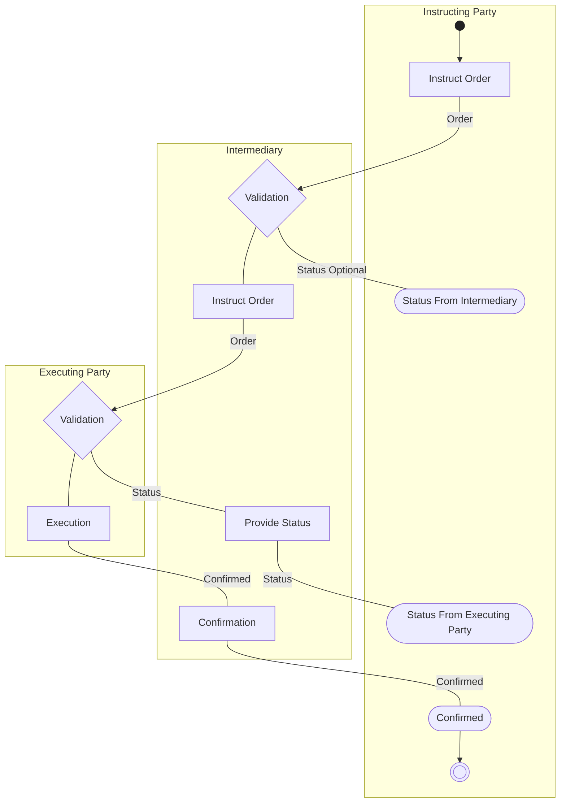

# Order Flow with Intermediary

[src-000095](../../../../../../../../raw-input/investment_funds/ISO20022_MDRPart1_InvestmentFunds_2025_2026_v2.docx); direct-body paragraph P214; Description of BusinessActivities / Order Processing.

[Original source figure](../../../../../../assets/src-000095/originals/image12.png) · [Readable original preview](../../../../../../assets/src-000095/originals/image12.png) · [Complete Word-rendered page 29](../../../../../../assets/src-000095/word-render/page-029.png)

## Source reconstruction

## Activities and source connectors

| Node | Responsible lane | Literal label | Source shape |
| --- | --- | --- | --- |
| start | Instructing Party |  | start |
| orderI | Instructing Party | Instruct Order | action |
| validateM | Intermediary | Validation | decision |
| statusM | Instructing Party | Status From Intermediary | receive |
| orderM | Intermediary | Instruct Order | action |
| validateE | Executing Party | Validation | decision |
| provideStatus | Intermediary | Provide Status | action |
| statusE | Instructing Party | Status From Executing Party | receive |
| execute | Executing Party | Execution | action |
| confirmation | Intermediary | Confirmation | action |
| confirmed | Instructing Party | Confirmed | receive |
| end | Instructing Party |  | end |

| From / endpoint 1 | To / endpoint 2 | Label | Connector |
| --- | --- | --- | --- |
| start | orderI |  | arrow |
| orderI | validateM | Order | arrow |
| validateM | statusM | Status Optional | plain line |
| validateM | orderM |  | plain line |
| orderM | validateE | Order | arrow |
| validateE | execute |  | plain line |
| validateE | provideStatus | Status | plain line |
| provideStatus | statusE | Status | plain line |
| execute | confirmation | Confirmed | plain line |
| confirmation | confirmed | Confirmed | plain line |
| confirmed | end |  | arrow |

[Reusable flow with source-defined conditions and responsibilities](../../flows/flow-src-000095-p212-order-processing.md)

## Participants

- [participant-src-000095-instructing-party](../../../../../../../../shared/reference/participants/participant-src-000095-instructing-party.md)
- [participant-src-000095-intermediary](../../../../../../../../shared/reference/participants/participant-src-000095-intermediary.md)
- [participant-src-000095-executing-party](../../../../../../../../shared/reference/participants/participant-src-000095-executing-party.md)

## Qualifications

- The picture places Status From Executing Party in the Instructing Party lane. T40 names Intermediary as initiator and says the intermediary receives this status; the source claims are retained separately rather than silently relabelling.
- Unlabelled plain source connectors are retained as undirected lines; business direction established by the activity table is described separately. Blank start/end and control symbols remain blank. Mermaid swimlanes preserve responsibility labels but not the exact source geometry.
- Mermaid final-state glyphs use an unfilled double circle instead of the source black-centred bullseye; final-state meaning and every endpoint are preserved, and originals retain exact glyph geometry.

## Rendering and visual review

Mermaid 12.3.0 parsed and rendered successfully on 2026-11-09 with Mermaid browser API + Chromium 156.0.8078.81. [Rendered SVG](../../../../../../assets/src-000095/reconstructed-processes/fig-0012.svg) · [Rendered PNG](../../../../../../assets/src-000095/reconstructed-processes/fig-0012.png).

Original extracted picture and complete Word-rendered source page compared with rendered Mermaid PNG; checked actor occurrences, source labels, endpoints, arrowheads/plain lines, lane/control boundaries and alternatives. Complete-page composition checked in contact sheets; original pictures inspected at readable size. Review date: 2026-11-09. Source page 29.

Source inconsistency remains open: issue-000041. Literal reconstruction does not resolve that evidence conflict.
