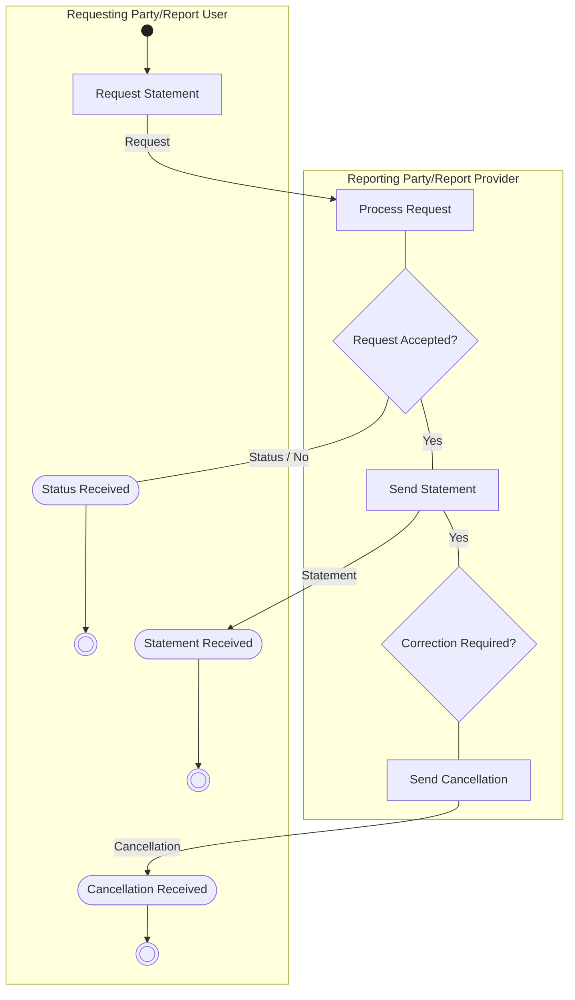

# Statement Flow

[src-000095](../../../../../../../../raw-input/investment_funds/ISO20022_MDRPart1_InvestmentFunds_2025_2026_v2.docx); direct-body paragraph P217; Description of BusinessActivities / Reconciliation (Statements) / Custody and Accounting.

[Original source figure](../../../../../../assets/src-000095/originals/image13.png) · [Readable original preview](../../../../../../assets/src-000095/originals/image13.png) · [Complete Word-rendered page 31](../../../../../../assets/src-000095/word-render/page-031.png)

## Source reconstruction

## Activities and source connectors

| Node | Responsible lane | Literal label | Source shape |
| --- | --- | --- | --- |
| start | Requesting Party/Report User |  | start |
| request | Requesting Party/Report User | Request Statement | action |
| process | Reporting Party/Report Provider | Process Request | action |
| accept | Reporting Party/Report Provider | Request Accepted? | decision |
| status | Requesting Party/Report User | Status Received | receive |
| endStatus | Requesting Party/Report User |  | end |
| statement | Reporting Party/Report Provider | Send Statement | action |
| received | Requesting Party/Report User | Statement Received | receive |
| endStatement | Requesting Party/Report User |  | end |
| correct | Reporting Party/Report Provider | Correction Required? | decision |
| cancel | Reporting Party/Report Provider | Send Cancellation | action |
| cancelReceived | Requesting Party/Report User | Cancellation Received | receive |
| endCancel | Requesting Party/Report User |  | end |

| From / endpoint 1 | To / endpoint 2 | Label | Connector |
| --- | --- | --- | --- |
| start | request |  | arrow |
| request | process | Request | arrow |
| process | accept |  | plain line |
| accept | status | Status / No | plain line |
| status | endStatus |  | arrow |
| accept | statement | Yes | plain line |
| statement | received | Statement | arrow |
| received | endStatement |  | arrow |
| statement | correct | Yes | plain line |
| correct | cancel |  | plain line |
| cancel | cancelReceived | Cancellation | arrow |
| cancelReceived | endCancel |  | arrow |

[Reusable flow with source-defined conditions and responsibilities](../../flows/flow-src-000095-p216-custody-and-accounting.md)

## Participants

- [participant-src-000095-requesting-party](../../../../../../../../shared/reference/participants/participant-src-000095-requesting-party.md)
- [participant-src-000095-reporting-party](../../../../../../../../shared/reference/participants/participant-src-000095-reporting-party.md)
- [participant-src-000095-requesting-party](../../../../../../../../shared/reference/participants/participant-src-000095-requesting-party.md)

## Qualifications

- Grey shading surrounds the optional pull request/status path; not all institutions support it. Push reporting enters at Send Statement (T41). The picture prints Yes on the connector between Send Statement and Correction Required? and draws no replacement loop; T41 separately specifies a new statement for incorrect information.
- Unlabelled plain source connectors are retained as undirected lines; business direction established by the activity table is described separately. Blank start/end and control symbols remain blank. Mermaid swimlanes preserve responsibility labels but not the exact source geometry.
- Mermaid final-state glyphs use an unfilled double circle instead of the source black-centred bullseye; final-state meaning and every endpoint are preserved, and originals retain exact glyph geometry.

## Rendering and visual review

Mermaid 12.3.0 parsed and rendered successfully on 2026-11-09 with Mermaid browser API + Chromium 156.0.8078.81. [Rendered SVG](../../../../../../assets/src-000095/reconstructed-processes/fig-0013.svg) · [Rendered PNG](../../../../../../assets/src-000095/reconstructed-processes/fig-0013.png).

Original extracted picture and complete Word-rendered source page compared with rendered Mermaid PNG; checked actor occurrences, source labels, endpoints, arrowheads/plain lines, lane/control boundaries and alternatives. Complete-page composition checked in contact sheets; original pictures inspected at readable size. Review date: 2026-11-09. Source page 31.

The recorded review covers this bounded figure and its cited source context.
