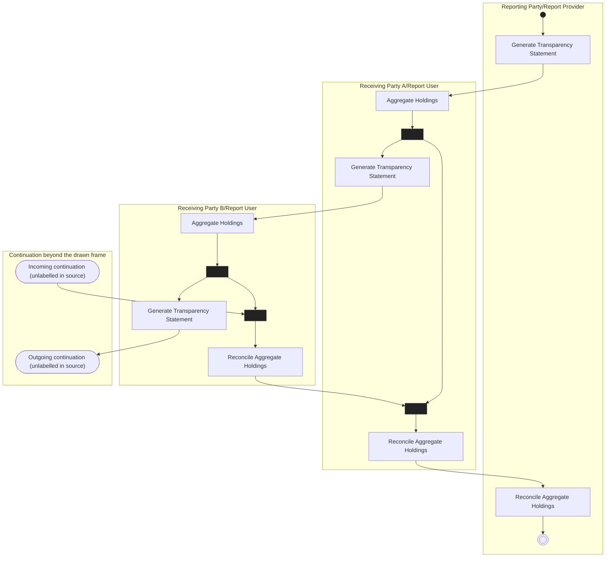

# Report Transparency of Holdings

[src-000095](../../../../../../../../raw-input/investment_funds/ISO20022_MDRPart1_InvestmentFunds_2025_2026_v2.docx); direct-body paragraph P219; Description of BusinessActivities / Reconciliation (Statements) / Transparency of Holdings.

[Original source figure](../../../../../../assets/src-000095/originals/image14.png) · [Readable original preview](../../../../../../assets/src-000095/originals/image14.png) · [Complete Word-rendered page 32](../../../../../../assets/src-000095/word-render/page-032.png)

## Source reconstruction

## Activities and source connectors

| Node | Responsible lane | Literal label | Source shape |
| --- | --- | --- | --- |
| start | Reporting Party/Report Provider |  | start |
| generateP | Reporting Party/Report Provider | Generate Transparency Statement | action |
| aggregateA | Receiving Party A/Report User | Aggregate Holdings | action |
| forkA | Receiving Party A/Report User |  | bar |
| generateA | Receiving Party A/Report User | Generate Transparency Statement | action |
| aggregateB | Receiving Party B/Report User | Aggregate Holdings | action |
| forkB | Receiving Party B/Report User |  | bar |
| generateB | Receiving Party B/Report User | Generate Transparency Statement | action |
| out | Continuation beyond the drawn frame | Outgoing continuation (unlabelled in source) | receive |
| in | Continuation beyond the drawn frame | Incoming continuation (unlabelled in source) | receive |
| mergeB | Receiving Party B/Report User |  | bar |
| reconcileB | Receiving Party B/Report User | Reconcile Aggregate Holdings | action |
| mergeA | Receiving Party A/Report User |  | bar |
| reconcileA | Receiving Party A/Report User | Reconcile Aggregate Holdings | action |
| reconcileP | Reporting Party/Report Provider | Reconcile Aggregate Holdings | action |
| end | Reporting Party/Report Provider |  | end |

| From / endpoint 1 | To / endpoint 2 | Label | Connector |
| --- | --- | --- | --- |
| start | generateP |  | arrow |
| generateP | aggregateA |  | arrow |
| aggregateA | forkA |  | arrow |
| forkA | generateA |  | arrow |
| generateA | aggregateB |  | arrow |
| aggregateB | forkB |  | arrow |
| forkB | generateB |  | arrow |
| generateB | out |  | arrow |
| forkB | mergeB |  | arrow |
| in | mergeB |  | arrow |
| mergeB | reconcileB |  | arrow |
| reconcileB | mergeA |  | arrow |
| forkA | mergeA |  | arrow |
| mergeA | reconcileA |  | arrow |
| reconcileA | reconcileP |  | arrow |
| reconcileP | end |  | arrow |

[Reusable flow with source-defined conditions and responsibilities](../../flows/flow-src-000095-p218-transparency-of-holdings.md)

## Participants

- [participant-src-000095-reporting-party](../../../../../../../../shared/reference/participants/participant-src-000095-reporting-party.md)
- [participant-src-000095-receiving-party-all-levels](../../../../../../../../shared/reference/participants/participant-src-000095-receiving-party-all-levels.md)

## Qualifications

- Two receiving occurrences represent distinct custody-chain levels. The right edge has an outgoing arrow and an incoming continuation without named external actors; explicit boundary nodes in this reconstruction are explanatory labels, not new source participants. Parallel bars and both return paths are retained.
- Unlabelled plain source connectors are retained as undirected lines; business direction established by the activity table is described separately. Blank start/end and control symbols remain blank. Mermaid swimlanes preserve responsibility labels but not the exact source geometry.
- Mermaid final-state glyphs use an unfilled double circle instead of the source black-centred bullseye; final-state meaning and every endpoint are preserved, and originals retain exact glyph geometry.
- Mermaid renders the four source fork/join bars as dark rectangular control nodes; their fork/join meaning and every incoming/outgoing connection are specified in the edge table. Original horizontal/vertical bar orientation is retained in the source artwork.

## Rendering and visual review

Mermaid 12.3.0 parsed and rendered successfully on 2026-11-09 with Mermaid browser API + Chromium 156.0.8078.81. [Rendered SVG](../../../../../../assets/src-000095/reconstructed-processes/fig-0014.svg) · [Rendered PNG](../../../../../../assets/src-000095/reconstructed-processes/fig-0014.png).

Original extracted picture and complete Word-rendered source page compared with rendered Mermaid PNG; checked actor occurrences, source labels, endpoints, arrowheads/plain lines, lane/control boundaries and alternatives. Complete-page composition checked in contact sheets; original pictures inspected at readable size. Review date: 2026-11-09. Source page 32.

The recorded review covers this bounded figure and its cited source context.
