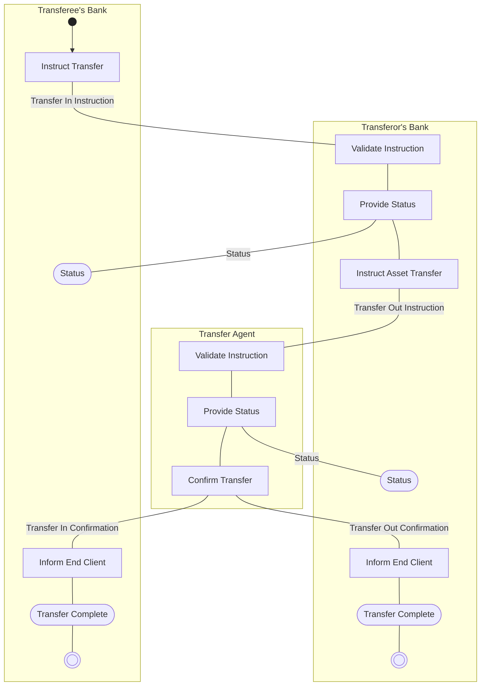

# Transfer Flow — Single Leg (from transfer agent perspective)

[src-000095](../../../../../../../../raw-input/investment_funds/ISO20022_MDRPart1_InvestmentFunds_2025_2026_v2.docx); direct-body paragraph P225; Description of BusinessActivities / Stock Transfers (Single Leg Transfer).

[Original source figure](../../../../../../assets/src-000095/originals/image15.png) · [Readable original preview](../../../../../../assets/src-000095/originals/image15.png) · [Complete Word-rendered page 34](../../../../../../assets/src-000095/word-render/page-034.png)

## Source reconstruction

## Activities and source connectors

| Node | Responsible lane | Literal label | Source shape |
| --- | --- | --- | --- |
| start | Transferee's Bank |  | start |
| instructN | Transferee's Bank | Instruct Transfer | action |
| validateO | Transferor's Bank | Validate Instruction | action |
| provideO | Transferor's Bank | Provide Status | action |
| statusN | Transferee's Bank | Status | receive |
| instructO | Transferor's Bank | Instruct Asset Transfer | action |
| validateA | Transfer Agent | Validate Instruction | action |
| provideA | Transfer Agent | Provide Status | action |
| statusO | Transferor's Bank | Status | receive |
| confirmA | Transfer Agent | Confirm Transfer | action |
| informO | Transferor's Bank | Inform End Client | action |
| informN | Transferee's Bank | Inform End Client | action |
| completeO | Transferor's Bank | Transfer Complete | receive |
| completeN | Transferee's Bank | Transfer Complete | receive |
| endO | Transferor's Bank |  | end |
| endN | Transferee's Bank |  | end |

| From / endpoint 1 | To / endpoint 2 | Label | Connector |
| --- | --- | --- | --- |
| start | instructN |  | arrow |
| instructN | validateO | Transfer In Instruction | plain line |
| validateO | provideO |  | plain line |
| provideO | statusN | Status | plain line |
| provideO | instructO |  | plain line |
| instructO | validateA | Transfer Out Instruction | plain line |
| validateA | provideA |  | plain line |
| provideA | statusO | Status | plain line |
| provideA | confirmA |  | plain line |
| confirmA | informO | Transfer Out Confirmation | plain line |
| confirmA | informN | Transfer In Confirmation | plain line |
| informO | completeO |  | plain line |
| informN | completeN |  | plain line |
| completeO | endO |  | plain line |
| completeN | endN |  | plain line |

[Reusable flow with source-defined conditions and responsibilities](../../flows/flow-src-000095-p221-stock-transfers-single-leg-transfer.md)

## Participants

- [participant-src-000095-transferee-s-bank-instructing-party](../../../../../../../../shared/reference/participants/participant-src-000095-transferee-s-bank-instructing-party.md)
- [participant-src-000095-transferor-s-bank-executing-party](../../../../../../../../shared/reference/participants/participant-src-000095-transferor-s-bank-executing-party.md)
- [participant-src-000095-transferor-s-bank-instructing-party](../../../../../../../../shared/reference/participants/participant-src-000095-transferor-s-bank-instructing-party.md)
- [participant-src-000095-transferee-s-bank-executing-party](../../../../../../../../shared/reference/participants/participant-src-000095-transferee-s-bank-executing-party.md)
- [participant-src-000095-transfer-agent](../../../../../../../../shared/reference/participants/participant-src-000095-transfer-agent.md)
- [participant-src-000095-end-client](../../../../../../../../shared/reference/participants/participant-src-000095-end-client.md)

## Qualifications

- All process connectors except the initial start arrow are plain lines in this artwork. Direction of named message exchanges is established separately by T43. End Client is mentioned in action labels and T43 but has no separate lane. T43 leaves the fourth activity Initiator blank.
- Unlabelled plain source connectors are retained as undirected lines; business direction established by the activity table is described separately. Blank start/end and control symbols remain blank. Mermaid swimlanes preserve responsibility labels but not the exact source geometry.
- Mermaid final-state glyphs use an unfilled double circle instead of the source black-centred bullseye; final-state meaning and every endpoint are preserved, and originals retain exact glyph geometry.

## Rendering and visual review

Mermaid 12.3.0 parsed and rendered successfully on 2026-11-09 with Mermaid browser API + Chromium 156.0.8078.81. [Rendered SVG](../../../../../../assets/src-000095/reconstructed-processes/fig-0015.svg) · [Rendered PNG](../../../../../../assets/src-000095/reconstructed-processes/fig-0015.png).

Original extracted picture and complete Word-rendered source page compared with rendered Mermaid PNG; checked actor occurrences, source labels, endpoints, arrowheads/plain lines, lane/control boundaries and alternatives. Complete-page composition checked in contact sheets; original pictures inspected at readable size. Review date: 2026-11-09. Source page 34.

The recorded review covers this bounded figure and its cited source context.
