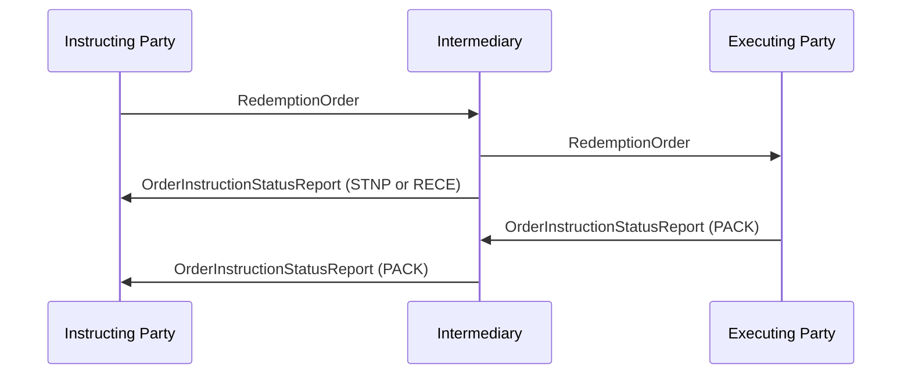

# Order Instruction Status Reporting / Redemption / Intermediary — figure 62

[src-000095](../../../../../../../../raw-input/investment_funds/ISO20022_MDRPart1_InvestmentFunds_2025_2026_v2.docx); direct-body paragraph P455; Word file/printed page 63.

[Original figure](../../../../../../assets/src-000095/originals/image62.png) · [Complete rendered page](../../../../../../assets/src-000095/word-render/page-063.png) · [Reusable flow](../../flows/flow-src-000095-p449-intermediary.md)

## Source reconstruction

## Participant occurrences

| Occurrence | Literal label | Scoped participant |
| --- | --- | --- |
| I | Instructing Party | [instructing-party](../../../../../../../../shared/reference/participants/participant-src-000095-instructing-party.md) |
| M | Intermediary | [intermediary](../../../../../../../../shared/reference/participants/participant-src-000095-intermediary.md) |
| E | Executing Party | [executing-party](../../../../../../../../shared/reference/participants/participant-src-000095-executing-party.md) |

## Ordered exchanges

| Step | Sender | Receiver | Literal message label |
| --- | --- | --- | --- |
| 1 | Instructing Party | Intermediary | RedemptionOrder |
| 2 | Intermediary | Executing Party | RedemptionOrder |
| 3 | Intermediary | Instructing Party | OrderInstructionStatusReport (STNP or RECE) |
| 4 | Executing Party | Intermediary | OrderInstructionStatusReport (PACK) |
| 5 | Intermediary | Instructing Party | OrderInstructionStatusReport (PACK) |

## Source qualifications and conditions

- P453: SLA requires executing party to send status; PACK is forwarded.
- Source bank icons denote named participants, not institutional identity of a functional role. Repeated instructing-party occurrences are distinct parties using the same role definition.
- Arrow direction and order follow the literal picture. Mermaid uses standard solid arrowheads rather than source open-head geometry; no additional synchrony, timing or network guarantee is inferred.
- Part1 message names/families do not establish exact versions; use maintained Part2/schema references.

## Rendering and visual review

Mermaid 12.3.0 parsed and rendered on 2026-11-09 with Mermaid browser API + Chromium 156.0.8078.81. [Rendered SVG](../../../../../../assets/src-000095/reconstructed-early-sequences/fig-0062.svg) · [Rendered PNG](../../../../../../assets/src-000095/reconstructed-early-sequences/fig-0062.png).

Every original figure inspected and compared directly with final rendered Mermaid PNG for participant occurrence, arrow direction, message label/code and order. Complete Word-page composition separately inspected in contact sheets for pages40–70; pages65–70 also inspected individually.

This bounded source reconstruction passed its recorded comparison.
