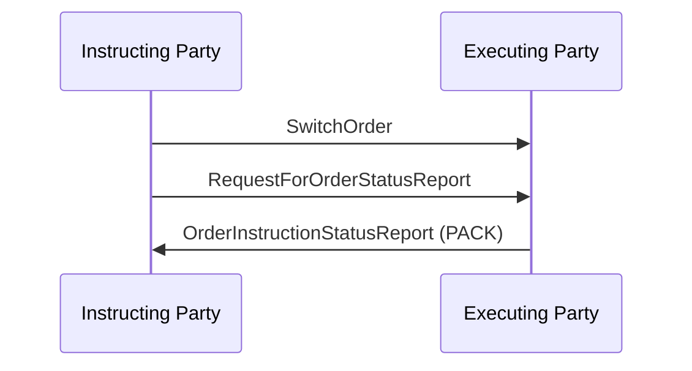

# Order Instruction Status Reporting / Order Instruction Status Request / Request Status of Switch — figure 68

[src-000095](../../../../../../../../raw-input/investment_funds/ISO20022_MDRPart1_InvestmentFunds_2025_2026_v2.docx); direct-body paragraph P490; Word file/printed page 66.

[Original figure](../../../../../../assets/src-000095/originals/image68.png) · [Complete rendered page](../../../../../../assets/src-000095/word-render/page-066.png) · [Reusable flow](../../flows/flow-src-000095-p486-request-status-of-switch.md)

## Source reconstruction

## Participant occurrences

| Occurrence | Literal label | Scoped participant |
| --- | --- | --- |
| I | Instructing Party | [instructing-party](../../../../../../../../shared/reference/participants/participant-src-000095-instructing-party.md) |
| E | Executing Party | [executing-party](../../../../../../../../shared/reference/participants/participant-src-000095-executing-party.md) |

## Ordered exchanges

| Step | Sender | Receiver | Literal message label |
| --- | --- | --- | --- |
| 1 | Instructing Party | Executing Party | SwitchOrder |
| 2 | Instructing Party | Executing Party | RequestForOrderStatusReport |
| 3 | Executing Party | Instructing Party | OrderInstructionStatusReport (PACK) |

## Source qualifications and conditions

- P489: PACK is an example status response.
- Source bank icons denote named participants, not institutional identity of a functional role. Repeated instructing-party occurrences are distinct parties using the same role definition.
- Arrow direction and order follow the literal picture. Mermaid uses standard solid arrowheads rather than source open-head geometry; no additional synchrony, timing or network guarantee is inferred.
- Part1 message names/families do not establish exact versions; use maintained Part2/schema references.

## Rendering and visual review

Mermaid 12.3.0 parsed and rendered on 2026-11-09 with Mermaid browser API + Chromium 156.0.8078.81. [Rendered SVG](../../../../../../assets/src-000095/reconstructed-early-sequences/fig-0068.svg) · [Rendered PNG](../../../../../../assets/src-000095/reconstructed-early-sequences/fig-0068.png).

Every original figure inspected and compared directly with final rendered Mermaid PNG for participant occurrence, arrow direction, message label/code and order. Complete Word-page composition separately inspected in contact sheets for pages40–70; pages65–70 also inspected individually.

This bounded source reconstruction passed its recorded comparison.
