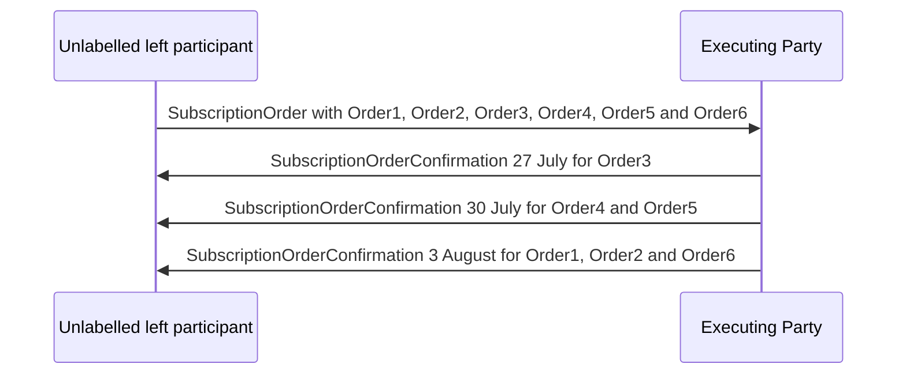

# Scenarios For Confirmations When 'Multiple’ Orders Specified in a Single Message — figure 71

[src-000095](../../../../../../../../raw-input/investment_funds/ISO20022_MDRPart1_InvestmentFunds_2025_2026_v2.docx); direct-body paragraph P501; Word file/printed page 68.

[Original figure](../../../../../../assets/src-000095/originals/image71.png) · [Complete rendered page](../../../../../../assets/src-000095/word-render/page-068.png) · [Reusable flow](../../flows/flow-src-000095-p491-scenarios-for-confirmations-when-multiple-orders-specified-in-a-single.md)

## Source reconstruction

## Participant occurrences

| Occurrence | Literal label | Scoped participant |
| --- | --- | --- |
| I | Unlabelled left participant | [instructing-party](../../../../../../../../shared/reference/participants/participant-src-000095-instructing-party.md) |
| E | Executing Party | [executing-party](../../../../../../../../shared/reference/participants/participant-src-000095-executing-party.md) |

## Ordered exchanges

| Step | Sender | Receiver | Literal message label |
| --- | --- | --- | --- |
| 1 | Unlabelled left participant | Executing Party | SubscriptionOrder with Order1, Order2, Order3, Order4, Order5 and Order6 |
| 2 | Executing Party | Unlabelled left participant | SubscriptionOrderConfirmation 27 July for Order3 |
| 3 | Executing Party | Unlabelled left participant | SubscriptionOrderConfirmation 30 July for Order4 and Order5 |
| 4 | Executing Party | Unlabelled left participant | SubscriptionOrderConfirmation 3 August for Order1, Order2 and Order6 |

## Source qualifications and conditions

- Source left icon is unlabelled; its displayed explanatory label is not source text. The instructing role comes from enclosing narrative. Dates are illustrative source dates without a year. P502 intentionally omits OrderInstructionStatusReport. Source order colours1–6: green, cyan, red, blue, brown, purple.
- Source bank icons denote named participants, not institutional identity of a functional role. Repeated instructing-party occurrences are distinct parties using the same role definition.
- Arrow direction and order follow the literal picture. Mermaid uses standard solid arrowheads rather than source open-head geometry; no additional synchrony, timing or network guarantee is inferred.
- Part1 message names/families do not establish exact versions; use maintained Part2/schema references.

## Rendering and visual review

Mermaid 12.3.0 parsed and rendered on 2026-11-09 with Mermaid browser API + Chromium 156.0.8078.81. [Rendered SVG](../../../../../../assets/src-000095/reconstructed-early-sequences/fig-0071.svg) · [Rendered PNG](../../../../../../assets/src-000095/reconstructed-early-sequences/fig-0071.png).

Every original figure inspected and compared directly with final rendered Mermaid PNG for participant occurrence, arrow direction, message label/code and order. Complete Word-page composition separately inspected in contact sheets for pages40–70; pages65–70 also inspected individually.

This bounded source reconstruction passed its recorded comparison.
