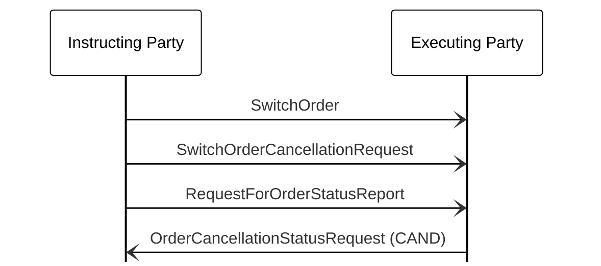

# Switch cancellation status query

[src-000095](../../../../../../../../raw-input/investment_funds/ISO20022_MDRPart1_InvestmentFunds_2025_2026_v2.docx); direct-body paragraph P591; BusinessTransactions / Order Cancellation and Status  / Order Cancellation Status Request / Request Status of Switch; `/w:document/w:body/w:p[591]`.

[Unchanged original figure](../../../../../../assets/src-000095/originals/image83.png)

## Mermaid source reconstruction

## Actors and message directions

| Step | Sender | Receiver | Literal picture label |
| --- | --- | --- | --- |
| 1 | Instructing Party | Executing Party | SwitchOrder |
| 2 | Instructing Party | Executing Party | SwitchOrderCancellationRequest |
| 3 | Instructing Party | Executing Party | RequestForOrderStatusReport |
| 4 | Executing Party | Instructing Party | OrderCancellationStatusRequest (CAND) |

- [Instructing Party](../../../../../../../../shared/reference/participants/participant-src-000095-instructing-party.md)
- [Executing Party](../../../../../../../../shared/reference/participants/participant-src-000095-executing-party.md)

[Reusable flow, conditions, outcomes and source narrative](../../flows/flow-src-000095-p586-request-status-of-switch.md)

## Source distinctions and limitations

- The final picture label is OrderCancellationStatusRequest (CAND); P590 names OrderCancellationStatusReport. Both claims remain visible.
- The source uses institutional pictograms for functional participants; native Mermaid lifeline boxes retain the labels without equating a functional role with one institution.
- Open source arrowheads are reproduced with native Mermaid open arrows. This visual notation choice does not establish additional transport or acknowledgement rules.
- The picture itself names messages without version numbers. Exact message references are matched separately through the supplied Part 2 headings; the mapping evidence and publication remain explicit.

[issue-000034 — Investment Funds source wording/order distinctions](../../../../../../../../tracking/issues.md)

## Rendering and visual review

Mermaid 12.3.0 parsed and rendered successfully using Mermaid browser API + Chromium 156.0.8078.81. [Rendered SVG](../../../../../../assets/src-000095/funds-sequences/fig-0083.svg) · [Rendered PNG](../../../../../../assets/src-000095/funds-sequences/fig-0083.png).

The unchanged source image and final reconstruction were directly compared on 2026-11-09 (Europe/Warsaw): participant instances, message labels, sender/receiver endpoints, vertical ordering and open arrowheads. Result: **visual relationship fidelity pass**. Recorded source wording/order differences remain unresolved as described above. The renderer’s UTC date is 2026-11-09.

[Hash-bound review evidence](../../../../../../../../tracking/reviews/funds-sequences.json)

<!-- FUNDS-WORD-LOCATOR-START -->
## Word-rendered source page and composite review

[Word-rendered file page 76](../../../../../../assets/src-000095/word-page-context/page-0076.png) was inspected in complete-page context on 2026-11-09. The asset identity also matches by SHA-256. The original image contains the displayed substantive figure; no additional external labels or omitted drawing objects were observed in its page surroundings. The two-panel message5 overview intentionally spans pages314–315 (figures146–147), linked separately.

This whole-page check complements the prior detailed original-image versus reconstruction review. Known local Word header-field errors are excluded from business evidence. [Hash-bound page-context review evidence](../../../../../../../../tracking/reviews/funds-second-half-word-context.json).
<!-- FUNDS-WORD-LOCATOR-END -->
