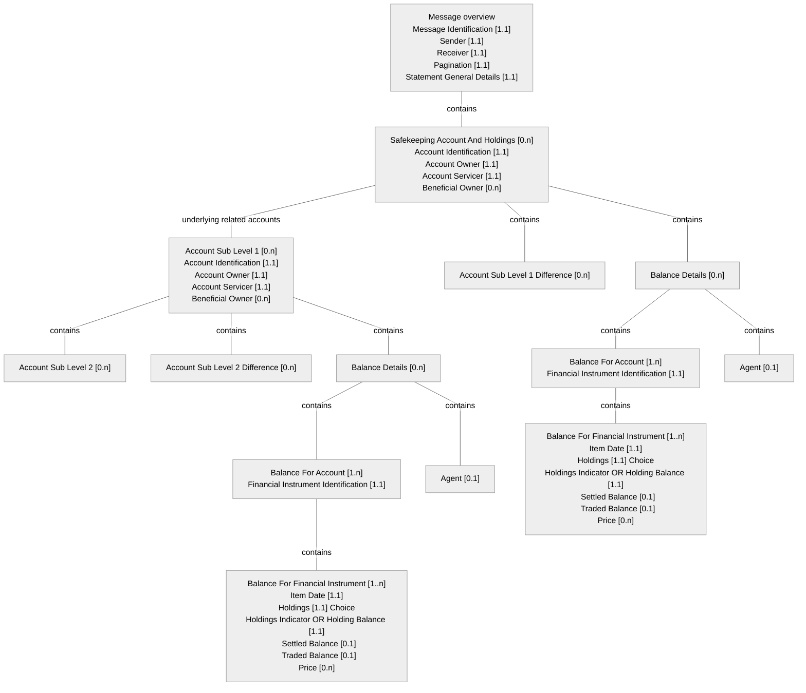

# Transparency report — source structural overview

[src-000095](../../../../../../../../raw-input/investment_funds/ISO20022_MDRPart1_InvestmentFunds_2025_2026_v2.docx); direct-body paragraph P5808; Business Examples / Transparency Of Holdings.

[Unchanged original image](../../../../../../assets/src-000095/originals/image142.png)

## Mermaid source reconstruction

## Complete label inventory

| Scoped diagram entity/block | Literal labels and values |
| --- | --- |
| M | Message overview Message Identification [1.1] Sender [1.1] Receiver [1.1] Pagination [1.1] Statement General Details [1.1] |
| S | Safekeeping Account And Holdings [0.n] Account Identification [1.1] Account Owner [1.1] Account Servicer [1.1] Beneficial Owner [0.n] |
| L1 | Account Sub Level 1 [0.n] Account Identification [1.1] Account Owner [1.1] Account Servicer [1.1] Beneficial Owner [0.n] |
| L2 | Account Sub Level 2 [0.n] |
| D2 | Account Sub Level 2 Difference [0.n] |
| D1 | Account Sub Level 1 Difference [0.n] |
| SB | Balance Details [0.n] |
| SBA | Balance For Account [1.n] Financial Instrument Identification [1.1] |
| SF | Balance For Financial Instrument [1..n] Item Date [1.1] Holdings [1.1] Choice Holdings Indicator OR Holding Balance [1.1]   Settled Balance [0.1]   Traded Balance [0.1] Price [0.n] |
| SA | Agent [0.1] |
| L1B | Balance Details [0.n] |
| L1BA | Balance For Account [1.n] Financial Instrument Identification [1.1] |
| L1F | Balance For Financial Instrument [1..n] Item Date [1.1] Holdings [1.1] Choice Holdings Indicator OR Holding Balance [1.1]   Settled Balance [0.1]   Traded Balance [0.1] Price [0.n] |
| L1A | Agent [0.1] |

## Relationships and numbered messages

| From/container | To/contained entity | Source relation |
| --- | --- | --- |
| M | S | contains |
| S | L1 | underlying related accounts |
| S | D1 | contains |
| L1 | L2 | contains |
| L1 | D2 | contains |
| S | SB | contains |
| SB | SBA | contains |
| SBA | SF | contains |
| SB | SA | contains |
| L1 | L1B | contains |
| L1B | L1BA | contains |
| L1BA | L1F | contains |
| L1B | L1A | contains |

| Sender | Receiver | Numbered source message |
| --- | --- | --- |

## Source callouts and distinctions

- For the Safekeeping Account And Holdings, the sender specifies holdings of underlying accounts specified in Account Sub Level 1.
- An account at Account Sub Level 1 is related to the Safekeeping Account above; it may specify holdings for underlying accounts in Account Sub Level 2.
- Inside Account Sub Level 2 is Account Sub Level 3; inside 3 is 4; inside 4 is 5; and so on. The source permits 9 account levels below the top-level Safekeeping Account.
- The source’s dot-separated cardinality labels are retained literally. Holdings is explicitly a choice, not two independently mandatory fields. These are source-illustration claims; no supplied schema for semt.041.001.02 is available.

[issue-000040 — source example contradictions; issue-000042 — unavailable definition/schema](../../../../../../../../tracking/issues.md)

## Participants and reusable flow

[Source narrative, conditions, report directions, example values and table evidence](../../flows/flow-src-000095-transparency-example-1.md)

- [account-owner](../../../../../../../../shared/reference/participants/participant-src-000095-account-owner.md)
- [account-servicer](../../../../../../../../shared/reference/participants/participant-src-000095-account-servicer.md)
- [custodian](../../../../../../../../shared/reference/participants/participant-src-000095-custodian.md)
- [icsd](../../../../../../../../shared/reference/participants/participant-src-000095-icsd.md)
- [transfer-agent](../../../../../../../../shared/reference/participants/participant-src-000095-transfer-agent.md)

## Rendering and visual review

Mermaid 12.3.0 parsed and rendered using Mermaid browser API + Chromium 156.0.8078.81. The original image (enlarged where needed) and final render were directly compared on 2026-11-09 for all labels, literal values, cardinalities, containment, relation endpoints, numbered message directions and callouts. Visual reconstruction fidelity: pass, with explicit notation differences and unresolved source contradictions above. Full Word-page/composite checks are separate.

[Rendered SVG](../../../../../../assets/src-000095/funds-transparency/fig-0142.svg) · [Rendered PNG](../../../../../../assets/src-000095/funds-transparency/fig-0142.png) · [Hash-bound visual-review record](../../../../../../../../tracking/reviews/funds-transparency.json)

<!-- FUNDS-WORD-LOCATOR-START -->
## Word-rendered source page and composite review

[Word-rendered file page 284](../../../../../../assets/src-000095/word-page-context/page-0284.png) was inspected in complete-page context on 2026-11-09. The asset identity also matches by SHA-256. The original image contains the displayed substantive figure; no additional external labels or omitted drawing objects were observed in its page surroundings. The two-panel message5 overview intentionally spans pages314–315 (figures146–147), linked separately.

This whole-page check complements the prior detailed original-image versus reconstruction review. Known local Word header-field errors are excluded from business evidence. [Hash-bound page-context review evidence](../../../../../../../../tracking/reviews/funds-second-half-word-context.json).
<!-- FUNDS-WORD-LOCATOR-END -->
