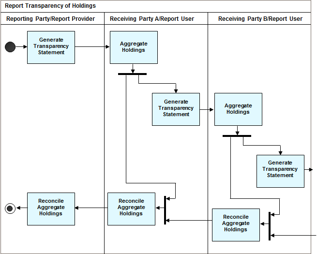

# fig-0014 - original figure evidence

Source: [src-000095](../../../../../../../../../raw-input/investment_funds/ISO20022_MDRPart1_InvestmentFunds_2025_2026_v2.docx). Locator: direct-body paragraph P219; Description of BusinessActivities / Reconciliation (Statements) / Transparency of Holdings; /w:document/w:body/w:p[219].

Original extracted asset: [image14.png](../../../../../../../assets/src-000095/originals/image14.png)

## Interpretation and review

The canonical reference linked below contains the source reconstruction or deduplication decision, participant/flow links, rendering results, explicit visual-review evidence and remaining source limitations. Original media remain unchanged.

<!-- FUNDS-PROCESS -->
[Canonical source reconstruction and review evidence](../../../diagrams/funds-processes/fig-0014.md)
