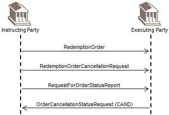

# fig-0081 - original figure evidence

Source: [src-000095](../../../../../../../../../raw-input/investment_funds/ISO20022_MDRPart1_InvestmentFunds_2025_2026_v2.docx). Locator: direct-body paragraph P580; BusinessTransactions / Order Cancellation and Status  / Order Cancellation Status Request / Request Status of Redemption; /w:document/w:body/w:p[580].

Original extracted asset: [image81.png](../../../../../../../assets/src-000095/originals/image81.png)

## Canonical reconstruction and review

[Canonical diagram, source qualifications, participant/flow links and recorded review evidence](../../../diagrams/funds-sequences/fig-0081.md). Original media and this occurrence's precise locator are retained. Rendering and visual comparison results above are copied from the canonical reference; any unresolved business, version or contextual limitation remains open.

<!-- FUNDS-CANONICAL-START -->
[Canonical reconstruction and review evidence](../../../diagrams/funds-sequences/fig-0081.md)
<!-- FUNDS-CANONICAL-END -->
