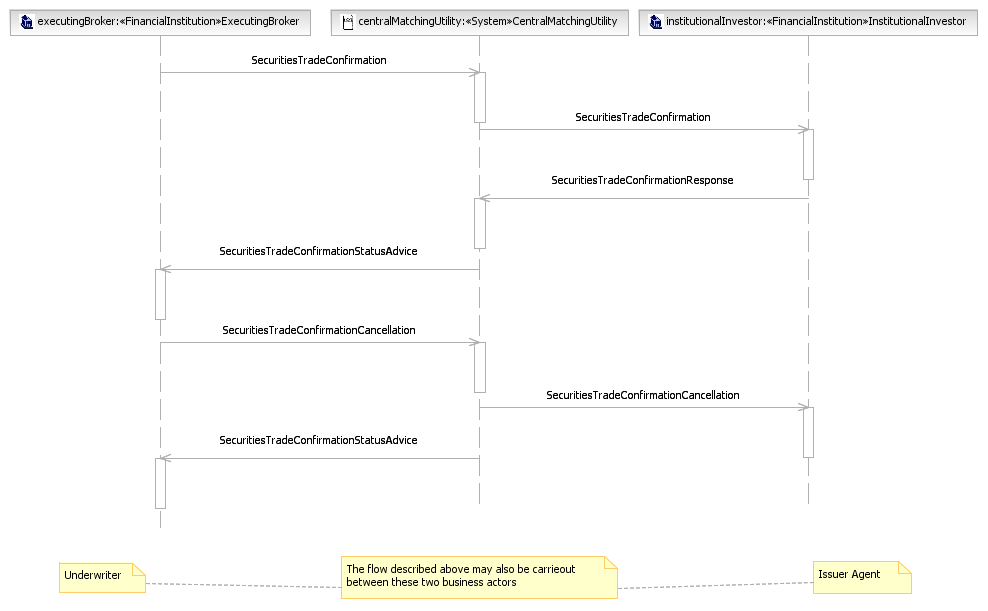
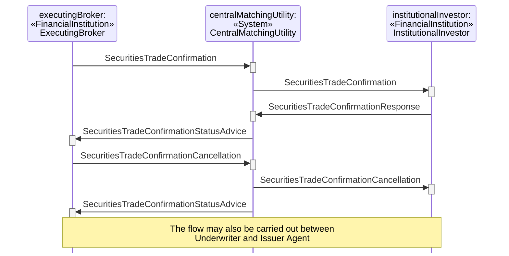

# Own Account Trade Type Cancellation

## Source evidence

[src-000180](../../../../../../../../raw-input/post_trade_matching/ISO20022_MDRPart1_PostTradeMatching_2024_2025_v2.docx); P210 and preceding scenario narrative P209. [Unchanged full source figure](../../../../../../assets/src-000180/originals/image14.png).

## Mermaid reconstruction

## Participants and ordered exchanges

Source instance names and stereotypes are retained in the diagram labels. Each occurrence links to a scoped participant record; a source business-actor label is not an assertion that a named institution always plays that role.

| Source instance / stereotype / label | Canonical scoped role |
| --- | --- |
| executingBroker / FinancialInstitution / ExecutingBroker | [ExecutingBroker](../../../../../../../../shared/reference/participants/participant-src-000180-broker-executing-broker.md) |
| centralMatchingUtility / System / CentralMatchingUtility | [CentralMatchingUtility](../../../../../../../../shared/reference/participants/participant-src-000180-central-matching-utility-cmu.md) |
| institutionalInvestor / FinancialInstitution / InstitutionalInvestor | [InstitutionalInvestor](../../../../../../../../shared/reference/participants/participant-src-000180-institutional-investor.md) |

| Source order | Sender | Receiver | Source message label | Exact supplied definition |
| --- | --- | --- | --- | --- |
| 1 | ExecutingBroker | CentralMatchingUtility | SecuritiesTradeConfirmation | [setr.027.001.05](../../../../../messages/setr.027.001.05/index.md) |
| 2 | CentralMatchingUtility | InstitutionalInvestor | SecuritiesTradeConfirmation | [setr.027.001.05](../../../../../messages/setr.027.001.05/index.md) |
| 3 | InstitutionalInvestor | CentralMatchingUtility | SecuritiesTradeConfirmationResponse | [setr.030.001.03](../../../../../messages/setr.030.001.03/index.md) |
| 4 | CentralMatchingUtility | ExecutingBroker | SecuritiesTradeConfirmationStatusAdvice | [setr.044.001.04](../../../../../messages/setr.044.001.04/index.md) |
| 5 | ExecutingBroker | CentralMatchingUtility | SecuritiesTradeConfirmationCancellation | [setr.029.001.02](../../../../../messages/setr.029.001.02/index.md) |
| 6 | CentralMatchingUtility | InstitutionalInvestor | SecuritiesTradeConfirmationCancellation | [setr.029.001.02](../../../../../messages/setr.029.001.02/index.md) |
| 7 | CentralMatchingUtility | ExecutingBroker | SecuritiesTradeConfirmationStatusAdvice | [setr.044.001.04](../../../../../messages/setr.044.001.04/index.md) |

## Conditions, alternatives and notes

**P209** The executing broker sends a trade confirmation to the CMU. Once received from the broker, The CMU forwards the trade confirmation to the Institutional Investor. The Institutional Investor will compare the details of the confirmation with their details of the trade. If the details are irreconcilable, a disaffirmation message will be sent to the CMU. The CMU sends a disaffirmation status message to the executing broker upon receipt of the disaffirmation message from the Institutional Investor which may result in the cancellation of the trade or the sending of a new confirmation.

The source note gives an analogous Underwriter/Issuer Agent pair. Both are linked as narrative participants in the flow; they are not merged with the main ExecutingBroker/InstitutionalInvestor pair.

[Reusable flow](../../flows/flow-src-000180-p208-own-account-trade-type-cancellation.md); [Related activity process](../../flows/flow-src-000180-p153-own-account-trade-type.md).

## Review evidence

Opened the full source PNG and rendered reconstruction; compared all 3 source actor instance/stereotype labels, 7 ordered message arrows, sender/receiver endpoints, receiver execution markers, and source notes. Inactive lifelines are retained. Alternate-actor, proprietary-report, securities-financing and pre-advice notes were checked where present. Dashed lifelines and readable complete message labels were checked after rendering; vertical marker spacing is not elapsed time. Parsed/rendered using Mermaid 12.3.0 with Chromium 156.0.8078.81. Visual comparison on 2026-11-09 Europe/Warsaw; render report UTC date 2026-11-08.

[Compared reconstruction](../../../../../../assets/src-000180/reconstructed-transactions/fig-0017.png).
