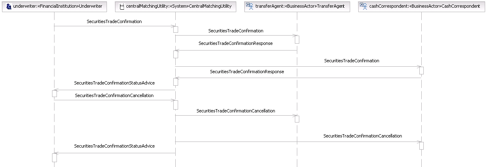
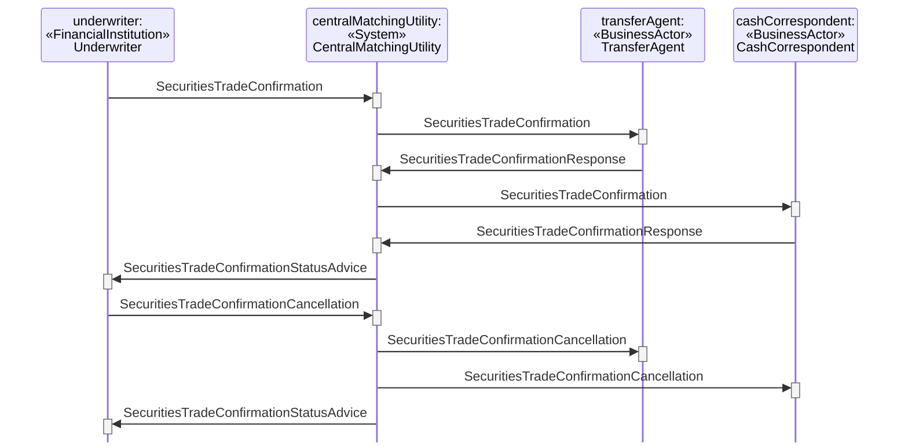

# Duplex Type Rejection by Cash Correspondent

## Source evidence

[src-000180](../../../../../../../../raw-input/post_trade_matching/ISO20022_MDRPart1_PostTradeMatching_2024_2025_v2.docx); P224 and preceding scenario narrative P223. [Unchanged full source figure](../../../../../../assets/src-000180/originals/image17.png).

## Mermaid reconstruction

## Participants and ordered exchanges

Source instance names and stereotypes are retained in the diagram labels. Each occurrence links to a scoped participant record; a source business-actor label is not an assertion that a named institution always plays that role.

| Source instance / stereotype / label | Canonical scoped role |
| --- | --- |
| underwriter / FinancialInstitution / Underwriter | [Underwriter](../../../../../../../../shared/reference/participants/participant-src-000180-underwriter.md) |
| centralMatchingUtility / System / CentralMatchingUtility | [CentralMatchingUtility](../../../../../../../../shared/reference/participants/participant-src-000180-central-matching-utility-cmu.md) |
| transferAgent / BusinessActor / TransferAgent | [TransferAgent](../../../../../../../../shared/reference/participants/participant-src-000180-transfer-agent.md) |
| cashCorrespondent / BusinessActor / CashCorrespondent | [CashCorrespondent](../../../../../../../../shared/reference/participants/participant-src-000180-cash-correspondent.md) |

| Source order | Sender | Receiver | Source message label | Exact supplied definition |
| --- | --- | --- | --- | --- |
| 1 | Underwriter | CentralMatchingUtility | SecuritiesTradeConfirmation | [setr.027.001.05](../../../../../messages/setr.027.001.05/index.md) |
| 2 | CentralMatchingUtility | TransferAgent | SecuritiesTradeConfirmation | [setr.027.001.05](../../../../../messages/setr.027.001.05/index.md) |
| 3 | TransferAgent | CentralMatchingUtility | SecuritiesTradeConfirmationResponse | [setr.030.001.03](../../../../../messages/setr.030.001.03/index.md) |
| 4 | CentralMatchingUtility | CashCorrespondent | SecuritiesTradeConfirmation | [setr.027.001.05](../../../../../messages/setr.027.001.05/index.md) |
| 5 | CashCorrespondent | CentralMatchingUtility | SecuritiesTradeConfirmationResponse | [setr.030.001.03](../../../../../messages/setr.030.001.03/index.md) |
| 6 | CentralMatchingUtility | Underwriter | SecuritiesTradeConfirmationStatusAdvice | [setr.044.001.04](../../../../../messages/setr.044.001.04/index.md) |
| 7 | Underwriter | CentralMatchingUtility | SecuritiesTradeConfirmationCancellation | [setr.029.001.02](../../../../../messages/setr.029.001.02/index.md) |
| 8 | CentralMatchingUtility | TransferAgent | SecuritiesTradeConfirmationCancellation | [setr.029.001.02](../../../../../messages/setr.029.001.02/index.md) |
| 9 | CentralMatchingUtility | CashCorrespondent | SecuritiesTradeConfirmationCancellation | [setr.029.001.02](../../../../../messages/setr.029.001.02/index.md) |
| 10 | CentralMatchingUtility | Underwriter | SecuritiesTradeConfirmationStatusAdvice | [setr.044.001.04](../../../../../messages/setr.044.001.04/index.md) |

## Conditions, alternatives and notes

**P223** The Underwriter sends a trade confirmation to the CMU. The CMU forwards the confirmation received from the Underwriter to the Transfer Agent. Should the trade detail on the confirmation agree with that of the Transfer Agent, it sends an affirmation message to the CMU. Upon receipt of the affirmation message from the Transfer Agent, The CMU forwards the confirmation received from the Underwriter to the Cash Settlement Agent. The Cash Settlement Agent compares the trade details of the confirmation (Underwriter) with its own trade detail and if there are irreconcilable differences sends a disaffirmation message to the CMU. Upon receipt of the disaffirmation message from the Cash Settlement Agent, the CMU sends a disaffirmation status message to the Underwriter which may lead to a trade confirmation cancellation or a new trade confirmation message from the Underwriter to the CMU.

The source artwork labels the fourth actor CashCorrespondent, while its narrative uses Cash Settlement Agent. Both contextual labels remain recorded; the rejection-by-Transfer-Agent figure retains the otherwise inactive cash-correspondent lifeline.

[Reusable flow](../../flows/flow-src-000180-p222-duplex-type-rejection-by-cash-correspondent.md); [Related activity process](../../flows/flow-src-000180-p159-duplex-type.md).

## Review evidence

Opened the full source PNG and rendered reconstruction; compared all 4 source actor instance/stereotype labels, 10 ordered message arrows, sender/receiver endpoints, receiver execution markers, and source notes. Inactive lifelines are retained. Alternate-actor, proprietary-report, securities-financing and pre-advice notes were checked where present. Dashed lifelines and readable complete message labels were checked after rendering; vertical marker spacing is not elapsed time. Parsed/rendered using Mermaid 12.3.0 with Chromium 156.0.8078.81. Visual comparison on 2026-11-09 Europe/Warsaw; render report UTC date 2026-11-08.

[Compared reconstruction](../../../../../../assets/src-000180/reconstructed-transactions/fig-0020.png).
