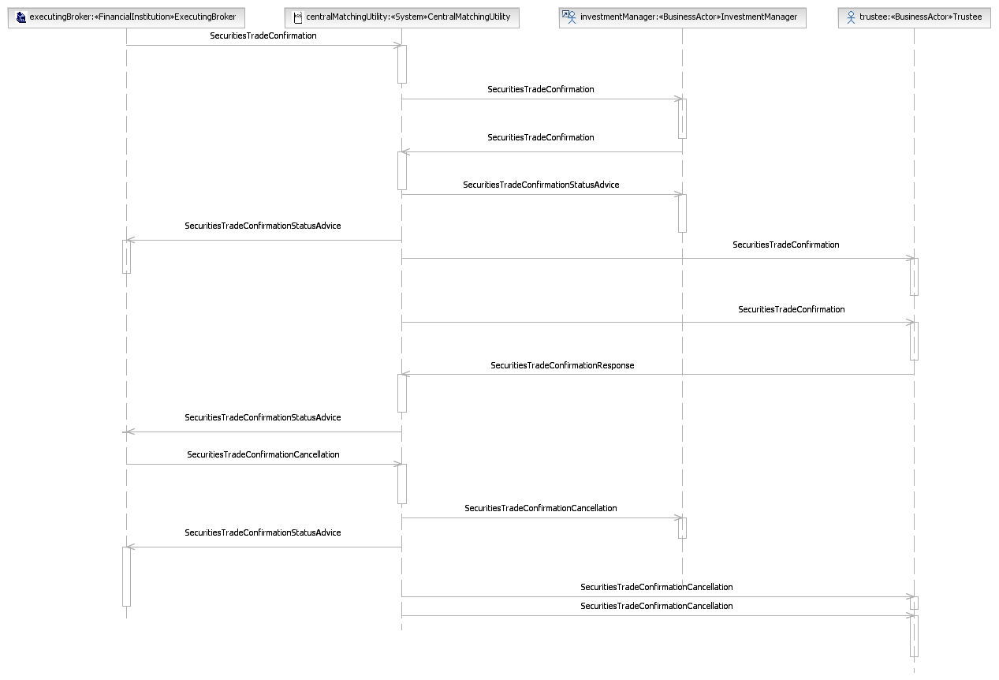
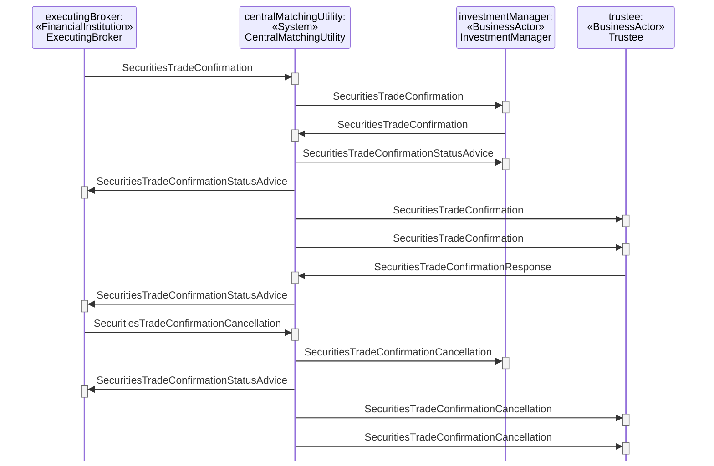

# Tripartite Central Matching With Confirmation Distribution Service Rejection

## Source evidence

[src-000180](../../../../../../../../raw-input/post_trade_matching/ISO20022_MDRPart1_PostTradeMatching_2024_2025_v2.docx); P271 and preceding scenario narrative P270. [Unchanged full source figure](../../../../../../assets/src-000180/originals/image27.png).

## Mermaid reconstruction

## Participants and ordered exchanges

Source instance names and stereotypes are retained in the diagram labels. Each occurrence links to a scoped participant record; a source business-actor label is not an assertion that a named institution always plays that role.

| Source instance / stereotype / label | Canonical scoped role |
| --- | --- |
| executingBroker / FinancialInstitution / ExecutingBroker | [ExecutingBroker](../../../../../../../../shared/reference/participants/participant-src-000180-broker-executing-broker.md) |
| centralMatchingUtility / System / CentralMatchingUtility | [CentralMatchingUtility](../../../../../../../../shared/reference/participants/participant-src-000180-central-matching-utility-cmu.md) |
| investmentManager / BusinessActor / InvestmentManager | [InvestmentManager](../../../../../../../../shared/reference/participants/participant-src-000180-investment-manager.md) |
| trustee / BusinessActor / Trustee | [Trustee](../../../../../../../../shared/reference/participants/participant-src-000180-trustee.md) |

| Source order | Sender | Receiver | Source message label | Exact supplied definition |
| --- | --- | --- | --- | --- |
| 1 | ExecutingBroker | CentralMatchingUtility | SecuritiesTradeConfirmation | [setr.027.001.05](../../../../../messages/setr.027.001.05/index.md) |
| 2 | CentralMatchingUtility | InvestmentManager | SecuritiesTradeConfirmation | [setr.027.001.05](../../../../../messages/setr.027.001.05/index.md) |
| 3 | InvestmentManager | CentralMatchingUtility | SecuritiesTradeConfirmation | [setr.027.001.05](../../../../../messages/setr.027.001.05/index.md) |
| 4 | CentralMatchingUtility | InvestmentManager | SecuritiesTradeConfirmationStatusAdvice | [setr.044.001.04](../../../../../messages/setr.044.001.04/index.md) |
| 5 | CentralMatchingUtility | ExecutingBroker | SecuritiesTradeConfirmationStatusAdvice | [setr.044.001.04](../../../../../messages/setr.044.001.04/index.md) |
| 6 | CentralMatchingUtility | Trustee | SecuritiesTradeConfirmation | [setr.027.001.05](../../../../../messages/setr.027.001.05/index.md) |
| 7 | CentralMatchingUtility | Trustee | SecuritiesTradeConfirmation | [setr.027.001.05](../../../../../messages/setr.027.001.05/index.md) |
| 8 | Trustee | CentralMatchingUtility | SecuritiesTradeConfirmationResponse | [setr.030.001.03](../../../../../messages/setr.030.001.03/index.md) |
| 9 | CentralMatchingUtility | ExecutingBroker | SecuritiesTradeConfirmationStatusAdvice | [setr.044.001.04](../../../../../messages/setr.044.001.04/index.md) |
| 10 | ExecutingBroker | CentralMatchingUtility | SecuritiesTradeConfirmationCancellation | [setr.029.001.02](../../../../../messages/setr.029.001.02/index.md) |
| 11 | CentralMatchingUtility | InvestmentManager | SecuritiesTradeConfirmationCancellation | [setr.029.001.02](../../../../../messages/setr.029.001.02/index.md) |
| 12 | CentralMatchingUtility | ExecutingBroker | SecuritiesTradeConfirmationStatusAdvice | [setr.044.001.04](../../../../../messages/setr.044.001.04/index.md) |
| 13 | CentralMatchingUtility | Trustee | SecuritiesTradeConfirmationCancellation | [setr.029.001.02](../../../../../messages/setr.029.001.02/index.md) |
| 14 | CentralMatchingUtility | Trustee | SecuritiesTradeConfirmationCancellation | [setr.029.001.02](../../../../../messages/setr.029.001.02/index.md) |

## Conditions, alternatives and notes

**P270** The executing broker sends a trade confirmation to the CMU. The CMU forwards the confirmation received from the broker to the investment manager. The investment manager compares the details of the trade to its own details and sends a trade confirmation to the CMU. The CMU performs a matching process and sends matching status messages to both parties reflecting the outcome of the matching process. If matched, the CMU sends both the confirmations received from the investment manager and from the executing broker to the trustee. If the trustee does not agree with the details of the trade, it sends a disaffirmation message to the CMU. Upon receipt of the disaffirmation message from the trustee, the CMU sends a disaffirmation status message to the broker, which may lead to the broker sending a new confirmation to the CMU or a confirmation cancellation. The CMU forwards a cancellation message to the investment manager. The CMU advise the executing broker that they send a cancellation to the investment manager. The CMU will forward the cancellation received from the investment manager and send the cancellation on behalf of the executing broker to the trustee.

**Source contradiction (issue-000031):** the last narrative sentence says the CMU forwards a cancellation received from the investment manager. Earlier narrative and the figure show broker initiation followed by forwarding to the investment manager. Both claims remain visible; the reconstruction follows the source artwork, without silently correcting the narrative.

[Reusable flow](../../flows/flow-src-000180-p269-tripartite-central-matching-with-confirmation-distribution-service-rej.md); [Related activity process](../../flows/flow-src-000180-p180-tripartite-central-matching-with-confirmation-distribution-service.md).

## Review evidence

Opened the full source PNG and rendered reconstruction; compared all 4 source actor instance/stereotype labels, 14 ordered message arrows, sender/receiver endpoints, receiver execution markers, and source notes. Inactive lifelines are retained. Alternate-actor, proprietary-report, securities-financing and pre-advice notes were checked where present. Dashed lifelines and readable complete message labels were checked after rendering; vertical marker spacing is not elapsed time. Visual correspondence passes, while the narrative/artwork cancellation-origin contradiction remains open under issue-000031; the page is therefore needs-review. Parsed/rendered using Mermaid 12.3.0 with Chromium 156.0.8078.81. Visual comparison on 2026-11-09 Europe/Warsaw; render report UTC date 2026-11-08.

[Compared reconstruction](../../../../../../assets/src-000180/reconstructed-transactions/fig-0030.png).
