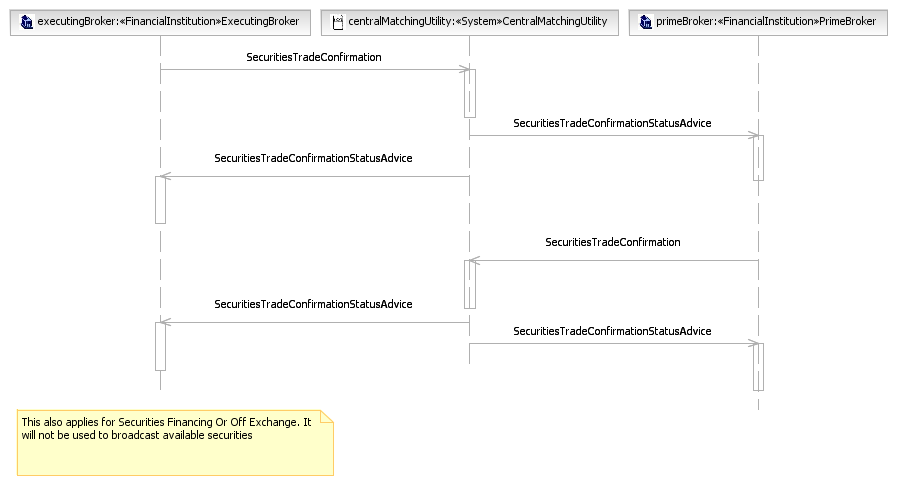
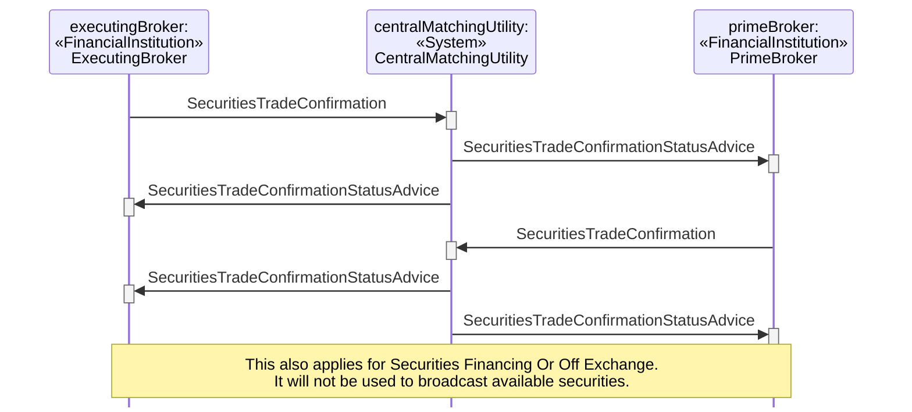

# Bilateral Central Matching

## Source evidence

[src-000180](../../../../../../../../raw-input/post_trade_matching/ISO20022_MDRPart1_PostTradeMatching_2024_2025_v2.docx); P276 and preceding scenario narrative P275. [Unchanged full source figure](../../../../../../assets/src-000180/originals/image28.png).

## Mermaid reconstruction

## Participants and ordered exchanges

Source instance names and stereotypes are retained in the diagram labels. Each occurrence links to a scoped participant record; a source business-actor label is not an assertion that a named institution always plays that role.

| Source instance / stereotype / label | Canonical scoped role |
| --- | --- |
| executingBroker / FinancialInstitution / ExecutingBroker | [ExecutingBroker](../../../../../../../../shared/reference/participants/participant-src-000180-broker-executing-broker.md) |
| centralMatchingUtility / System / CentralMatchingUtility | [CentralMatchingUtility](../../../../../../../../shared/reference/participants/participant-src-000180-central-matching-utility-cmu.md) |
| primeBroker / FinancialInstitution / PrimeBroker | [PrimeBroker](../../../../../../../../shared/reference/participants/participant-src-000180-prime-broker.md) |

| Source order | Sender | Receiver | Source message label | Exact supplied definition |
| --- | --- | --- | --- | --- |
| 1 | ExecutingBroker | CentralMatchingUtility | SecuritiesTradeConfirmation | [setr.027.001.05](../../../../../messages/setr.027.001.05/index.md) |
| 2 | CentralMatchingUtility | PrimeBroker | SecuritiesTradeConfirmationStatusAdvice | [setr.044.001.04](../../../../../messages/setr.044.001.04/index.md) |
| 3 | CentralMatchingUtility | ExecutingBroker | SecuritiesTradeConfirmationStatusAdvice | [setr.044.001.04](../../../../../messages/setr.044.001.04/index.md) |
| 4 | PrimeBroker | CentralMatchingUtility | SecuritiesTradeConfirmation | [setr.027.001.05](../../../../../messages/setr.027.001.05/index.md) |
| 5 | CentralMatchingUtility | ExecutingBroker | SecuritiesTradeConfirmationStatusAdvice | [setr.044.001.04](../../../../../messages/setr.044.001.04/index.md) |
| 6 | CentralMatchingUtility | PrimeBroker | SecuritiesTradeConfirmationStatusAdvice | [setr.044.001.04](../../../../../messages/setr.044.001.04/index.md) |

## Conditions, alternatives and notes

**P275** The executing broker sends a confirmation to the CMU. The CMU advise both parties that the trade confirmation is not paired yet. The prime broker sends a confirmation to the CMU. The CMU performs a matching process between the two confirmations and sends matching status messages to both parties reflecting the outcome of the matching process. If the confirmations are matched, the trade can move into the settlement process.

[Reusable flow](../../flows/flow-src-000180-p274-bilateral-central-matching.md); [Related activity process](../../flows/flow-src-000180-p185-bilateral-central-matching.md).

## Review evidence

Opened the full source PNG and rendered reconstruction; compared all 3 source actor instance/stereotype labels, 6 ordered message arrows, sender/receiver endpoints, receiver execution markers, and source notes. Inactive lifelines are retained. Alternate-actor, proprietary-report, securities-financing and pre-advice notes were checked where present. Dashed lifelines and readable complete message labels were checked after rendering; vertical marker spacing is not elapsed time. Parsed/rendered using Mermaid 12.3.0 with Chromium 156.0.8078.81. Visual comparison on 2026-11-09 Europe/Warsaw; render report UTC date 2026-11-08.

[Compared reconstruction](../../../../../../assets/src-000180/reconstructed-transactions/fig-0031.png).
