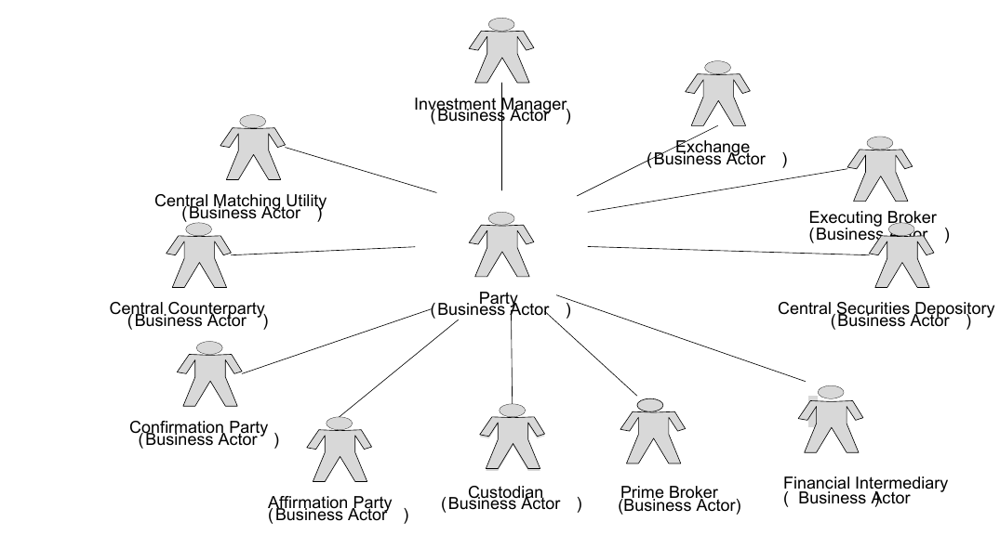
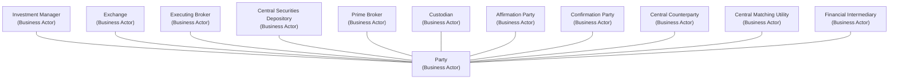

# Post-trade business-actor context

## Source evidence

[src-000180](../../../../../../../../raw-input/post_trade_matching/ISO20022_MDRPart1_PostTradeMatching_2024_2025_v2.docx); BusinessRoles and Participants; direct-body paragraph P114; Word rendered page 10. [Unchanged original figure or complete rendered document](../../../../../../../../work/docx-render/src-000180/document.pdf).

## Mermaid reconstruction

## Actors, activities and relationships

Twelve business-actor symbols appear. Eleven plain association rays connect the central Party context with surrounding actors. Several rays stop short of their actor symbols, including the ray toward Financial Intermediary; the reconstruction retains that association with this endpoint-spacing qualification. There are no use-case ellipses, include/extend links, inheritance triangles or multiplicities in this figure. P111–113 distinguishes real-world business roles from functional participants and states that their relationship is many-to-many. T7/T8 provides the separate definitions and role mapping. The source label Affirmation Party is retained separately from the table label Affirming Party.

| Source-scoped participant | Canonical record |
| --- | --- |
| party | [party](../../../../../../../../shared/reference/participants/participant-src-000180-party.md) |
| investment manager | [investment manager](../../../../../../../../shared/reference/participants/participant-src-000180-investment-manager.md) |
| exchange | [exchange](../../../../../../../../shared/reference/participants/participant-src-000180-exchange.md) |
| broker executing broker | [broker executing broker](../../../../../../../../shared/reference/participants/participant-src-000180-broker-executing-broker.md) |
| central securities depositories | [central securities depositories](../../../../../../../../shared/reference/participants/participant-src-000180-central-securities-depositories.md) |
| prime broker | [prime broker](../../../../../../../../shared/reference/participants/participant-src-000180-prime-broker.md) |
| custodian | [custodian](../../../../../../../../shared/reference/participants/participant-src-000180-custodian.md) |
| affirmation party | [affirmation party](../../../../../../../../shared/reference/participants/participant-src-000180-affirmation-party.md) |
| confirmation party | [confirmation party](../../../../../../../../shared/reference/participants/participant-src-000180-confirmation-party.md) |
| central counterparty | [central counterparty](../../../../../../../../shared/reference/participants/participant-src-000180-central-counterparty.md) |
| central matching utility cmu | [central matching utility cmu](../../../../../../../../shared/reference/participants/participant-src-000180-central-matching-utility-cmu.md) |
| financial intermediary | [financial intermediary](../../../../../../../../shared/reference/participants/participant-src-000180-financial-intermediary.md) |

Responsibilities and activities: [Source table T8](../../documents/src-000180/tables/tbl-0008.md).

The crop is derived from the complete Word render, with the parent page retained. Word produced a STYLEREF header error outside these figure crops; it is a rendering limitation, not a source business claim.

## Review evidence

Opened complete Word page10 and its full-width crop, then the rendered reconstruction. Compared all twelve business-actor labels and eleven plain relationship rays; checked absence of arrowheads or inheritance triangles. Independent second-agent inspection confirmed endpoint spacing near Financial Intermediary. No general identity equivalence inferred. Parsed and rendered with Mermaid 12.3.0 and Chromium156.0.8078.81; visual comparison 2026-11-09 Europe/Warsaw.

[Compared reconstruction](../../../../../../assets/src-000180/reconstructed-processes/fig-0002.png).
