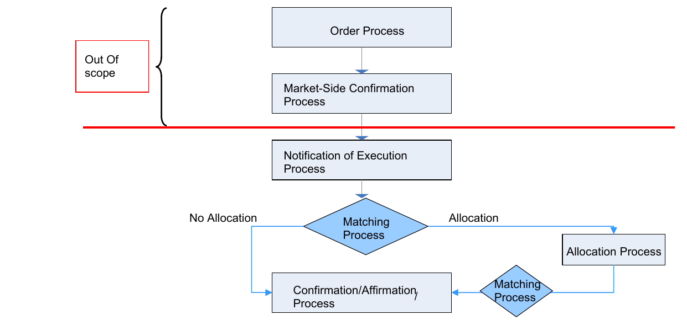
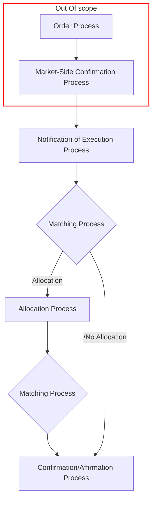

# Trade lifecycle process overview

## Source evidence

[src-000180](../../../../../../../../raw-input/post_trade_matching/ISO20022_MDRPart1_PostTradeMatching_2024_2025_v2.docx); BusinessProcess Description / BusinessProcess Diagram; direct-body paragraph P123; Word rendered page 13. [Unchanged original figure or complete rendered document](../../../../../../../../work/docx-render/src-000180/document.pdf).

## Mermaid reconstruction

## Actors, activities and relationships

The source begins with Order Process and Market-Side Confirmation Process above its red scope boundary, both explicitly out of scope. Notification of Execution leads to the first Matching Process decision. Its Allocation path passes through Allocation Process and a second Matching Process before Confirmation/Affirmation; its /No Allocation path goes directly to Confirmation/Affirmation. Two separately occurring matching diamonds are retained. P122 warns that further updates and diagrams would precede final publication; that source qualification is preserved. P125–129 defines the activity responsibilities: instructing party places the order and allocates blocks; executing party seeks the counterparty, reports execution and sends client confirmations; counterparties agree market-side details; matching can be central or local, with positive affirmation in some markets.

| Source-scoped participant | Canonical record |
| --- | --- |
| instructing party | [instructing party](../../../../../../../../shared/reference/participants/participant-src-000180-instructing-party.md) |
| executing servicing party | [executing servicing party](../../../../../../../../shared/reference/participants/participant-src-000180-executing-servicing-party.md) |
| trade counterparty | [trade counterparty](../../../../../../../../shared/reference/participants/participant-src-000180-trade-counterparty.md) |
| central matching utility cmu | [central matching utility cmu](../../../../../../../../shared/reference/participants/participant-src-000180-central-matching-utility-cmu.md) |

Reusable source flow: [BusinessProcess Diagram](../../flows/flow-src-000180-p120-business-process-diagram.md). All narrative conditions and activity-table rows remain there.

The crop is derived from the complete Word render, with the parent page retained. Word produced a STYLEREF header error outside these figure crops; it is a rendering limitation, not a source business claim.

## Review evidence

Opened complete Word page13 and its crop, then the rendered reconstruction. Compared seven process/decision nodes, seven directed connections, Allocation and /No Allocation paths, and explicit out-of-scope grouping of Order and Market-Side Confirmation. Preserved the source publication-update qualification. Parsed and rendered with Mermaid 12.3.0 and Chromium156.0.8078.81; visual comparison 2026-11-09 Europe/Warsaw.

[Compared reconstruction](../../../../../../assets/src-000180/reconstructed-processes/fig-0003.png).
